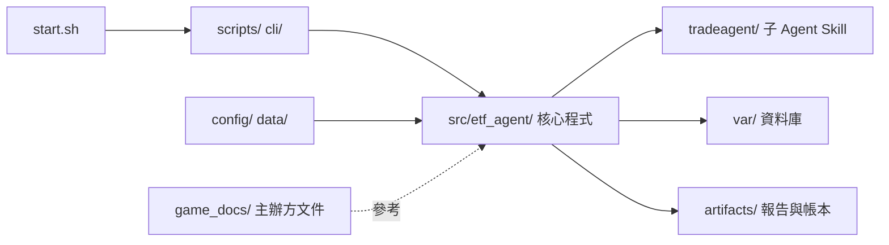

# ETF-AGENTS｜AI CUP 2026 台股 ETF 決策系統

收集並驗證台股行情與公司資料，經分析團隊、多空研究、交易整合與風險審查，產生供人工檢視的決策報告。

## 快速啟動

在專案根目錄操作，需有可執行 `start.sh` 的 shell。首次安裝先建立本機環境：

```bash
python3 -m venv .venv
.venv/bin/python -m pip install -r requirements.txt
```

啟動 Docker Desktop，執行：

```bash
./start.sh
```

首次會建立虛擬帳戶，之後驗證並沿用既有帳本，開啟[績效儀表板](http://127.0.0.1:8000)。按 `Ctrl+C` 關閉；已有帳戶不會重新注資。此指令不抓資料、不執行決策。

## 常用指令

| 用途 | 指令 | 執行內容 |
| --- | --- | --- |
| 看帳戶與績效 | `./start.sh` | 開帳或驗證既有帳戶，啟動唯讀儀表板；不更新資料 |
| 只更新資料 | `./start.sh auto` | 更新行情、公司事件與財報，顯示資料狀態；不建研究快照、不推進帳本或執行決策（`data` 為相容別名） |
| 更新資料與帳本 | `./start.sh daily` | 驗證來源、更新資料、建立 Snapshot、結算／準備虛擬帳本；不跑 Agent |
| 完整每日決策 | `./start.sh run` | 更新資料、建立快照、準備帳本，執行分析與決策 Agent，封存中文報告；符合條件時另產生 D-Plan 候選。若已抓到應有的最新交易日資料（交易日 15:00 後算當日），會自動沿用、不重抓；資料庫已有該日收盤後抓到的完整行情時，`start.sh` 也略過三個行情步驟（官方最新價、Yahoo 日線、官方個股價量），重大訊息、月營收、財報等發布時間不固定的資料照常收集，`FORCE_FETCH=1` 可強制重抓行情 |
| 查看資料狀態 | `./start.sh status` | 顯示資料數量、品質問題、驗證結果與最後更新時間（台北時間）；不重新抓取、不需 Docker |

首次跑完整決策前，先用 `./start.sh` 開帳。完整決策預設使用已登入的 Claude CLI；可改用 Codex 或 OpenCode：

```bash
./start.sh run --agent-cli codex
./start.sh run --agent-cli opencode
```

環境設定見 [Docker 使用說明](docs/docker.md)，單步操作見 [CLI 說明](cli/README.md)。

## `./start.sh run` 可調整的參數

參數會原樣傳給 `scripts/run_daily_pipeline.py`，完整說明用 `./start.sh run --help` 查看。不帶任何參數即使用下表「預設」欄。

### 控制用量與模型

| 參數 | 預設 | 作用 |
| --- | --- | --- |
| `--agent-cli claude\|codex\|opencode` | `claude` | 子 Agent 使用的 CLI。換執行器時不可續用其他執行器的 run。 |
| `--model 模型` | 所選 CLI 的設定 | 多空研究、交易與現金姿態使用的模型。 |
| `--analyst-model 模型` | Claude CLI 為 `sonnet`；其他 CLI 沿用 `--model` | 只用於技術／基本面／事件三位分析師的批次，量最大。傳 `inherit` 則沿用 `--model`。 |
| `--max-workers N` | 6 | 分析師、多空研究與交易階段同時執行的子 Agent 數（1～8）；1 為串行。只縮短時間，不改決策內容；同時呼叫越多越容易撞到用量上限。現金姿態與風險審查仍串行。同一 Snapshot 實跑對照：3 時 Agent 階段合計 928.7 秒，6 時 601.0 秒（約少 35%），皆未撞用量上限；6 的那次有 1 次事件批次驗證重試。8 尚未實測。`pipeline.json` 的 `stage_durations` 記錄各階段秒數。 |
| `--technical-gate` ／ `--no-technical-gate` | 開啟 | 趨勢一致的股票技術 brief 只附 `momentum`、不附逐日歷史，約少一半輸入；資料不足或訊號衝突者仍附完整歷史。同 Snapshot 對照結果見[降 token 計劃](docs/token_reduction_plan.md)，樣本只有一天。 |
| `--max-budget-usd 金額` | 3 | 單次子 Agent 呼叫的估算用量上限，只適用 Claude CLI。 |

### 續跑與重跑

| 參數 | 預設 | 作用 |
| --- | --- | --- |
| `--resume [RUN_ID]` | 關 | 沿用已通過驗證的 Agent 輸出續跑，例如撞到用量上限。不帶值：續跑今天最近一個未完成的 run；帶 `RUN_ID`（如 `daily-20261020`）：續跑指定 run，跨午夜或額度重置後使用。找到可續跑的 run 時自動沿用既有 Snapshot，不重新更新資料。 |
| `--skip-data` | 關 | 一律沿用既有 Snapshot 與帳戶快照，不重新執行資料更新，不看更新時間。續跑、或 Snapshot 已含應有的最新交易日資料（150 檔齊全，且是該日 15:00 後建立）時會自動套用，通常不用手動加。 |
| `--force` | 關 | 休市日或當日已完成時仍執行；預設同一台北日期已完成就不重跑。 |
| `--delivery-only RUN_ID` | 無 | 只重建既有 run 的最終交付，不執行資料準備或 Agent，不耗用量。 |

### 檢查與輸入

| 參數 | 預設 | 作用 |
| --- | --- | --- |
| `--preflight-only` | 未啟用 | 預檢（Docker、Agent CLI 登入、帳戶、必要檔案、磁碟）每次 `run` 都會先執行，失敗即停止；預檢通過後繼續跑決策。啟用此參數則檢查完就結束，不抓資料、不跑 Agent，不耗用量。 |
| `--min-free-gb GiB` | 2.0 | 執行前要求的最低可用磁碟空間。 |
| `--account-id ID` | `ai-cup-2026` | 指定帳戶。 |
| `--perception BUNDLE RESULT` | 無 | 提供市場情緒與分析師共識資料：資料包與其驗證結果，兩個檔案必須同時給。不給時這類資訊標為「無資料」。目前尚未接入合法來源，平常不需要使用。 |

### 常見組合

```bash
./start.sh run --preflight-only --skip-data                  # 不耗用量，先確認環境
./start.sh run --resume                                      # 撞到用量上限後，續跑今天未完成的 run
./start.sh run --resume daily-20261020                       # 跨午夜後，續跑指定的 run
./start.sh run --no-technical-gate --analyst-model inherit   # 回到最保守的完整輸入、單一模型
./start.sh run --delivery-only daily-20261020-213724         # 只重建報告
```

不在表中的設定（Policy 乘數、現金姿態對應、`max_revisions` 等）在 `config/decision_policy.json`，不是命令列參數，修改須符合[架構文件](docs/architecture.md)的契約。`./start.sh status` 另可用 `--database 路徑` 指定資料庫。


## 決策流程

```text
資料驗證與研究快照 → 三位分析師 → 多頭／空頭研究
→ 交易 Agent → 風險 Agent → Python 配置與風控 → 封存報告 → 人工檢視
```

### 原則

- **分工**：Agent 提出有證據的市場解讀與買賣意圖；指標、權重、股數、費稅及競賽限制由 Python 計算與驗證。
- **時間一致**：所有下游輸入必須與研究快照的截止時間、資料版本一致，並以當時可得時間防止未來資訊洩漏。
- **失敗處理**：資料不足或風控失敗時停止或明確降級。

### 單股超出權重上限時

既有持股若因價格變動超出單股權重硬上限：

1. 配置程式在 Guard 前，按整張計算必要減碼。
2. 連同部分成交的壓力情境一併重算。
3. 原 Agent 意圖與程式風險減碼分開記錄；減碼賣單由程式標為 `trim`（仍有持股）或 `exit`（減至零）。
4. 無法滿足所有硬性限制時仍會拒絕。

## 專案架構與資料夾

整體架構（細節見[資料夾架構](docs/repository-layout.md)、[套件依賴](docs/modules.md)、[執行產物](docs/runtime-artifacts.md)）：



各資料夾都有自己的 README，也可先看[文件索引](docs/README.md)。

```text
ETF_AGENTS/
├── start.sh                 # 日常入口：儀表板、auto、daily、run、status
├── compose.yaml, Dockerfile # Docker 執行環境
├── requirements.txt         # 本機 .venv 與 Docker 共用依賴（含 pytest）
├── pytest.ini               # 測試設定
├── AGENTS.md                # 開發規則、Agent 邊界、測試與 commit 格式
│
├── src/etf_agent/           # 核心程式：所有計算、驗證與資料邏輯都在這裡
│   ├── data/                #   收集、驗證、版本化行情與公司事件，建立 ResearchSnapshot
│   ├── automation/          #   每日管線：呼叫子 Agent、重試、Validator
│   ├── decision/            #   配置、風控、CompetitionGuard、最終決策
│   ├── ledger/              #   虛擬帳本、成交與費稅
│   ├── virtual_account/     #   每日開帳、結算與官方價量
│   ├── decision_delivery/   #   風控後中文 JSON／Markdown 報告
│   ├── reporting/           #   Research Report
│   ├── competition/         #   D-Plan 整理與匯出
│   ├── perception/          #   市場新聞與情緒輸入
│   ├── fundamentals/        #   財務比率計算
│   ├── research/            #   事件研究（獨立流程與舊封存）
│   ├── dashboard/           #   績效儀表板
│   ├── calibration/         #   校準旁觀者：信心等級事後對答案、決策價與成交均價偏離（不入決策鏈）
│   ├── runtime/, core/      #   管線串接，以及共用的雜湊、時間、數值工具
│
├── cli/                     # 單步命令入口：只解析參數並呼叫 src/，不放邏輯（見 cli/README.md）
├── scripts/                 # 維運與補抓腳本：收集行情／財報／官方價量、check_setup、run_daily_pipeline
│   └── launchd/             #   排程樣板
├── tradeagent/              # 子 Agent 的 Skill：analysis、research、trading、risk、reporting、data
│
├── config/                  # 設定檔
│   ├── competition_rules.json    # 競賽硬性規則（持股 20–30 檔、現金上限等）
│   ├── decision_rules.json       # 決策規則（含 minimum_active_share）
│   ├── decision_policy.json      # 權重、情境與滑價參數
│   ├── data_sources.json         # 資料來源網址
│   ├── trading_status_approvals.json  # 已核准的交易狀態來源
│   └── competition_profile.json  # D-Plan 的隊伍設定
├── data/                    # 靜態輸入
│   ├── official_universe.csv     # 150 檔交易池
│   ├── sector_classification.json # 產業分類
│   ├── active_etf_list.csv       # 官方 30 檔主動型 ETF 名單
│   └── active_etf_holdings.csv   # Active Share 用前 15 大持股（尚未填入）
├── game_docs/               # 主辦方原始文件：標的清單、D-Plan 指南與 schema、DataPack 規格
├── docs/                    # 設計與操作文件
│   └── source_audit/        #   來源核對與核准證據，程式與核准設定會引用，不可刪
├── tests/                   # pytest 測試，依職責分 core／data／perception／research／decision／account／automation
│   └── fixtures/            #   測試用的小型資料
│
├── var/                     # 執行時資料，不進 git：etf_agent.db（行情、公司文件、來源原文）
└── artifacts/               # 執行時產物，不進 git
    ├── latest/              #   先看這裡：最新中文報告（latest.md／latest.json）或失敗診斷
    ├── daily/               #   每日執行狀態、分析師與決策輸出（<日期>/<run_id>/）
    ├── decisions/           #   不可變決策封存與重建輸入
    ├── reports/             #   決策報告：runs（交付紀錄）、views（依日期的閱讀副本）
    ├── competition_d_plan/  #   D-Plan v4.3 候選與內部 context
    ├── ledger/              #   虛擬帳本與帳戶快照
    ├── data/                #   最新資料：研究快照、財報、產業分類、決策輸入、官方歷史行情
    ├── debug/               #   平常不用看：source_audit（來源原始抓取）、source_probe（來源探測）
    └── archive/             #   舊實驗、被取代的決策
```

### 分工

| 誰 | 負責 |
| --- | --- |
| 子 Agent（`tradeagent/`） | 市場解讀、多空論點、買賣意圖、信心等級 |
| 程式（`src/etf_agent/`） | 指標、權重、股數、費稅、現金、競賽限制；計算後重建驗證 |

不自動下單或送件。

### 執行時產生的資料夾

`var/`、`artifacts/` 不進 git，由 `./start.sh` 與每日管線產生，新環境是空的。

| 資料夾 | 內容 | 按日期分 | 能否刪 |
| --- | --- | --- | --- |
| `var/etf_agent.db` | 行情、公司文件、來源原文與時間版本 | 否 | 不要刪，無法依原時間點重建 |
| `artifacts/latest/` | 最新中文報告或失敗診斷 | 否 | 可刪，交付時重建 |
| `artifacts/daily/` | 每日執行狀態、分析師與子 Agent 輸出 | 是 | 可刪舊日期；刪了無法續跑與審計 |
| `artifacts/decisions/` | 不可變決策封存 | 是 | 不建議刪，是重建驗證的依據 |
| `artifacts/reports/` | 交付紀錄與閱讀副本 | 是 | 不建議刪，可由 `decisions/` 重建 |
| `artifacts/competition_d_plan/` | D-Plan v4.3 候選與 context | 否 | 已人工上傳即可刪 |
| `artifacts/ledger/` | 虛擬帳本（雜湊鏈）與帳戶快照 | 否 | 不要刪，是帳戶唯一狀態來源 |
| `artifacts/data/` | 最新 Snapshot、財報、產業分類、交易狀態 CSV | 否（`trading_status/` 依日期） | 多數可刪，下次收集重建 |
| `artifacts/debug/` | 來源原始抓取與探測 | 是 | 可刪 |
| `artifacts/archive/` | 舊實驗、被取代的決策 | 手動整理 | 可刪 |

規則：

- 日期資料夾只是排列方式，run ID、manifest 與雜湊不含日期。
- 同一個 run ID 出現在兩個日期資料夾會被拒絕。
- FinMind 財報補抓時程、交易狀態封存保存規則與 2026-10-22 前的舊資料夾名稱，見 [執行產物說明](docs/runtime-artifacts.md#5-保存規則與歷史名稱)。

## 目前狀態與限制

- **已接入**：150 檔交易池、yfinance 研究日線、官方月營收／重大訊息／財報、虛擬帳本、每日決策鏈與可重建的中文報告。帳本使用 TWSE／TPEx 官方價量。
- **價格口徑**：Snapshot 的決策與帳本用價是同日官方原價（`execution_close_price`），研究指標用調整價；上市與上櫃官方歷史月行情皆可補抓。缺官方價時退回調整價，重放過去日期時含事後除權息調整，見[架構](docs/architecture.md)。
- **已接入**：[台股恐懼貪婪指標](docs/market_fear_greed.md)（期交所 VIX、Put/Call 比、FinMind 融資），`./start.sh daily` 在 cutoff 前抓取，由程式算出整體台股情緒；VIX 依使用者決定以非商業比賽研究用途核准，見[來源核對](docs/source_audit/2026-10-23_market_fear_greed_sources.md)。
- **尚未接入**：正式全市場新聞情緒與合法歷史分析師共識，維持 `unavailable`。FinMind 財報與新聞等候選資料，未通過授權、時間與覆蓋核對前不進正式決策。
- **已接入但仍需人工上傳**：每日流程在決策為 `approved`／`no_trade`、競賽設定已確認且帳本綁定通過時，自動建立 D-Plan v4.3 候選。主辦方伺服器驗證與上傳仍由人工執行；回測功能已移除。

### D-Plan 候選

正式產生前，請人工確認 `config/competition_profile.json` 的隊伍、策略與實際模型資訊，並將 `strategy_status` 設為 `approved`。完整 `run` 會自動嘗試匯出；D-Plan 失敗不會否定已封存決策或阻止中文報告，原因會寫入同一次 `pipeline.json`。

若決策與報告已完成，只想重試最新候選，不需重跑 Agent：

```bash
docker compose run --rm agent python3 cli/dplan.py build-latest
```

輸出只是供人工檢查的候選檔，不會自動送件，也不代表已通過主辦方平台驗證。

## 資料與報告位置

| 路徑 | 內容 |
| --- | --- |
| `data/official_universe.csv` | 150 檔交易池輸入 |
| `var/etf_agent.db` | 行情、公司文件、來源原文、時間與版本 |
| `artifacts/latest/latest.md` | 最新中文報告或失敗診斷 |
| `artifacts/daily/<日期>/<run_id>/pipeline.json` | 每日執行狀態與阻擋原因 |
| `artifacts/decisions/<日期>/<run_id>/` | 不可變決策封存與重建輸入 |
| `artifacts/ledger/` | 虛擬帳本與帳戶快照 |
| `artifacts/competition_d_plan/D-Plan_<team_id>_<日期>.json` | 可人工上傳的 D-Plan v4.3 候選 |
| `artifacts/competition_d_plan/contexts/` | D-Plan 內部 context 稽核檔；不是主辦方繳交檔 |

## 常見問題

### 資料更新成功，但當天不能決策

資料更新成功不代表當天可決策。行情覆蓋、官方價量、交易狀態與日曆都要通過檢查；沒通過時 `run` 會停止並顯示缺口。可先用 `./start.sh status` 查看資料狀態。

### `run` 顯示「虛擬帳本未建立本次 prepare 狀態」

原因是上一次決策還在等指定成交日的官方價量，帳本無法結算。依缺的資料處理：

| 缺的資料 | 處理 |
| --- | --- |
| 歷史上櫃（TPEx）價量 | 依下方三個步驟補抓並結算 |
| 上市（TWSE）價量，或來源未提供 | 無法補抓；`run` 會停止並顯示缺口，不會改用 Yahoo 價格 |

補抓上櫃價量，在專案根目錄依序執行：

```bash
# 1. 只補目前待結算決策所需的 TPEx 官方價量
.venv/bin/python scripts/repair_pending_tpex_close.py

# 2. 結算帳本，確認輸出 status=settled
.venv/bin/python cli/virtual_account.py settle

# 3. 再跑完整每日決策
./start.sh run
```

## 詳細文件

- [文件索引](docs/README.md)：所有文件的分類入口與更新紀錄。
- 資料夾說明：[config](config/README.md)、[data](data/README.md)、[game_docs](game_docs/README.md)、[scripts](scripts/README.md)、[tradeagent](tradeagent/README.md)、[tests](tests/README.md)。
- [環境安裝與 Docker](docs/docker.md)、[CLI 與單步操作](cli/README.md)
- [每日決策架構](docs/architecture.md)、[資料來源與授權限制](docs/data_sources_inventory.md)
- [事件與市場情緒邊界](docs/event_market_scope.md)、[事件研究整合](docs/integrated_event_analysis.md)、[技術分析歷史輸入](docs/technical_trend_history.md)
- [開發規則與測試要求](AGENTS.md)：核心程式在 `src/etf_agent/`，命令入口在 `cli/`／`scripts/`，Agent Skill 在 `tradeagent/`。
