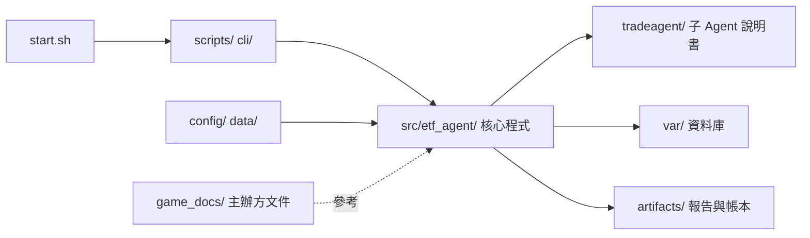

# ETF-AGENTS｜AI CUP 2026 台股 ETF 決策系統

這個系統每天收集並驗證台股資料，讓多個 AI Agent 分工研究、辯論、決定買賣意圖，再由程式計算權重、股數、費稅並檢查比賽規則，最後產生一份給人檢視的中文決策報告和 D-Plan 候選檔。**系統不自動下單或送件**，上傳一律由人執行。

目前哪些功能已經在跑、哪些還沒接，見[目前狀態與限制](docs/status.md)。所有文件的入口在[文件索引](docs/README.md)。

## 快速啟動

在專案根目錄操作，需要能執行 `start.sh` 的 shell。本機使用 Python 3.12（與 Docker 映像相同）。首次安裝先用 [uv](https://docs.astral.sh/uv/) 建立環境：

```bash
uv python install 3.12
"$(uv python find 3.12)" -m venv .venv
.venv/bin/python -m pip install --require-hashes -r requirements.lock
```

啟動 Docker Desktop，執行：

```bash
./start.sh
```

首次會建立虛擬帳戶，之後驗證並沿用既有帳本，開啟[績效儀表板](http://127.0.0.1:8000)。按 `Ctrl+C` 關閉。這個指令不抓資料、不跑決策。

## 常用指令

先看最常用的三個：

| 想做什麼 | 指令 |
| --- | --- |
| 看帳戶與績效（不抓資料、不跑決策） | `./start.sh` |
| 跑完整每日決策 | `./start.sh run` |
| 看資料狀態（不需 Docker） | `./start.sh status` |

其他指令：

| 指令 | 做什麼 |
| --- | --- |
| `./start.sh auto` | 只更新行情、公司事件與財報；不建快照、不動帳本（`data` 是別名） |
| `./start.sh daily` | 更新資料、建研究快照、結算虛擬帳本；不跑 Agent |
| `./start.sh benchmark collect` | 補抓基準（如 0050）的官方行情，不進交易池 |
| `./start.sh benchmark compare` | 唯讀比較帳戶與基準的報酬、回撤；口徑見 [benchmark/README.md](src/etf_agent/benchmark/README.md) |
| `./start.sh backtest` | 只重算已封存的決策、不呼叫 Agent，產生 HTML。僅供參考，不算前瞻證據 |
| `./start.sh reflect` | 補跑一次策略反思週報（只封存、不改策略）；子命令見[日常操作](docs/operations.md) |

`run` 的重跑與還原規則見[日常操作](docs/operations.md#系統每天自己會做的事)。

第一次跑完整決策前，先用 `./start.sh` 開帳。完整決策預設用已登入的 Claude CLI，也可改用 OpenCode 或 Codex；多空研究員可另外指定，Codex 的多空隔離較弱（見[每日決策架構](docs/architecture.md)）：

```bash
./start.sh run --agent-cli opencode
./start.sh run --agent-cli codex                                 # 全部用 Codex 模型（研究員隔離較弱）
./start.sh run --agent-cli codex --research-agent-cli claude     # 研究員改用 Claude：隔離較強
```

可調的參數見[參數說明](docs/run-options.md)，環境設定見 [Docker 使用說明](docs/docker.md)，單步操作見 [CLI 說明](cli/README.md)。

## 每日決策流程

```text
資料驗證與研究快照 → 三位分析師（技術／基本面／事件與情緒）→ 多頭／空頭研究
→ 交易 Agent → 風險 Agent → Python 配置與風控 → 封存報告 → 人工檢視
```

1. **資料與快照**：收集並驗證行情、公司事件、財報與全市場新聞，建立不可變的研究快照。
2. **分析團隊**：三位分析師逐批覆蓋全部交易池，只輸出走勢判斷、事件重要性與有證據的文字發現；指標與財務比率由程式計算。
3. **多空研究**：多頭與空頭研究員讀同一份輸入、互相隔離，對全部交易池逐檔給強度與有證據的論點；比賽只能做多，空頭論點代表不宜買進或應減碼。
4. **交易 Agent**：整合多空論點，逐檔給買賣意圖與信心等級；權重、張數與現金由程式計算。
5. **風險 Agent**：配置前對整體給現金姿態與持股廣度，現金比例與檔數由 Policy 對應；不手寫權重、不覆寫比賽限制。
6. **程式配置與風控**：入選、權重、現金緩衝、換股、回撤下限、費稅與比賽限制全由 Python 執行並驗證，硬規則不過就拒絕。
7. **報告與人工檢視**：封存中文決策報告；條件符合時另產生 D-Plan 候選，上傳由人執行。

幾個一直成立的原則：

- **分工**：Agent 只提出有證據的解讀、買賣意圖與信心等級；數字（權重、股數、費稅、限制）全由 Python 計算和驗證。
- **時間一致**：所有輸入都必須是決策截止時間之前「當時已經看得到」的資料，防止偷看未來。
- **失敗處理**：資料不足或風控不過就停止或明確降級，不填假值。
- **可重建驗證**：決策與帳本都能由封存獨立重建；官方執行價只採交易所來源；呼叫 Agent 前先驗策略與帳本前提。失敗恢復範圍見[日常操作](docs/operations.md)，評測規則見 [`evaluation/README.md`](src/etf_agent/evaluation/README.md)。

策略版本與閘門啟用狀態見[目前狀態](docs/status.md#版本閘門啟用狀態)，舊樣板保存在 [`config/policy_versions/`](config/policy_versions/)。完整說明見[每日決策架構](docs/architecture.md)、[決策流程細節](docs/decision-details.md)與[契約與閘門細節](docs/decision-contracts.md)。

## 專案架構



| 資料夾 | 放什麼 |
| --- | --- |
| `src/etf_agent/` | 核心程式，所有計算、驗證與資料邏輯都在這裡（17 個套件，見[模組總覽](docs/modules.md)） |
| `cli/`、`scripts/` | 單步命令與維運腳本，只解析參數並呼叫 `src/`；`scripts/launchd/` 是排程樣板 |
| `tradeagent/` | 子 Agent 的工作說明書（分析、研究、交易、風險、報告、資料） |
| `config/`、`data/` | 比賽規則、決策參數、資料來源與核准狀態；150 檔交易池、主動型 ETF 名單、產業分類 |
| `game_docs/` | 主辦方原始文件，唯讀 |
| `docs/` | 本專案的說明文件；`plans/` 是計畫與設計紀錄、`source_audit/` 是來源核對證據，不可刪 |
| `tests/` | 自動化測試 |
| `var/`、`artifacts/` | 執行時資料與產物，不進 git。先看 `artifacts/latest/` 的最新報告；各資料夾內容與能否刪除見[執行產物說明](docs/runtime-artifacts.md) |
| `start.sh`、`compose.yaml`、`Dockerfile`、`requirements.txt`、`requirements.lock`、`pytest.ini` | 入口腳本、容器與測試設定 |

每個資料夾都有自己的 README；整體分工見[資料夾架構](docs/repository-layout.md)。

## 文件

所有文件的入口是[文件索引](docs/README.md)，依「我想知道什麼」查。最常用的：

| 想知道 | 看這份 |
| --- | --- |
| 哪些功能在跑、哪些還沒接 | [目前狀態與限制](docs/status.md) |
| 每天要做什麼、出事怎麼辦 | [日常操作](docs/operations.md) |
| 決策怎麼跑 | [每日決策架構](docs/architecture.md) |
| 某個閘門或旗標是什麼 | [名稱對照](docs/glossary.md) |
| 資料從哪來、能不能用 | [資料來源與授權限制](docs/data_sources_inventory.md) |
| 開發規則與測試要求 | [AGENTS.md](AGENTS.md) |

`docs/plans/` 是計畫與設計紀錄，不是現行行為說明。

持續整合：每次 push 與 pull request 由 GitHub Actions 在 Python 3.12 執行測試與編譯檢查，說明見 [tests/README.md](tests/README.md)。

## 參與專案

- [貢獻指南](CONTRIBUTING.md)與[行為準則](CODE_OF_CONDUCT.md)。
- [安全漏洞通報方式](SECURITY.md)：請勿公開漏洞或憑證。
