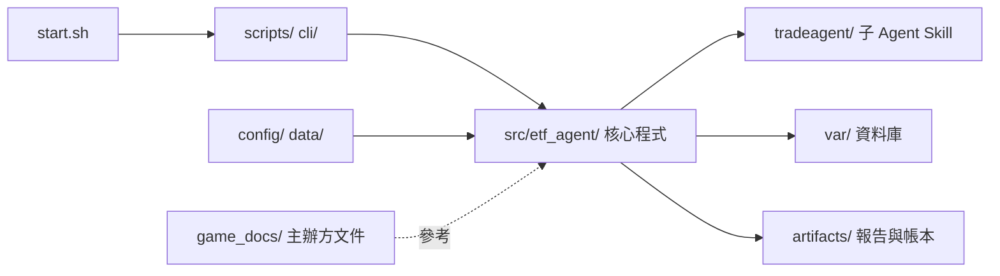

# ETF-AGENTS｜AI CUP 2026 台股 ETF 決策系統

收集並驗證台股行情與公司資料，經分析團隊、多空研究、交易整合與風險審查，產生供人工檢視的決策報告。不自動下單或送件。

目前哪些功能已接入、哪些尚未接入，見[目前狀態與限制](docs/status.md)。

## 快速啟動

在專案根目錄操作，需有可執行 `start.sh` 的 shell。本機環境使用 Python 3.12（與 Docker 映像相同；系統內建的 3.9 已停止維護，且裝不了 pip 26.2.2 以上的安全版本）。首次安裝先用 [uv](https://docs.astral.sh/uv/) 取得 Python 3.12 並建立本機環境：

```bash
uv python install 3.12
"$(uv python find 3.12)" -m venv .venv
.venv/bin/python -m pip install -r requirements.txt
```

啟動 Docker Desktop，執行：

```bash
./start.sh
```

首次會建立虛擬帳戶，之後驗證並沿用既有帳本，開啟[績效儀表板](http://127.0.0.1:8000)。按 `Ctrl+C` 關閉；已有帳戶不會重新注資。此指令不抓資料、不執行決策。

## 常用指令

| 用途 | 指令 | 執行內容 |
| --- | --- | --- |
| 看帳戶與績效 | `./start.sh` | 開帳或驗證既有帳戶，啟動唯讀儀表板（含帳戶對 0050 買入持有、150 檔等權買入持有的基準比較）；不更新資料 |
| 補抓基準、比較績效 | `.venv/bin/python cli/benchmark.py collect`／`compare` | `collect` 補抓已核准的基準標的行情；`compare` 唯讀計算帳戶對基準的報酬與回撤（口徑見 [benchmark/README.md](src/etf_agent/benchmark/README.md)） |
| 只更新資料 | `./start.sh auto` | 更新行情、公司事件與財報，顯示資料狀態；不建研究快照、不推進帳本或執行決策（`data` 為相容別名） |
| 更新資料與帳本 | `./start.sh daily` | 驗證來源、更新資料、建立 Snapshot、結算／準備虛擬帳本；不跑 Agent |
| 完整每日決策 | `./start.sh run` | 更新資料、建立快照、準備帳本，執行分析與決策 Agent，封存中文報告；符合條件時另產生 D-Plan 候選。沿用 Snapshot、重做與還原的規則見[日常操作](docs/operations.md#每日排程晚上備案早上重做) |
| 查看資料狀態 | `./start.sh status` | 顯示資料數量、品質問題、驗證結果與最後更新時間（台北時間）；不重新抓取、不需 Docker |

首次跑完整決策前，先用 `./start.sh` 開帳。完整決策預設使用已登入的 Claude CLI；可改用 Codex 或 OpenCode：

```bash
./start.sh run --agent-cli codex
./start.sh run --agent-cli opencode
```

環境設定見 [Docker 使用說明](docs/docker.md)，單步操作見 [CLI 說明](cli/README.md)。

首次跑完整決策前，先用 `./start.sh` 開帳。完整決策預設使用已登入的 Claude CLI；可改用 Codex 或 OpenCode：

```bash
./start.sh run --agent-cli codex
./start.sh run --agent-cli opencode
```

可調整的參數（用量、模型、續跑、資料包）見[參數說明](docs/run-options.md)，環境設定見 [Docker 使用說明](docs/docker.md)，單步操作見 [CLI 說明](cli/README.md)。

## 決策流程

```text
資料驗證與研究快照 → 三位分析師 → 多頭／空頭研究
→ 交易 Agent → 風險 Agent → Python 配置與風控 → 封存報告 → 人工檢視
```

- **分工**：Agent 提出有證據的市場解讀與買賣意圖；指標、權重、股數、費稅及競賽限制由 Python 計算與驗證。
- **時間一致**：所有下游輸入必須與研究快照的截止時間、資料版本一致，並以當時可得時間防止未來資訊洩漏。
- **失敗處理**：資料不足或風控失敗時停止或明確降級。

原則細節、對應參賽策略文件的因子、超出權重或產業上限時的處理，見[決策流程細節](docs/decision-details.md)與[每日決策架構](docs/architecture.md)。

## 專案架構與資料夾

整體架構（細節見[資料夾架構](docs/repository-layout.md)、[套件依賴](docs/modules.md)、[執行產物](docs/runtime-artifacts.md)）：



各資料夾都有自己的 README，也可先看[文件索引](docs/README.md)。

各資料夾都有自己的 README，也可先看[文件索引](docs/README.md)。

```text
ETF_AGENTS/
├── start.sh                 # 日常入口：儀表板、auto、daily、run、status
├── compose.yaml, Dockerfile # Docker 執行環境
├── requirements.txt         # 本機 .venv 與 Docker 共用依賴（含 pytest）
├── pytest.ini               # 測試設定
├── AGENTS.md                # 開發規則、Agent 邊界、測試與 commit 格式
│
├── src/etf_agent/           # 核心程式：所有計算、驗證與資料邏輯都在這裡
│   ├── data/                #   收集、驗證、版本化行情與公司事件，建立 ResearchSnapshot
│   ├── automation/          #   每日管線：呼叫子 Agent、重試、Validator
│   ├── decision/            #   配置、風控、CompetitionGuard、最終決策
│   ├── ledger/              #   虛擬帳本、成交與費稅
│   ├── virtual_account/     #   每日開帳、結算與官方價量
│   ├── decision_delivery/   #   風控後中文 JSON／Markdown 報告
│   ├── reporting/           #   Research Report
│   ├── competition/         #   D-Plan 整理與匯出
│   ├── perception/          #   市場新聞與情緒輸入
│   ├── fundamentals/        #   財務比率計算
│   ├── research/            #   事件研究（獨立流程與舊封存）；cross_market_study/ 為跨市場隔夜訊號離線回測（見 docs/cross_market_study.md）
│   ├── dashboard/           #   績效儀表板
│   ├── benchmark/           #   帳戶對 0050／交易池等權買入持有的基準比較（同本金、同費稅、官方價）
│   ├── calibration/         #   校準旁觀者：信心等級事後對答案、決策價與成交均價偏離（不入決策鏈）
│   ├── strategy_reflection/ #   策略反思旁觀者：讀校準報告提出旋鈕提案，驗證與影子回放後自動改寫 decision_policy.json（不入決策鏈）
│   ├── evaluation/          #   Agent 評測：資料抓齊率、評測集重跑、一致度／穩定度，以及零 token 的多日 Policy 回放（不入決策鏈）
│   └── core/                #   共用的雜湊、時間、數值工具
│
├── cli/                     # 單步命令入口：只解析參數並呼叫 src/，不放邏輯（見 cli/README.md）
├── scripts/                 # 維運與補抓腳本：收集行情／財報／官方價量、check_setup、run_daily_pipeline
│   └── launchd/             #   排程樣板
├── tradeagent/              # 子 Agent 的 Skill：analysis、research、trading、risk、reporting、data
│
├── config/                  # 設定檔
│   ├── competition_rules.json    # 競賽硬性規則（持股 20–30 檔、現金上限等）
│   ├── decision_rules.json       # 決策規則（含 minimum_active_share）
│   ├── decision_policy.json      # 權重、情境與滑價參數
│   ├── data_sources.json         # 資料來源網址
│   ├── benchmarks.json           # 績效比較基準（0050、150 檔等權）與授權狀態
│   ├── trading_status_approvals.json  # 已核准的交易狀態來源
│   └── competition_profile.json  # D-Plan 的隊伍設定
├── data/                    # 靜態輸入
│   ├── official_universe.csv     # 150 檔交易池
│   ├── sector_classification.json # 產業分類
│   ├── active_etf_list.csv       # 官方 30 檔主動型 ETF 名單
│   └── active_etf_holdings.csv   # Active Share 用 30 檔主動型 ETF 前 15 大持股（MoneyDJ 2026-09-30，一次性）
├── game_docs/               # 主辦方原始文件：標的清單、D-Plan 指南與 schema、DataPack 規格
├── docs/                    # 設計與操作文件
│   └── source_audit/        #   來源核對與核准證據，程式與核准設定會引用，不可刪
├── tests/                   # pytest 測試，依職責分 core／data／perception／research／decision／account／automation
│   └── fixtures/            #   測試用的小型資料
│
├── var/                     # 執行時資料，不進 git：etf_agent.db（行情、公司文件、來源原文）
└── artifacts/               # 執行時產物，不進 git
    ├── latest/              #   先看這裡：最新中文報告（latest.md／latest.json）或失敗診斷
    ├── daily/               #   每日執行狀態、分析師與決策輸出（<日期>/<run_id>/）
    ├── decisions/           #   不可變決策封存與重建輸入
    ├── reports/             #   決策報告：runs（交付紀錄）、views（依日期的閱讀副本）
    ├── competition_d_plan/  #   D-Plan v4.3 候選與內部 context
    ├── ledger/              #   虛擬帳本與帳戶快照
    ├── data/                #   最新資料：研究快照、財報、產業分類、決策輸入、官方歷史行情
    ├── debug/               #   平常不用看：source_audit（來源原始抓取）、source_probe（來源探測）
    └── archive/             #   舊實驗、被取代的決策
```

`var/`、`artifacts/` 不進 git，由 `./start.sh` 與每日管線產生；各資料夾內容與能否刪除見[執行產物說明](docs/runtime-artifacts.md)。

## 文件

- [文件索引](docs/README.md)：所有文件的分類入口與更新紀錄。
- 日常操作：[每日排程與 D-Plan、資料包、開新帳戶、常見問題](docs/operations.md)；[目前狀態與限制](docs/status.md)。
- 資料夾說明：[config](config/README.md)、[data](data/README.md)、[game_docs](game_docs/README.md)、[scripts](scripts/README.md)、[tradeagent](tradeagent/README.md)、[tests](tests/README.md)。
- [每日決策架構](docs/architecture.md)、[資料來源與授權限制](docs/data_sources_inventory.md)
- [事件與市場情緒邊界](docs/event_market_scope.md)、[事件研究整合](docs/integrated_event_analysis.md)、[技術分析歷史輸入](docs/technical_trend_history.md)
- [開發規則與測試要求](AGENTS.md)：核心程式在 `src/etf_agent/`，命令入口在 `cli/`／`scripts/`，Agent Skill 在 `tradeagent/`。
- 持續整合：每次 push 與 pull request 由 GitHub Actions（`.github/workflows/ci.yml`）在 Python 3.12 執行 pytest、`compileall` 與 `git diff --check`，說明見 [tests/README.md](tests/README.md)。

## 參與專案

- [貢獻指南](CONTRIBUTING.md)與[行為準則](CODE_OF_CONDUCT.md)。
- [安全漏洞通報方式](SECURITY.md)：請勿公開漏洞或憑證。
