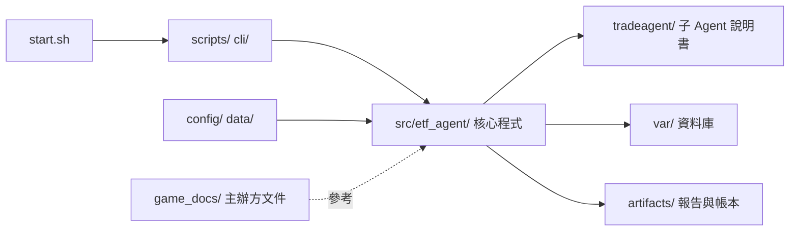

# ETF-AGENTS｜AI CUP 2026 台股 ETF 決策系統

這個系統每天收集並驗證台股資料，讓多個 AI Agent 分工研究、辯論、決定買賣意圖，再由程式計算權重、股數、費稅並檢查比賽規則，最後產生一份給人檢視的中文決策報告和 D-Plan 候選檔。**系統不自動下單或送件**，上傳一律由人執行。

哪些功能已經在跑、哪些還沒接，見[目前狀態與限制](docs/status.md)。所有文件的入口在[文件索引](docs/README.md)。

## 快速啟動

在專案根目錄操作，需要能執行 `start.sh` 的 shell。本機使用 Python 3.12（與 Docker 映像相同）。首次安裝先用 [uv](https://docs.astral.sh/uv/) 建立環境：

```bash
uv python install 3.12
"$(uv python find 3.12)" -m venv .venv
.venv/bin/python -m pip install --require-hashes -r requirements.lock
```

啟動 Docker Desktop，執行：

```bash
./start.sh
```

首次會建立虛擬帳戶，之後驗證並沿用既有帳本，開啟[績效儀表板](http://127.0.0.1:8000)。按 `Ctrl+C` 關閉。這個指令不抓資料、不跑決策。

## 常用指令

| 想做什麼 | 指令 | 會發生什麼 |
| --- | --- | --- |
| 看帳戶與績效 | `./start.sh` | 開帳或驗證既有帳戶，啟動唯讀儀表板（含對 0050、150 檔等權買入持有的基準比較） |
| 補抓基準行情 | `./start.sh benchmark collect` | 補抓基準標的（如 0050）的官方行情，只存行情、不進交易池 |
| 比較績效 | `./start.sh benchmark compare` | 唯讀計算帳戶對基準的報酬與回撤（口徑見 [benchmark/README.md](src/etf_agent/benchmark/README.md)） |
| 回測（買進的股票有沒有贏基準） | `./start.sh backtest` | 只重算已封存的決策、不呼叫 Agent，產生 HTML 並印出路徑；`backtest replay` 換策略設定重算，`backtest report --eval-id 編號` 更新評測報告。僅供參考，不算前瞻證據 |
| 只更新資料 | `./start.sh auto` | 更新行情、公司事件與財報，顯示資料狀態；不建快照、不動帳本（`data` 是別名） |
| 更新資料與帳本 | `./start.sh daily` | 驗證來源、更新資料、建立研究快照、結算並準備虛擬帳本；不跑 Agent |
| 完整每日決策 | `./start.sh run` | 做完 `daily`，再跑分析與決策 Agent，封存中文報告；條件符合時另產生 D-Plan 候選。重跑與還原規則見[日常操作](docs/operations.md#系統每天自己會做的事) |
| 查看資料狀態 | `./start.sh status` | 顯示資料數量、品質問題與最後更新時間；不抓資料、不需 Docker |

第一次跑完整決策前，先用 `./start.sh` 開帳。完整決策預設用已登入的 Claude CLI，也可改用 OpenCode 或 Codex；多空研究員可另外指定，Codex 的多空隔離較弱（見[每日決策架構](docs/architecture.md)）：

```bash
./start.sh run --agent-cli opencode
./start.sh run --agent-cli codex                                 # 全部用 Codex 模型（研究員隔離較弱）
./start.sh run --agent-cli codex --research-agent-cli claude     # 研究員改用 Claude：隔離較強
```

可調的參數見[參數說明](docs/run-options.md)，環境設定見 [Docker 使用說明](docs/docker.md)，單步操作見 [CLI 說明](cli/README.md)。

## 決策流程

```text
資料驗證與研究快照 → 三位分析師 → 多頭／空頭研究
→ 交易 Agent → 風險 Agent → Python 配置與風控 → 封存報告 → 人工檢視
```

- **分工**：Agent 只提出有證據的解讀、買賣意圖與信心等級；權重、股數、費稅與比賽限制全由 Python 計算和驗證。
- **時間一致**：所有輸入都必須是決策截止時間之前「當時已經看得到」的資料，防止偷看未來。
- **審查修正**：日行情同時核對交易日、台北收盤內容時間與可得時間；完整決策在呼叫 Agent 前先驗策略及帳本前提。完整評測使用考卷凍結的當時帳本，缺少時提前拒絕，不暗中關掉換股；詳見 [`evaluation/README.md`](src/etf_agent/evaluation/README.md)。策略版本與生效時間見[目前狀態](docs/status.md#版本閘門啟用狀態)，舊樣板保存在 [`config/policy_versions/`](config/policy_versions/)。
- **失敗處理**：資料不足或風控不過就停止或明確降級，不填假值。
- **驗證邊界**：官方執行價採交易所來源白名單，財報須與來源證據一致；有主辦方資料包時，D-Plan 的股數換算與最終比例檢查使用同一份官方 NAV。帳本重建先在暫存區驗證，再發布結果，失敗恢復範圍見[日常操作](docs/operations.md)。

- **配置閘門（2026-11-05 已實作與測試）**：高信心份額下限 `limit_scaled_conviction`（正式設定已開啟，alpha 0.6）；高信心現金下限 `high_conviction_cash_floor`（正式設定未開啟，與 `cash_ratio_range` 互斥），計劃與重放見 [`docs/cash_buffer_high_conviction_plan.md`](docs/cash_buffer_high_conviction_plan.md)、[`docs/limit_aware_conviction_weights_plan.md`](docs/limit_aware_conviction_weights_plan.md)。姿態內現金子等級 `cash_ratio_range`（同日已實作第一階段，正式設定已開啟）：風險 Agent 除了姿態另選 lower／middle／upper 子等級（仍是列舉、不輸出數字），程式依格點對應現金比例，現金每天最多比前次決策高 3 個百分點、往下不限；與高信心現金下限互斥，計劃見 [`docs/agent_cash_ratio_range_plan.md`](docs/agent_cash_ratio_range_plan.md)。開啟時（目前已開啟）以 `cli/portfolio_decision.py` 重跑 finalize／validate-decision 時，程式預設讀 `artifacts/decisions` 重讀前次決策，也可用 `--decision-repository` 指定。另外，風險審查修正動作 `increase_cash_buffer` 的值一律必須在現金上限之下留 3 個百分點邊際（比賽上限 25% 時最高 22%），因為整張取整與現金分配會讓現金高於緩衝。
- **轉向事實閘門（2026-11-09 已實作並開啟）**：`position_sizing.cash_stance_turn_facts` v1 是紀錄工具，不是規則：風險 Agent 簡報附程式算的交易池轉向事實（池等權報酬、站回均線比例、MA20 之上比例變化、新低比例、連續 bear 天數），Agent 多填列舉 `turn_assessment`，與現金姿態不設對應；計劃見 [`docs/turn_facts_plan.md`](docs/turn_facts_plan.md)。
- **大盤指數事實閘門（2026-11-10 已開啟）**：`position_sizing.market_index_facts` v1 讓風險 Agent 簡報附程式算的加權指數事實（收盤、當日漲跌、近 5／20 日報酬、離高點回檔），補上晚間決策看不到隔夜行情的缺口；背景事實、不可引用、不改配置，見 [docs/market_index_facts_plan.md](docs/market_index_facts_plan.md)。
- **反彈參與閘門（2026-11-10 已切到 v2、只開 confirmed；v1 保留供舊 run 重建）**：`position_sizing.rebound_participation` v1 讓程式狀態機（`turn_state`：none／candidate／confirmed，只在 regime 為 bear 時有意義）與風險 Agent 既有的 `turn_assessment` 列舉取較保守者，才放寬防守姿態下的曝險換股（beta 停止線、換股檔數、持有天數；選填：防守現金比例條件式放寬、confirmed 換手上限，皆放寬風控、只由人設定）；缺資料永不升級，只放寬、不改寫交易 Agent 意圖，`team_inputs` 升為 2.8。門檻由只有極少數大漲日的歷史擬合，過擬合風險與重放結果見 [`docs/rebound_participation_plan.md`](docs/rebound_participation_plan.md)。v2（2026-11-10 01:37 開啟）拿掉固定門檻，程式只整理事實與資料品質，由風險 Agent 的 `turn_assessment` 單獨決定、缺資料恆 none，見 [`docs/rebound_participation_v2_plan.md`](docs/rebound_participation_v2_plan.md)。
- **優質股被大盤拖累的事實閘門（2026-11-10 已實作第一階段、尚未開啟）**：`position_sizing.quality_dip_facts` v1 讓程式對全交易池算「跌幅能不能被大盤解釋」（評估視窗前 60 日 beta 調整後的 20 日殘差與名次）、價格位置與財報三個清單（新壞事／疑慮／不知道），並標出被大盤拖累與超跌（原因不明）兩種候選；事實給技術／基本面分析師、背景給交易 Agent（不可引用），多空研究員不拿；不新增 Agent 輸出、不影響配置，`team_inputs` 另存 `dip_facts` 由 Finalizer 重算。是否開啟由人決定，見 [`docs/quality_dip_plan.md`](docs/quality_dip_plan.md)。
- **曝險換股閘門（2026-11-09 已實作並開啟）**：`position_sizing.exposure_rotation` v1 讓交易 Agent 對 hold 也給信心，程式依持股 beta（對交易池等權基準）、帳本算的持有天數與信心，在姿態觸發或新股 high 對持股 low 時換股；有次數與比例上限、死區（不是跨日遲滯），不改寫 Agent 意圖，與 `drawdown_derisk` 互斥，不會只賣不買；`team_inputs` 升為 2.7（多存 `exposure_review`）。計劃見 [`docs/exposure_rotation_plan.md`](docs/exposure_rotation_plan.md)；正式設定已切到 v2 精簡版（刪三個欄位），見 [`docs/exposure_rotation_v2_plan.md`](docs/exposure_rotation_v2_plan.md)。

完整說明見[每日決策架構](docs/architecture.md)與[決策流程細節](docs/decision-details.md)。

## 專案架構



| 資料夾 | 放什麼 |
| --- | --- |
| `src/etf_agent/` | 核心程式，所有計算、驗證與資料邏輯都在這裡（17 個套件，見[模組總覽](docs/modules.md)） |
| `cli/`、`scripts/` | 單步命令與維運腳本，只解析參數並呼叫 `src/`；`scripts/launchd/` 是排程樣板 |
| `tradeagent/` | 子 Agent 的工作說明書（分析、研究、交易、風險、報告、資料） |
| `config/`、`data/` | 比賽規則、決策參數、資料來源與核准狀態；150 檔交易池、主動型 ETF 名單、產業分類 |
| `game_docs/` | 主辦方原始文件，唯讀 |
| `docs/` | 本專案的說明文件；`source_audit/` 是來源核對證據，不可刪 |
| `tests/` | 自動化測試 |
| `var/`、`artifacts/` | 執行時資料與產物，不進 git。先看 `artifacts/latest/` 的最新報告；各資料夾內容與能否刪除見[執行產物說明](docs/runtime-artifacts.md) |
| `start.sh`、`compose.yaml`、`Dockerfile`、`requirements.txt`、`requirements.lock`、`pytest.ini` | 入口腳本、容器與測試設定 |

每個資料夾都有自己的 README；整體分工見[資料夾架構](docs/repository-layout.md)。

## 文件

- [文件索引](docs/README.md)：所有文件的分類入口與更新紀錄。
- 日常操作：[每日排程、D-Plan、資料包、開新帳戶、常見問題](docs/operations.md)；[目前狀態與限制](docs/status.md)。
- 資料夾說明：[config](config/README.md)、[data](data/README.md)、[game_docs](game_docs/README.md)、[scripts](scripts/README.md)、[tradeagent](tradeagent/README.md)、[tests](tests/README.md)。
- 資料與事件：[資料來源與授權限制](docs/data_sources_inventory.md)、[事件與市場情緒邊界](docs/event_market_scope.md)。
- [開發規則與測試要求](AGENTS.md)。
- 持續整合：每次 push 與 pull request 由 GitHub Actions（`.github/workflows/ci.yml`）在 Python 3.12 執行測試與編譯檢查，說明見 [tests/README.md](tests/README.md)。

## 參與專案

- [貢獻指南](CONTRIBUTING.md)與[行為準則](CODE_OF_CONDUCT.md)。
- [安全漏洞通報方式](SECURITY.md)：請勿公開漏洞或憑證。
