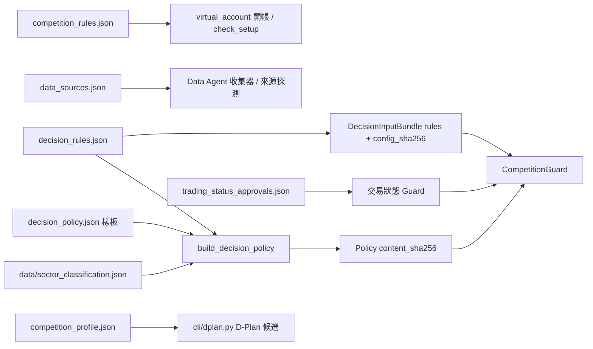

# config/：規則與來源設定

放影響資料來源、風控與送件資格的靜態設定；程式以唯讀掛載讀取（`compose.yaml` 的 `./config:/app/config:ro`），Agent 不改寫。

## 檔案清單

| 檔案 | 用途 | 誰讀它 |
| --- | --- | --- |
| `competition_rules.json` | 主辦方競賽規則的機器可讀摘要 | `cli/virtual_account.py`（`init`／`ensure-init` 的 `--rules` 預設）、`scripts/check_setup.py` |
| `decision_rules.json` | 決策層硬性規則（含 `available_at`） | `cli/portfolio_decision.py`（`--rules` 預設）、`scripts/run_daily_pipeline.py`、`preflight` |
| `decision_policy.json` | 團隊策略樣板（非競賽規則） | `cli/portfolio_decision.py build-policy`（`--template`）、`scripts/run_daily_pipeline.py`、`preflight` |
| `data_sources.json` | 資料來源白名單與抓取參數 | `cli/data_agent.py`、`scripts/collect_latest_prices.py`、`scripts/collect_financial_statements.py`、`scripts/probe_data_sources.py` |
| `trading_status_approvals.json` | 交易狀態來源的人工核准清單 | `scripts/run_daily_pipeline.py`、`src/etf_agent/data/ogd_trading_status.py`、`preflight` |
| `competition_profile.json` | 隊伍設定檔（不是 D-Plan） | `cli/dplan.py`（`--profile` 預設）、`src/etf_agent/competition/`、`scripts/run_daily_pipeline.py` |
| `competition_profile.md` | 設定檔的填寫說明（文件，程式不讀） | 人工閱讀 |
| `active_account.json` | 使用中的帳戶 ID；比賽第一天由 `cli/virtual_account.py open-competition` 改寫 | `start.sh`、`scripts/run_daily_pipeline.py`、`cli/virtual_account.py`、`cli/dplan.py`、`cli/dashboard.py`、`scripts/repair_pending_tpex_close.py` |
| `benchmarks.json` | 績效比較基準清單：0050 買入持有（單一標的）與 150 檔等權買入持有，含來源與 `license_status` | `cli/benchmark.py`、`cli/dashboard.py`（`--benchmarks` 預設）、`src/etf_agent/data/benchmarks.py`、`src/etf_agent/benchmark/` |

## 欄位說明與規則

| 檔案 | 內容與規則 |
| --- | --- |
| `competition_rules.json` | 本金、150 檔交易池版本與雜湊（`universe_source.sha256`，對應主辦方 PDF）、持股數、現金上限、單股上限、費率、送件時段 |
| `competition_rules.json` | 硬性現金上限為 `cash_weight_must_be_below`（0.25）；`recommended_cash_weight_ceiling`（0.22）是建議值 |
| `competition_rules.json` | 本金與規則是帳本開帳與環境檢查的基準；交易池雜湊需與 `data/official_universe.csv` 一致 |
| `decision_rules.json` | 張數 `lot_size`、費率、最低手續費、單股／特定股權重上限、持股數、現金上限 |
| `decision_rules.json` | 內容算 `config_sha256` 寫入決策輸入包，Validator 以此重算 |
| `decision_rules.json` | `source_url` 指向 `config/competition_rules.json`，兩份數值需一致 |
| `decision_rules.json` | `max_sector_weight` 為 `"0.35"`（2026-10-23 起；超過時由配置程式在 Guard 前按整張減碼，見根 README）；`minimum_active_share` 為 `"0"`，即不設實際限制（比賽只比總報酬，與主動型 ETF 的差異不加分） |
| `decision_policy.json` | 現金緩衝、預設權重、減碼比例、滑價、換手、壓力情境、修正次數與 `position_sizing` |
| `decision_policy.json` | 可調：`drawdown_control`（`neutral_at`／`defensive_at` 峰值回撤門檻，達到時現金姿態至少 neutral／defensive）、`cash_buffer_by_stance`（aggressive／neutral／defensive 現金比例）、`conviction_multipliers`（high／medium／low 乘數）、`volatility_floor`、`slippage_bps`、`trim_fraction` |
| `decision_policy.json` | 樣板不得含硬性規則或產業分類欄位，否則 `build_decision_policy` 拒絕 |
| `decision_policy.json` | 變更會改變權重與成交模擬，並影響可重算雜湊；改版時更新 `policy_id` 與 `available_at`，Snapshot 截止時間早於 `available_at` 的舊 run 不能再 `--resume`，要用 `--force` 重跑 |
| `decision_rules.json` ＋ `decision_policy.json` | `build_decision_policy`（`src/etf_agent/decision/policy_builder.py`）以後者為樣板，併入前者的硬性規則與 `data/sector_classification.json`，產生帶 `content_sha256` 的 Policy |
| `data_sources.json` | 涵蓋 TWSE／TPEx 最新價、`source_probes`、歷史行情（節流、重試、回補年數）、yfinance、月營收與重大訊息、財報來源、交易狀態候選端點 |
| `data_sources.json` | 抓取參數：`timeout_seconds`、`retries`、`max_workers`、`min_request_interval_seconds`、`throttle_backoff_seconds`、`lookback_years`、`overlap_days`、`batch_size` |
| `data_sources.json` | 新增或改動 URL／欄位對應等於改變正式來源，需先走來源稽核與核准 |
| `data_sources.json` | 調高並行或縮短間隔可能被官方節流 |
| `trading_status_approvals.json` | `approved_sources`：人工核准的來源；`not_applicable`：經官方依據核准的不適用類別 |
| `trading_status_approvals.json` | 每筆需有 `approved_by`、`approved_at`（含時區）、`evidence`、`max_age_hours` |
| `trading_status_approvals.json` | 未列入的來源一律視為 candidate，Guard fail-closed；程式不自行核准 |
| `competition_profile.json` | `team_id`（主辦方配發）、ETF 名稱／主題／投資理念、`approved_at`、模型供應商與版本 |
| `competition_profile.json` | `strategy_status` 不是 `approved` 或 `strategy.*` 欄位為空時，不產生正式 D-Plan |
| `competition_profile.json` | D-Plan 預設輸出至 `artifacts/competition_d_plan/` |
| `benchmarks.json` | 每筆需有 `benchmark_id`、`label`、`kind`（`single_instrument`／`universe_equal_weight`）與 `license_status`；單一標的另需 `symbol`、`name`、`market`、`source`（官方來源，如 `TWSE_STOCK_DAY`）。只有 `license_status=approved` 的基準會收集與進正式計算，其餘在儀表板與 CLI 顯示 unavailable |
| `benchmarks.json` | 基準標的只保存行情，不加入 150 檔交易池（`instruments.in_competition_universe` 維持 0）；費稅沿用 `decision_rules.json`，不另設 |

## 設定如何流入決策

