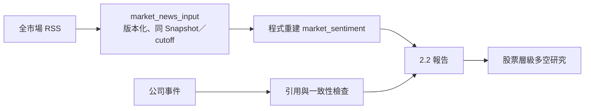

# 公司事件與整體市場情緒

## 用途與範圍

第三位分析師的 2.2 報告含兩個獨立範圍：

| 範圍 | 產出 |
| --- | --- |
| 整體台股 | 只產生一次 `market_sentiment` |
| 交易池內每家公司 | 逐檔事件判讀 |

公司新聞、個股行情、市場成交背景不能代替全市場情緒。資料不足時，兩個範圍各自標示無法判斷。

## 運作方式

- 每日批次、輸出契約與 Validator 使用 2.2。
- 程式依相同 Snapshot 與 `decision_cutoff` 重建市場情緒欄位；模型不能覆寫。
- 重大公司事件的事實與脈絡，直接交給股票層級多空研究。
- 獨立事件研究與舊 2.1、2.0 封存，依各自原始契約驗證。

## 契約與規則

### 全市場新聞

| 規則 | 說明 |
| --- | --- |
| 覆蓋 | 新聞標註須涵蓋視窗內全部項目 |
| 去重 | 依 canonical content ID |
| 可得時間 | 歷史原頁依實際取得時間記錄，不回填過去 |

### 進入正式計算的條件

三項須同時滿足：

1. 授權已核准（`license_status=approved`）。
2. 來源與時間可追溯。
3. 涵蓋範圍完整。

### 不可補成全市場情緒的資料

- 公司維度的 `MarketPerceptionResult`
- 搜尋摘要
- 市場成交數字

### 恐懼貪婪指標

新聞不可用時，市場通道改用程式計算的[台股恐懼貪婪指標](market_fear_greed.md)（期交所 VIX、Put/Call 比與融資變化率）。指標另存於 `market_sentiment.fear_greed`，不與新聞結論合成分數；模型不能改寫分數或方向。

## 使用方式

`cli/market_context_probe.py --trade-date <日期>` 補抓交易所成交、指數與法人買賣資料，輸出至 `artifacts/market_context_probes`（`--output-root` 可改）。只作交易背景與來源查核，不參與正式情緒計算。

## 限制與注意事項

- 全市場新聞來源已於 2026-10-23 由使用者核准，並已接入每日決策鏈；樣本不足（少於 5 則獨立內容或 2 家媒體）時新聞部分仍為 `unavailable`／`unknown`，不可解讀為中性。
- 恐懼貪婪指標只有選擇權與融資兩類訊號；指標也不可用時，市場情緒維持 `unavailable`。

## 尚未實作

- 全市場新聞只有 RSS 最近項目與指定歷史目錄，不是全部新聞。

## 延伸閱讀

- [台股恐懼貪婪指標](market_fear_greed.md)
- [全市場新聞接入](market_news_integration.md)
- [歷史新聞](market_news_history.md)
- [事件研究整合](integrated_event_analysis.md)
