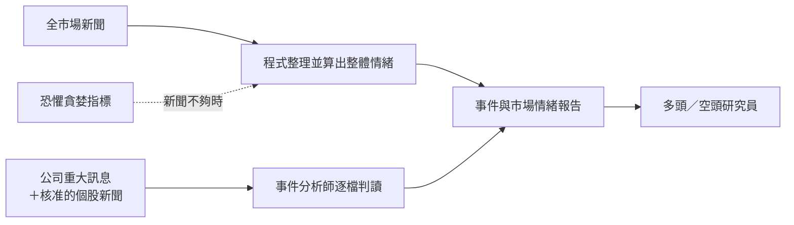

# 公司事件與整體市場情緒

## 這是什麼

第三位分析師（事件與市場情緒分析師）每天交出一份報告，裡面是兩件互不混用的事：

| 範圍 | 產出 | 資料來源 |
| --- | --- | --- |
| 整體台股 | 一次「整體市場情緒」 | 全市場新聞；新聞不夠時改用台股恐懼貪婪指標 |
| 交易池每家公司 | 逐檔事件判讀 | 公司重大訊息；已核准的個股新聞標題 |

為什麼要分開：一家公司的新聞或股價，不能代表整個市場的心情。所以個股新聞只用來判讀該公司事件，不會被拿去算整體情緒；公司層級的情緒分數、搜尋摘要、市場成交數字也不能冒充整體情緒。資料不夠時，兩邊各自標示「無法判斷」，不互相補。

## 一天怎麼跑



- 整體情緒由程式依同一個 Snapshot 與決策截止時間重算，模型不能改寫。
- 公司的重大事件，其事實與脈絡直接交給多空研究員，不再另開一輪事件研究。
- 報告版本：一般為 2.2；當天資料含已核准的個股新聞時為 2.3，每則新聞都要分類一次（規則見[事件研究整合](integrated_event_analysis.md#事件報告-23已核准個股新聞)）。
- 舊的 2.1 與 2.0 封存，依當時的規則驗證，不改寫。

## 整體情緒的規則

| 規則 | 說明 |
| --- | --- |
| 全數標註 | 查詢視窗內的每則新聞都要標註，不能只挑一部分 |
| 去重 | 同一內容只算一次 |
| 可得時間 | 歷史原頁記錄實際取得的時間，不回填到過去 |
| 入帳條件 | 授權已核准、來源與時間可追溯、涵蓋範圍完整，三項同時成立才進正式計算 |

新聞不可用時，改用[台股恐懼貪婪指標](market_fear_greed.md)；指標另存一欄，不跟新聞結論混成一個分數。兩者都不可用，整體情緒就是「無法取得」，不當作中性。

## 補充背景指令

```bash
.venv/bin/python cli/market_context_probe.py --trade-date <日期>
```

補抓交易所成交、指數與法人買賣，輸出到 `artifacts/market_context_probes`（`--output-root` 可改）。只當交易背景與來源查核，不參與正式情緒計算。

## 目前限制

- 全市場新聞來源已於 2026-10-23 核准並接入每日流程；但可用樣本少於 5 則獨立內容或 2 家媒體時，新聞部分視為無法判斷，不能解讀為中性。
- 全市場新聞只有 RSS 最近項目與指定的歷史目錄，不是全部新聞。
- FinMind 個股新聞的程式已接入，但來源核對指令（`cli/company_news.py review --status approved`）還沒執行；執行前每日決策不會加入個股新聞，事件報告維持 2.2。
- 恐懼貪婪指標只有選擇權與融資兩類訊號；指標也不可用時，整體情緒維持無法取得。

## 延伸閱讀

- [台股恐懼貪婪指標](market_fear_greed.md)
- [全市場新聞接入](market_news_integration.md)
- [歷史新聞](market_news_history.md)
- [事件研究整合](integrated_event_analysis.md)
