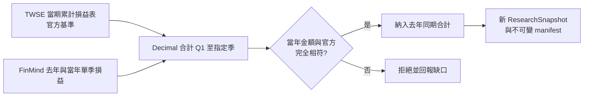

# 基本面缺口補抓

## 用途與範圍

補齊分析摘要缺少的基本面資料，並核對口徑與保存版本。

| 角色 | 責任 |
| --- | --- |
| Data Agent | 抓取、口徑核對、版本保存 |
| 基本面分析師 | 解讀已驗證的資料 |

- 入口：`.venv/bin/python cli/fundamental_repair.py`，環境須有 `FINMIND_TOKEN`。
- CLI 不自動讀取或輸出憑證，也不執行後續交易 Agent。
- 每日排程不會自動呼叫此入口，僅供互動研究；補抓的文件會寫進共用資料庫，之後的每日 Snapshot 會納入。

## 運作方式



互動順序：補抓一次 → 重建指標 → 再分析。失敗時交回確切缺口，不無限重試；憑證或額度失敗即停止本輪。

## 契約與規則

### 一般業：去年同期補抓

| 項目 | 規則 |
| --- | --- |
| 基準 | 官方當期累計損益表；上市用 `t187ap06_L_ci`，上櫃用 `mopsfin_t187ap06_O_ci` |
| 補充 | FinMind 去年與當年單季損益 |
| 合計 | Decimal 加總 Q1 至指定季度 |
| 一致性 | 營收、營業利益、稅後淨利須與官方累計金額完全相符 |
| EPS | 不加總 |
| 保存 | 原始回應、官方基準；標記 vendor 來源 |

拒絕條件：缺季、欄位重複、股票誤配、非有限值、金額或截止時間衝突。一般業三項全核對，官方基準任一項標為 `not_reported` 即拒絕整筆，不改成只核對部分欄位。

### 業別規格總表

每個業別一份 `RepairSpec`（`src/etf_agent/data/fundamental_repair.py::REPAIR_SPECS`），包含欄位對映、必要欄位、是否只核對官方有提供的欄位，以及各自的映射版本。不以字典物件相等判斷業別，避免新增業別時靜默套到別人的規則。

| 業別 | 核對項目 | FinMind type／origin_name | 映射版本 |
| --- | --- | --- | --- |
| ci（一般業） | revenue、operating_profit、net_income 全核對 | `Revenue`／營業收入、`OperatingIncome`／營業利益（損失）、`IncomeAfterTaxes`／本期淨利（淨損） | `finmind-official-anchor-ytd-v1` |
| mim（其他業） | 只核對 net_income | `IncomeAfterTaxes`／本期淨利（淨損） | `finmind-official-anchor-ytd-mim-v1` |
| fh／basi／ins（金控、銀行、保險） | 只核對 net_income | `IncomeAfterTax`／本期稅後淨利（淨損） | `finmind-official-anchor-ytd-financial-v1` |
| bd（證券期貨） | 只核對 net_income | `IncomeAfterTaxes`／本期淨利（淨損） | `finmind-official-anchor-ytd-bd-v1` |

### 其他業（mim）：去年同期補抓（2026-10-28 起接入，只限稅後淨利）

官方 `t187ap06_L_mim`／`mopsfin_t187ap06_O_mim` 的損益表只有「收入」與「支出」，沒有營業收入與營業利益，收集器把 `revenue` 與 `operating_profit` 標為 `not_reported`；FinMind 這邊的 `Revenue` 也掛在「收入」這個 origin_name 下。沒有官方金額可核對的項目一律不接入，因此只核對稅後淨利。

實測證據（2026-10-28，2207.TW 2026Q2）：官方 `net_income` 13,759,770 千元，FinMind 兩個單季 `IncomeAfterTaxes` 合計完全相符；去年同期合計 9,923,928,000 元，`net_income_yoy_pct` = +38.65%。`revenue_yoy_pct` 與 `operating_margin_*` 維持 unavailable。

### 金融業：去年同期補抓（2026-10-28 起接入，只限稅後淨利）

適用 fh／basi／ins，映射版本 `finmind-official-anchor-ytd-financial-v1`（與一般業的 `...-ytd-v1` 分開）。

| 項目 | 規則 |
| --- | --- |
| 基準 | 官方當期累計損益表（`t187ap06_L_fh`／`_basi`） |
| 補充 | FinMind 單季 `IncomeAfterTax`（origin_name 必須是「本期稅後淨利（淨損）」） |
| 核對 | 只核對 `net_income`；當年單季合計須與官方累計金額完全相符 |
| 必要欄位 | `net_income` 缺少即拒絕整筆，不以其他欄位替代 |

### 證券期貨業（bd）：去年同期補抓（2026-10-28 起接入，只限稅後淨利）

官方 `mopsfin_t187ap06_O_bd` 的稅後淨利欄位名是「本期淨利（淨損）」，與金控／銀行的「本期稅後淨利（淨損）」不同，FinMind 也跟著用一般業的 `IncomeAfterTaxes`。映射版本 `finmind-official-anchor-ytd-bd-v1`。

實測證據（2026-10-28，6023.TWO 2026Q2）：FinMind 完全沒有 `IncomeAfterTax`，只提供 `IncomeAfterTaxes`／本期淨利（淨損）；官方 `net_income` 1,543,614 千元與單季合計相符，去年同期合計 1,302,200,000 元，`net_income_yoy_pct` = +18.54%。官方 bd 表沒有可核對的營收金額，所以 FinMind 的 `Income`／收益一律不接入。

拒絕條件（除一般業共同條件外，適用 mim／fh／basi／bd／ins）：

- FinMind 同時提供 `IncomeAfterTax` 與 `IncomeAfterTaxes` 時語意不明，拒絕該檔。
- 業別對應的 type 與 origin_name 不符即拒絕，不以另一個業別的欄位替代（例如金控的 `IncomeAfterTax` 不得充當 bd 的稅後淨利）。

**刻意不接入「淨收益」。** FinMind 把金融業的淨收益放在 `Revenue` 這個 type 下，但與官方口徑不同：2026-10-28 以 2886.TW 2026Q2 實測，FinMind 單季淨收益合計 46,292,555,000 元，官方 `net_revenue` 為 1,477,626,000 元，相差約 31 倍；同期稅後淨利兩邊完全相符（21,307,220,000 元）。因此 `net_revenue` 永不對映為 `revenue`，金融業的 `revenue_yoy_pct` 與 `operating_margin_*` 一律維持 unavailable（有對應測試固定此行為）。原先「不接入未確認的金融業跨年公式」的限制，僅對稅後淨利這一項以實測核對解除；其餘項目仍不接入。

### 金融業與證券期貨業：當期欄位對應

適用 fh／basi／bd／ins。官方映射版本為 `twse-tpex-openapi-2026-10-v2`；更新須重新收集並另建快照，不改舊版本。

| 原始欄位 | 對應 | 備註 |
| --- | --- | --- |
| 本期稅後淨利（淨損）、本期淨利（淨損） | `net_income` | 兩者並存但不相等時，拒絕該列並保存解析警告 |
| 淨收益 | `net_revenue` | 不可當作 `revenue` |

- 不以繼續營業單位或母公司業主淨利冒充整體淨利。
- 分析摘要 `financial_facts` 提供金融業當期稅後淨利／淨收益原值與來源證據。
- 除上述已實測核對的稅後淨利外，不接入未確認的金融業跨年公式。

### 時間點

| 欄位 | 規則 |
| --- | --- |
| FinMind `available_at` | 實際抓取時間 |
| 來源發布時間 | `null` |
| 財報與公司基本資料的 `published_at` | 僅為觀測時間相容欄位，不是公司發布時間 |
| `--decision-cutoff` | 指定歷史時鐘；晚於它的新抓資料拒絕補入，不可偽裝歷史回測 |

每次補抓另建 ResearchSnapshot 與不可變 manifest；屬研究模式，不是正式每日決策輸入或 D-Plan。

### 缺口說明用語

分析摘要缺欄位不等於來源沒有資料。先確認原始回應、欄位映射、摘要傳遞。

| 狀態 | 對外說法 |
| --- | --- |
| 已取得但未接入 | 欄位存在，尚未接入 |
| 口徑未確認 | 口徑尚未確認 |
| 尚未取得 | 尚未取得 |
| 來源實際失敗 | 僅在有抓取失敗紀錄時使用 |
| 狀態未確認 | 狀態未確認 |

- 無失敗紀錄時，不寫「抓不到」或「公司未公告」。
- 金融業與證券期貨業的稅後淨利年增率已接入（2026-10-28 起），不再以「欄位尚未接入」描述；仍未接入的是這些業別的營收／淨收益類項目，口徑未確認，不得補算營收年增率或營業利益率。

`data_gap_explanations` 由程式依實際快照產生，區分三種情況：

1. 缺整張損益表。
2. 有表但缺欄位。
3. 基期非正數，無法算一般年增率。

內部錯誤碼留在 `unavailable_metrics`，不抄入對外報告。

### 分類與寫法

- 對外用「正面／中性／負面」；內部契約為 `positive`／`neutral`／`negative`／`unknown`。
- 無可用資料維持 `unknown`；對外暫列「中性」時須另寫「資料不足，暫不判斷」。
- 每檔順序：判斷 → 理由與反證 → 具體缺口。
- 中文表達參考 [ASD-STE100 原則](https://www.asd-ste100.org/STE_faq.html)（短句、用詞一致），不宣稱符合英文詞彙規範。
- 數值與證據可由原始 JSON 重建。

## 使用方式

```bash
.venv/bin/python cli/fundamental_repair.py \
  --symbols 1101.TW 2330.TW \
  --decision-cutoff <含時區的 ISO 時間>
```

| 旗標 | 預設 | 說明 |
| --- | --- | --- |
| `--database` | `var/etf_agent.db` | 資料庫 |
| `--universe` | `data/official_universe.csv` | 交易池 |
| `--symbols` | 交易池內有官方核對基準的全部股票 | 僅補抓指定股票（須在交易池內） |
| `--decision-cutoff` | 無 | 歷史截止時間 |
| `--output-root` | `artifacts/fundamental_repairs` | 輸出目錄 |

## 限制與注意事項

- 金融業、證券期貨業與其他業的去年同期稅後淨利已接入；這些業別的營收／淨收益類項目仍未接入，口徑未確認。
- FinMind 可補歷史財報，但不等於來源提供完整財報上下文。
- 當期金額相符，只驗證當期口徑，不保證去年沒有重編。
- 官方 `mopsfin_t187ap06_O_mim`／`_O_fh`／`_O_basi`／`_O_ins` 目前只回傳一列空白樣板（沒有任何公司），所以補抓入口不掛這幾個端點；上櫃出現這些業別的公司時才需加入。
- 交易池中確定無法補抓的缺口（2026-10-28 實測）：
  - `7828.TWO`：FinMind 的 `TaiwanStockFinancialStatements` 完全沒有 2025-03-31 這一期（2024 年也只有 2024-12-31），無法合出去年同期累計。不得用 2025-06-30 單季或月營收推算，也沒有官方 2025H1 基準可核對。
  - `3718.TWO`：中光電投控自 2026-08 起才 100% 認列中強光電（原 5371）營收，連當期官方累計損益表都還沒有（任何端點都查不到），FinMind 亦零筆。不得借用 5371 的歷史，兩者是不同法律主體。

## 尚未實作

- 去年報表範圍與重編資訊未取得，`reporting_scope=unknown`；報告須保留此限制。
- 補抓入口未接入：金融業的營收／淨收益類項目（口徑未確認）、資產負債表歷史補抓、同業比較標準。不得用一般業公式硬補。
- 無合法可比同業資料時，須明列「缺少業別比較標準」。
- 公司產業代碼已接入分析摘要並附引用證據，但無名稱對應或同業基準。
- Yahoo Finance 季度損益已實抓兩檔，尚未接入正式基本面指標。
- 每日排程尚未自動呼叫此補抓入口。
