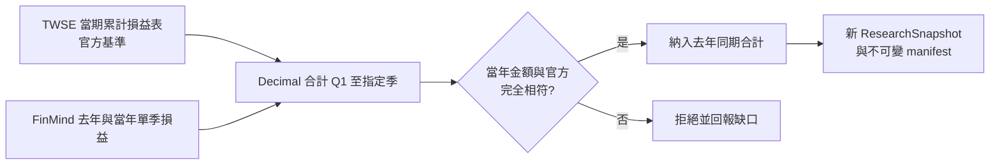

# 基本面缺口補抓

## 用途與範圍

補齊分析摘要缺少的基本面資料，並核對口徑與保存版本。

| 角色 | 責任 |
| --- | --- |
| Data Agent | 抓取、口徑核對、版本保存 |
| 基本面分析師 | 解讀已驗證的資料 |

- 入口：`.venv/bin/python cli/fundamental_repair.py`，環境須有 `FINMIND_TOKEN`。
- CLI 不自動讀取或輸出憑證，也不執行後續交易 Agent。
- 每日排程不會自動呼叫此入口，僅供互動研究。

## 運作方式



互動順序：補抓一次 → 重建指標 → 再分析。失敗時交回確切缺口，不無限重試；憑證或額度失敗即停止本輪。

## 契約與規則

### 一般業：去年同期補抓

| 項目 | 規則 |
| --- | --- |
| 基準 | TWSE 一般業當期累計損益表 |
| 補充 | FinMind 去年與當年單季損益 |
| 合計 | Decimal 加總 Q1 至指定季度 |
| 一致性 | 營收、營業利益、稅後淨利須與官方累計金額完全相符 |
| EPS | 不加總 |
| 保存 | 原始回應、官方基準；標記 vendor 來源 |

拒絕條件：缺季、欄位重複、股票誤配、非有限值、金額或截止時間衝突。

### 金融業：欄位對應

適用 fh／basi／bd／ins。官方映射版本為 `twse-tpex-openapi-2026-10-v2`；更新須重新收集並另建快照，不改舊版本。

| 原始欄位 | 對應 | 備註 |
| --- | --- | --- |
| 本期稅後淨利（淨損）、本期淨利（淨損） | `net_income` | 兩者並存但不相等時，拒絕該列並保存解析警告 |
| 淨收益 | `net_revenue` | 不可當作 `revenue` |

- 不以繼續營業單位或母公司業主淨利冒充整體淨利。
- 分析摘要 `financial_facts` 提供金融業當期稅後淨利／淨收益原值與來源證據。
- 不接入未確認的金融業跨年公式。

### 時間點

| 欄位 | 規則 |
| --- | --- |
| FinMind `available_at` | 實際抓取時間 |
| 來源發布時間 | `null` |
| 財報與公司基本資料的 `published_at` | 僅為觀測時間相容欄位，不是公司發布時間 |
| `--decision-cutoff` | 指定歷史時鐘；晚於它的新抓資料拒絕補入，不可偽裝歷史回測 |

每次補抓另建 ResearchSnapshot 與不可變 manifest；屬研究模式，不是正式每日決策輸入或 D-Plan。

### 缺口說明用語

分析摘要缺欄位不等於來源沒有資料。先確認原始回應、欄位映射、摘要傳遞。

| 狀態 | 對外說法 |
| --- | --- |
| 已取得但未接入 | 欄位存在，尚未接入 |
| 口徑未確認 | 口徑尚未確認 |
| 尚未取得 | 尚未取得 |
| 來源實際失敗 | 僅在有抓取失敗紀錄時使用 |
| 狀態未確認 | 狀態未確認 |

- 無失敗紀錄時，不寫「抓不到」或「公司未公告」。
- 僅在金融業原始表稅後淨利欄位存在且有限時，才說「欄位尚未接入」；不因此補算年增率。

`data_gap_explanations` 由程式依實際快照產生，區分三種情況：

1. 缺整張損益表。
2. 有表但缺欄位。
3. 基期非正數，無法算一般年增率。

內部錯誤碼留在 `unavailable_metrics`，不抄入對外報告。

### 分類與寫法

- 對外用「正面／中性／負面」；內部契約為 `positive`／`neutral`／`negative`／`unknown`。
- 無可用資料維持 `unknown`；對外暫列「中性」時須另寫「資料不足，暫不判斷」。
- 每檔順序：判斷 → 理由與反證 → 具體缺口。
- 中文表達參考 [ASD-STE100 原則](https://www.asd-ste100.org/STE_faq.html)（短句、用詞一致），不宣稱符合英文詞彙規範。
- 數值與證據可由原始 JSON 重建。

## 使用方式

```bash
.venv/bin/python cli/fundamental_repair.py \
  --symbols 1101.TW 2330.TW \
  --decision-cutoff <含時區的 ISO 時間>
```

| 旗標 | 預設 | 說明 |
| --- | --- | --- |
| `--database` | `var/etf_agent.db` | 資料庫 |
| `--universe` | `data/official_universe.csv` | 交易池 |
| `--symbols` | 交易池內有官方核對基準的全部股票 | 僅補抓指定股票（須在交易池內） |
| `--decision-cutoff` | 無 | 歷史截止時間 |
| `--output-root` | `artifacts/fundamental_repairs` | 輸出目錄 |

## 限制與注意事項

- 一般業補抓入口的「金融業專屬報表未接入」，不代表官方 Data Agent 不支援金融業當期欄位。
- FinMind 可補歷史財報，但不等於來源提供完整財報上下文。
- 當期金額相符，只驗證當期口徑，不保證去年沒有重編。

## 尚未實作

- 去年報表範圍與重編資訊未取得，`reporting_scope=unknown`；報告須保留此限制。
- 補抓入口未接入：金融業專屬報表（FinMind 去年同期）、TPEx 補抓、資產負債表歷史補抓、同業比較標準。不得用一般業公式硬補。
- 無合法可比同業資料時，須明列「缺少業別比較標準」。
- 公司產業代碼已接入分析摘要並附引用證據，但無名稱對應或同業基準。
- Yahoo Finance 季度損益已實抓兩檔，尚未接入正式基本面指標。
- 每日排程尚未自動呼叫此補抓入口。
