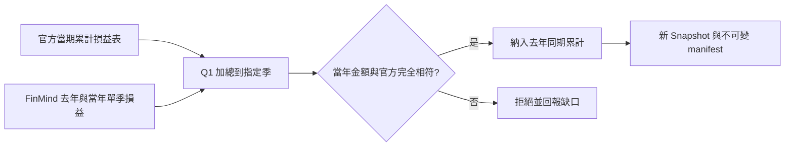

# 基本面缺口補抓

## 這是什麼

基本面分析要算「年增率」（今年累計 vs 去年同期累計）。官方開放資料只給當期累計，沒有去年同期，所以需要另外補。這份文件說明怎麼補、怎麼確保補進來的數字可信。

做法的核心：**用官方當期累計金額當標準答案**。FinMind 提供單季損益，把當年各季加總，若和官方累計金額完全相符，才相信 FinMind 這一套口徑，並把它的去年各季加總成「去年同期累計」。

| 角色 | 責任 |
| --- | --- |
| Data Agent（資料端） | 抓取、口徑核對、版本保存 |
| 基本面分析師 | 只解讀已驗證的資料 |

## 現況：手動模式與每日排程模式

- 入口：`.venv/bin/python cli/fundamental_repair.py`，環境須有 `FINMIND_TOKEN`。
- **手動模式**（預設）：互動研究用，補抓的文件寫進共用資料庫，之後的每日 Snapshot 會納入。
- **每日排程模式**（`--scheduled`，2026-11-10 實作，`start.sh` 在 FinMind 候選擷取之後自動呼叫，`PRIOR_REPAIR=0` 關閉）：只補「官方最新期別在共用資料庫還沒有去年同期文件」的股票，已有的一律跳過，所以平時幾乎 0 次 FinMind 呼叫。核對規則、時間規則與寫入的文件和手動模式完全相同；差別是只寫共用資料庫，不建研究用 Snapshot、不寫 manifest 與 `artifacts/fundamental_repairs/`，只覆寫一份摘要 `artifacts/data/fundamental_prior_repair_latest.json`（不含金鑰）。
  - 每輪最多呼叫 `--max-symbols` 檔（預設 60，`start.sh` 以 `PRIOR_REPAIR_MAX` 調整）；超過的下一輪再補。確定補不了的 7828.TWO、3718.TWO 排在最後，每天各試一次，原因固定記在摘要的 `known_unrepairable`，不重試、不算失敗。
  - 額度或憑證錯誤立即停止本輪（exit 1），已寫入的保留、其餘維持原狀；單檔核對不過只記入 `unverified`（exit 2）；兩者在 `start.sh` 都只讓資料狀態標為部分完成，不中斷每日決策。
  - 仍每輪向官方開放資料取當期累計當核對基準（不需金鑰；相同內容由資料庫去重）。FinMind 呼叫沿用逐檔連網，原始回應保持單一真實回應可稽核；曾評估改讀 `supplemental_facts` 不連網，但它會把同值去重、看不出暫時值又回復，與既有文件有 67% 不同，故不採用。
  - 金鑰只由 `start.sh` 以 `docker compose run -e FINMIND_TOKEN` 傳入該步驟；錯誤訊息進入摘要與原始回應存檔前會遮蔽金鑰值。
- CLI 不自動讀取或輸出憑證，也不執行後續交易 Agent。手動模式每次補抓另建新的 Snapshot 與不可變 manifest，屬研究模式，不是正式每日決策輸入或備援 D-Plan。
- 失敗時交回確切缺口，不無限重試；憑證或額度失敗就停止本輪。

```bash
.venv/bin/python cli/fundamental_repair.py \
  --symbols 1101.TW 2330.TW \
  --decision-cutoff <含時區的 ISO 時間>
```

| 旗標 | 預設 | 說明 |
| --- | --- | --- |
| `--database` | `var/etf_agent.db` | 資料庫 |
| `--universe` | `data/official_universe.csv` | 交易池 |
| `--symbols` | 交易池內有官方核對基準的全部股票 | 只補指定股票（須在交易池內） |
| `--decision-cutoff` | 無 | 歷史截止時間；晚於它的新抓資料拒絕補入，不可偽裝成歷史回測 |
| `--output-root` | `artifacts/fundamental_repairs` | 輸出目錄 |

## 流程



## 各業別怎麼核對

| 業別 | 核對項目 |
| --- | --- |
| 一般業 | 營收、營業利益、稅後淨利，三項都要與官方累計完全相符 |
| 其他業 | 只核對稅後淨利 |
| 金控、銀行、保險 | 只核對稅後淨利 |
| 證券期貨 | 只核對稅後淨利 |

為什麼後三類只核對稅後淨利：這些業別的官方損益表沒有營業收入與營業利益（其他業只有「收入」「支出」），沒有官方金額可核對的項目一律不接入。

共同規則：

- 官方基準：上市用 `t187ap06_L_ci`，上櫃用 `mopsfin_t187ap06_O_ci`（其他業別有對應端點）。
- 合計用 Decimal 加總 Q1 到指定季；EPS 不加總。
- 一般業的官方基準若有任一項標為「未申報」，整筆拒絕，不改成只核對部分欄位。
- 拒絕條件：缺季、欄位重複、股票誤配、非有限值、金額或截止時間衝突、FinMind 同時給了兩個稅後淨利欄位（語意不明）、業別對應的欄位名稱不符（不得拿另一個業別的欄位替代，例如金控的欄位不得充當證券期貨的稅後淨利）。
- 每個業別有獨立的規格（欄位對映、必要欄位、映射版本），避免新增業別時靜默套用別人的規則。

實測證據（2026-10-28，2026Q2）：

| 業別 | 股票 | 結果 |
| --- | --- | --- |
| 其他業 | 2207.TW | 官方稅後淨利 13,759,770 千元，與 FinMind 兩單季合計相符；去年同期 9,923,928,000 元，稅後淨利年增 +38.65%；營收年增與營業利益率維持不可用 |
| 證券期貨 | 6023.TWO | 官方 1,543,614 千元與合計相符；去年同期 1,302,200,000 元，年增 +18.54% |

### 刻意不接入金融業的「淨收益」

FinMind 把金融業淨收益放在「營收」類型下，口徑和官方不同：2886.TW 2026Q2 的 FinMind 單季淨收益合計 46,292,555,000 元，官方為 1,477,626,000 元，差約 31 倍；同期稅後淨利兩邊完全相符（21,307,220,000 元）。所以金融業的淨收益**永不當作營收**，營收年增率與營業利益率一律不可用（有測試固定此行為）。只有稅後淨利這一項因實測相符而解除「不接入未確認公式」的限制。

### 金融業與證券期貨業的當期欄位

- 官方映射版本 `twse-tpex-openapi-2026-10-v2`；更新須重新收集並另建快照，不改舊版本。
- 「本期稅後淨利（淨損）」與「本期淨利（淨損）」都對應稅後淨利；兩者並存但不相等，拒絕該列並保存警告。「淨收益」另存，不可當營收。
- 不以繼續營業單位或母公司業主淨利冒充整體淨利。
- 分析摘要提供金融業當期稅後淨利與淨收益原值及來源證據。

## 時間規則

| 欄位 | 規則 |
| --- | --- |
| FinMind 可得時間 | 實際抓取時間 |
| FinMind 發布時間 | 空（來源沒給） |
| 財報與公司資料的發布時間欄 | 只是觀測時間的相容欄位，不是公司真正發布時間 |

## 缺口怎麼對外說明

分析摘要缺欄位不等於來源沒有資料。先確認原始回應、欄位映射、摘要傳遞。

| 狀態 | 對外說法 |
| --- | --- |
| 已取得但未接入 | 欄位存在，尚未接入 |
| 口徑未確認 | 口徑尚未確認 |
| 尚未取得 | 尚未取得 |
| 來源實際失敗 | 只在有抓取失敗紀錄時使用 |
| 狀態未確認 | 狀態未確認 |

- 沒有失敗紀錄，就不寫「抓不到」或「公司未公告」。
- 缺口說明由程式依實際 Snapshot 產生，分三種：缺整張損益表、有表但缺欄位、基期非正數而無法算一般年增率。內部錯誤碼只留在資料裡，不抄進對外報告。
- 對外分類用「正面／中性／負面」；無可用資料維持「不明」，暫列中性時須另寫「資料不足，暫不判斷」。每檔順序：判斷、理由與反證、具體缺口。
- 數值與證據可由原始 JSON 重建。

## 確定補不了的股票（2026-10-28 實測）

- `7828.TWO`：FinMind 沒有 2025-03-31 這一期，合不出去年同期累計。不得用 2025-06-30 單季或月營收推算，也沒有官方 2025 上半年基準可核對。
- `3718.TWO`：中光電投控自 2026-08 起才 100% 認列中強光電營收，連當期官方累計都查不到，FinMind 零筆。不得借用 5371 的歷史（不同法律主體）。

## 限制

- 當期金額相符只驗證當期口徑，不保證去年沒有重編。
- 去年報表範圍與重編資訊未取得，報表範圍標「未知」，報告須保留此限制。
- FinMind 能補歷史財報，不等於提供完整財報上下文。
- 官方上櫃的其他業、金控、銀行、保險端點目前只回傳一列空白樣板，所以補抓不掛這幾個端點；上櫃出現這些業別的公司時才需加入。

## 尚未接入

- 每日排程自動補抓。
- 金融業的營收／淨收益類項目（口徑未確認）、資產負債表歷史補抓、同業比較標準（無合法可比同業資料時，須明列「缺少業別比較標準」）。
- Yahoo Finance 季度損益（已實抓兩檔，尚未接入正式基本面指標）。
- 公司產業代碼已接入分析摘要並附證據，但沒有名稱對應或同業基準。

## 附錄：名稱對照

| 白話說明 | 程式名稱 |
| --- | --- |
| 業別規格表 | `src/etf_agent/data/fundamental_repair.py` 的 `REPAIR_SPECS` |
| 一般業／其他業／金控銀行保險／證券期貨 | `ci`／`mim`／`fh`、`basi`、`ins`／`bd` |
| 一般業欄位 | `Revenue`、`OperatingIncome`、`IncomeAfterTaxes`；映射版本 `finmind-official-anchor-ytd-v1` |
| 其他業映射版本 | `finmind-official-anchor-ytd-mim-v1` |
| 金控銀行保險欄位／版本 | `IncomeAfterTax`；`finmind-official-anchor-ytd-financial-v1` |
| 證券期貨欄位／版本 | `IncomeAfterTaxes`；`finmind-official-anchor-ytd-bd-v1` |
| 稅後淨利年增 | `net_income_yoy_pct` |
| 淨收益 | `net_revenue` |
| 缺口說明 | `data_gap_explanations`；內部錯誤碼 `unavailable_metrics` |
| 報表範圍 | `reporting_scope` |
