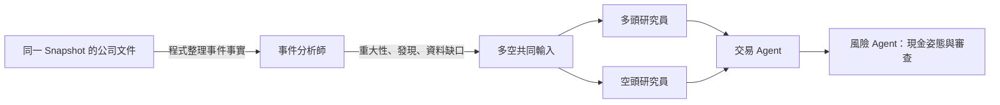

# 事件分析整合進每日決策

## 這是什麼

每天的決策不再另跑一套「事實、多頭、空頭、裁決」四個 Agent 的事件研究。公司事件改由分析團隊裡的事件分析師一次處理，重大事件再直接交給多頭與空頭研究員。

- 適用：2.1 版以後的每日 run。
- 獨立事件研究的指令、驗證與工具仍保留，只供舊封存與單獨研究使用，不在每日流程內。
- 整體架構見[目前每日決策架構](architecture.md)。

## 一天怎麼跑

- 多頭與空頭各做一輪，讀相同的共同輸入，彼此看不到對方輸出。
- 交易 Agent 把每個論點逐一採納或否決；風險 Agent 給現金姿態並審查程式算好的提案。
- 標為 high 的事件，其重大性與發現保存在事件分析報告，並交給多空雙方。
- 沒有重大訊息、也沒有核准個股新聞的股票，由程式直接標「未知」，不送 Agent；最終報告仍涵蓋全部交易池。

## 版本規則

| 版本 | 規則 |
| --- | --- |
| 2.1 及以後 | 只接受技術、基本面、事件三份分析報告與現金姿態，不得夾帶舊的事件研究結果；事件報告為 2.2，資料含個股新聞時為 2.3 |
| 2.0（舊封存） | 沿用原規則，內容、雜湊與 ID 都不改寫，也不重新包裝成新版 |

新鏈不產生事件研究結果；相容用的空輸入只是為了讓多空共同輸入的雜湊算得出來，不代表「沒有事件」。

## 各角色看到的事件資料

| 對象 | 內容 |
| --- | --- |
| 多空研究員 | 每檔股票的事件判讀；頂層一份相同的整體市場情緒（沒有資料就是「無法取得」，不推成中性） |
| 風險 Agent | 逐檔的公司事件、發現與資料缺口 |

市場背景不能代替個股論點的證據。

## 事件報告 2.3（已核准個股新聞）

決策截止時，FinMind 個股新聞若已核准，資料包就加入個股新聞，事件報告改用 2.3；否則維持 2.2。舊封存不受影響。

| 項目 | 規則 |
| --- | --- |
| 來源核准 | 截止前已保存的 `approved` 核對紀錄；之後若改為 `restricted` 則取代 |
| 視窗 | 只取截止前最後一批抓取：抓取時間往前 12 小時內，且不早於截止前 3 天。最後一批超過 3 天視為排程中斷，輸出空清單。重抓到的舊聞保留第一次的可得時間，不會再進新一批 |
| 媒體白名單 | 依連結網域判斷：聯合、自由、工商、中時、鉅亨、MoneyDJ、今周刊、ETtoday、TVBS、三立、台視、科技新報、Yahoo 新聞、中央社、鏡週刊。CMoney 貼文、聚財網論壇、富聯網、LINE TODAY、Yahoo 股市、券商文字都不收 |
| 去重 | 同一股票、同一內容只留最早取得的一則 |
| 時間 | 可得時間是第一次抓到的時間；FinMind 的來源時間沒有時區，所以不記發布時間 |
| 證據編號 | `news:finmind:` 加內容雜湊前 16 碼 |
| 給 Agent 看的內容 | 只有標題、媒體與可得時間 |
| 分類 | 每則新聞都要分類一次，重大性由分析師判斷。標 high 時，必須指出講同一件事的同股重大訊息，或另一家媒體（不同網域，子網域視為同一家）的新聞；沒指出、引用自己或別檔的，驗證會拒絕，Agent 依錯誤重試。舊封存沒有此欄位，照原樣驗證 |
| 引用 | 方向性的判斷可引用新聞；發現可引用該股自己的事件、新聞與同 Snapshot 的財報 |
| 批次 | 以事件數加新聞數計權，每批上限 80 |

驗證時會重算內容雜湊、檢查白名單與視窗、核准時間早於截止時間、股票在交易池內、沒有重複，並登錄新聞證據編號讓分析師與多空引用。個股新聞只進公司事件，不進整體市場情緒。

抓取時間：FinMind 排程平日 20:40 抓取，一批約 3 分鐘。21:00 的決策用當晚 20:40 那批；隔天早上重跑也用這批；週一早上用週五那批。

## 每日 run 的紀錄與續跑

- 每日摘要不再讀獨立的事件研究結果。
- 同版本的 run 可以續跑；若有舊的原始輸出卻缺少版本標記，不能跨版本續跑，須另開新 run。
- 重建驗證時，Finalizer 與 Validator 依版本重建同一份多空輸入；缺輸入、版本混搭、多餘欄位、內容被改一律拒絕。來源、可得時間、數字重算、授權、Guard 與「風險修正最多 3 次」都不放寬。

## 交易整合閱讀版

交易決策通過驗證後，程式把逐檔結果轉成給人讀的 `trader_report.md`（`src/etf_agent/decision/trader_report.py`）。

- 內容：先結論與信心，再依完整句分段的理由，英文等級轉成中文。
- 只是呈現轉換：不重貼多空全文、不改數值或決定；正式 JSON 與雜湊不變。
- 交易 Agent 的理由寫整合後的判斷，用短句分段，對外不寫內部編號。

## 多空 Skill 的文件分工

- 主文件講研究目的、如何從證據形成論點、強弱，以及何時重估。
- 各自的 `references/data-rules.md` 講欄位、編號與引用規則，執行時要求 Agent 讀取。

## 附錄：名稱對照

| 白話說明 | 程式名稱 |
| --- | --- |
| 每日決策輸入版本 | `team_inputs`（2.1 起） |
| 每日決策鏈標記 | `decision_chain`：`{"schema_version": "2.1", "event_analysis_mode": "integrated_analyst"}` |
| 個股新聞資料包 | `company_news_input`（`company-news-1.0`） |
| 個股新聞來源核對表 | `company_news_source_reviews` |
| 媒體白名單版本 | `company_news_publishers_v1` |
| 個股新聞來源代碼 | `FINMIND_NEWS` |
| 資料包建立函式 | `build_input_file` |
| 輸入重建驗證 | `DecisionInputValidator` |
| 高重大性事件旁證欄位 | `corroborated_by` |
