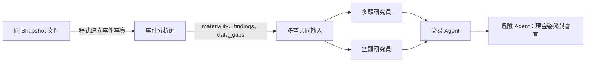

# 事件分析整合（每日決策鏈 2.1）

## 用途與範圍

每日決策鏈不再對 high 事件呼叫 Fact／Bull／Bear／Adjudicator，事件研究併入分析團隊。

- 適用：`team_inputs` 2.1 與 `decision_chain` 2.1 的每日 run。
- 獨立事件研究的 CLI、Validator 與工具仍保留，供舊封存與單獨研究使用，不在每日路徑內。
- 整體架構見 [docs/architecture.md](architecture.md)。

## 運作方式

- 多頭與空頭只做一輪，讀相同共同輸入、互相隔離。
- 交易 Agent 逐一採納或否決每個論點；風險 Agent 給現金姿態並審查程式提案。
- high 事件保存在 event 分析報告，並交給多空兩方。

## 契約

### `team_inputs`

| 版本 | 規則 |
| --- | --- |
| 2.1 | 只接受 `schema_version`、`analyst_reports`、`cash_stance`。報告鍵必須是 technical／fundamental／event，event 使用 2.2，或在資料包含 `company_news_input` 時必須使用 2.3（見下方）。不得注入 `research_result` |
| 2.0（舊） | 沿用原白名單、三／四份分析報告與已驗證 ResearchResult。多空共同輸入雜湊、DecisionResult ID 與封存內容都不改寫 |

### 共同輸入雜湊

- 新鏈的事件研究輸入以空物件 `{}` 帶入既有函式，僅為相容參數。
- 它不建立 ResearchResult，也不代表「沒有事件」或「completed」。
- StancePacket／ResearchDebateBundle 維持 2.0，`shared_input_sha256` 綁定實際分析報告與相容參數。

### Brief 內容

| Brief | 事件相關欄位 |
| --- | --- |
| 多空 | 不含 `event_research`、`research_status`；個股事件在 `symbols[].analysts.event`；頂層帶 event 2.2／2.3 已驗證的 `market_sentiment`，兩方相同、只出現一次 |
| 風險摘要 | 逐檔 `company_events`、`findings`、`data_gaps` |

- 缺少市場資料時 `market_sentiment` 維持 `unavailable`，不推成中性；市場背景不能代替個股論點的證據。

### 事件報告 2.3（已核准個股新聞）

決策截止時 FinMind 個股新聞（`FINMIND_NEWS`）已核准，`build_input_file` 才在資料包加入 `company_news_input`（`company-news-1.0`）；有這個鍵時事件報告必須是 2.3，沒有時維持 2.2，舊封存不受影響。`team_inputs` 2.1／2.2 都接受 2.2 或 2.3，需要哪一版由資料包綁定，沒有新增 `team_inputs` 版本。

| 項目 | 規則 |
| --- | --- |
| 來源核准 | `company_news_source_reviews` 中截止前已保存的 `approved` 紀錄；之後的 `restricted` 會取代 |
| 視窗 | 只取截止前最後一批抓取：(`latest_fetch_at` − 12 小時, cutoff]，且不早於 cutoff − 3 天；最後一批早於 3 天時視為排程中斷，輸出空清單 |
| 媒體白名單 | `company_news_publishers_v1`，依連結網域判斷（聯合、自由、工商、中時、鉅亨、MoneyDJ、今周刊、ETtoday、TVBS、三立、台視、科技新報、Yahoo 新聞、中央社、鏡週刊）；CMoney 貼文、聚財網論壇、富聯網、LINE TODAY、Yahoo股市、券商等不收 |
| 去重 | 依 (symbol, canonical content ID)，保留最早 `available_at` |
| 時間 | `available_at` 為第一次抓到的時間；FinMind 來源時間沒有時區，`published_at` 維持 null |
| 證據 ID | `news:finmind:<content_sha256 前 16 碼>` |
| Brief | 每檔 `news` 只給 evidence_id、標題、媒體與 `available_at`（只有標題） |
| 分類 | 每則新聞須在 `events` 剛好分類一次（與重大訊息相同）；方向性 `outlook` 可引用新聞；findings 可引用自己的事件、新聞與同快照財報 |
| 略過 | 沒有重大訊息也沒有核准新聞的股票由程式輸出 `unknown`，不送 Agent；只有新聞的股票會送 Agent |
| 批次 | 批次權重 = 事件數 + 新聞數，每批上限 80 |

`DecisionInputValidator` 重建驗證：重算內容雜湊、白名單、視窗、核准早於 cutoff、代號在交易池內、沒有重複，並登錄新聞 evidence ID，讓分析師 findings 與多空 claims 可以引用。個股新聞只進公司事件通道，不進市場情緒。

時間對應：FinMind 排程平日 22:00 抓取。21:00 備案時當晚那批還沒抓，用的是前一天 22:00 那批；隔天早上重跑用前一晚 22:00 那批；週一早上用週五那批。

### 每日 run

| 項目 | 值 |
| --- | --- |
| `decision_chain` | `{"schema_version": "2.1", "event_analysis_mode": "integrated_analyst"}` |
| 每日摘要 | 不讀 `event_research_result` |
| 續跑 | 同版本可 `--resume`；有舊 raw 輸出卻缺少 `decision_chain` 標記的 run 不能跨版本續跑，須另建新 run |

## 驗證

- Finalizer 與 Validator 依 `team_inputs` 版本重建同一份多空輸入。
- 缺輸入、版本混搭、多餘欄位、內容被改，一律拒絕。
- 不放寬：來源、`available_at`、數字重算、授權、Guard、風險修正最多 3 次。

## 交易整合閱讀版

`src/etf_agent/decision/trader_report.py` 的 `render_trader_report` 於 TradeDecision 驗證後，照原值呈現逐檔整合結果；每日 `run_trader` 保存為 `trader_report.md`。

| 項目 | 行為 |
| --- | --- |
| 內容 | 先結論與信心，再依完整句分段的理由；英文等級轉中文 |
| 不做 | 不重貼多空報告與逐條論點；不摘要、不改數值或決定 |
| 正式 JSON | 仍保留 `adopted_claim_ids`／`rejected_claim_ids`，雜湊不變 |
| prompt | `rationale` 為整合後判斷，不羅列多空全文；短句、分段，對外不寫內部 ID |

## 多空 Skill 文件分工

- 主文件：研究目的、如何從證據形成論點、強弱、何時重估。
- 各自的 `references/data-rules.md`：欄位、ID 與引用規則；執行 prompt 要求讀取。

## 限制與注意事項

- 舊 2.0 封存不改寫，也不重新包裝成 2.1。
- 事件分析師標為 high 的事件才由程式提供完整事實與脈絡給多空；所有事件仍須分級。
- `trader_report.md` 只是呈現轉換，不是新的決策產物。

## 尚未實作

無。
