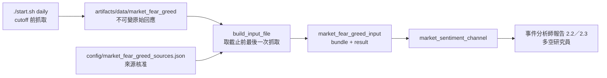

# 台股恐懼貪婪指標

## 用途與範圍

替第三位分析師的「整體台股情緒」提供一個由程式計算的分數。

- 本專案自建，**不是** CNN Fear & Greed Index（CNN 反映美股）。
- 只描述市場情緒，不是買賣訊號，不產生候選、權重或訂單。
- 程式在 `src/etf_agent/perception/market_fear_greed/`，CLI 為 `cli/market_fear_greed.py`。

## 運作方式



1. `./start.sh daily` 在固定 cutoff 之前執行 `cli/market_fear_greed.py capture`。失敗只會讓市場情緒降級，不會中止每日流程。
2. 決策輸入建立時，選出所有 `available_at` 都不晚於 cutoff 的最後一次抓取，連同來源核准組成資料包，由程式算出結果。
3. `DecisionInputValidator`、分析報告 Validator 與報告渲染都用原始回應重算，數字被改就拒絕。

## 指標與計分（`fear-greed-v1`）

| 來源代碼 | 指標 | 方向 |
| --- | --- | --- |
| `TAIFEX_VIX` | 臺指選擇權波動率指數收盤值 | 越高越恐懼 |
| `TAIFEX_PCR` | 臺指選擇權買賣權成交量比率% | 越高越恐懼 |
| `FINMIND_MARGIN` | 集中市場融資金額 5 個交易日變化率 | 越高越貪婪 |

- 每項取最近 20 個交易日（含當日）的百分位，同值各算一半，換成 0～100 分；恐懼方向的指標用 100 減百分位。
- 已核准且可用的指標取平均，至少要 2 項，否則 `unavailable`。
- 區間：≤25 極度恐懼、≤45 恐懼、≤55 中性、≤75 貪婪、其餘極度貪婪。恐懼對應 `negative`，中性對應 `neutral`，貪婪對應 `positive`。
- 常數集中在 `contracts.py`，改動計分需要新的 `SCORE_VERSION`。

## 降級與拒絕

| 情況 | 處理 |
| --- | --- |
| 單一來源擷取失敗、欄位變更、樣本少於 20 日、最新資料距 cutoff 超過 5 天 | 該項不可用，寫入 `data_gaps` |
| 來源未核准，或核准時間晚於 cutoff | 只算進 `diagnostic_score`，不進正式分數 |
| 原始回應雜湊不符、取得時間晚於 cutoff、時間缺時區、網址不在白名單、同日數值衝突、結果被改寫 | 整份拒絕 |

## 與全市場新聞的關係

- 市場通道仍以全市場新聞為優先；新聞不可用而指標可用時，市場情緒改用指標的結果。
- 指標另存於 `market_sentiment.fear_greed`，不與新聞結論合成一個分數。
- 沒有 `market_fear_greed_input` 的舊封存，市場通道輸出與先前完全相同，可照原樣重建。

## 來源使用

核准紀錄在 `config/market_fear_greed_sources.json`，依據見[來源核對](source_audit/2026-10-23_market_fear_greed_sources.md)。

- Put/Call 比與融資的原始資料都在政府資料開放平臺，授權為政府資料開放授權條款第 1 版。
- VIX 不在開放平臺；期交所條款要求書面同意，且未列非商業例外。目前依使用者決定以非商業比賽研究用途核准，這不是期交所的同意。

## 使用方式

```bash
# 手動抓一次（需要 FINMIND_TOKEN 才有融資資料）
.venv/bin/python cli/market_fear_greed.py capture

# 用現在時間當 cutoff 檢視分數，不寫入任何決策輸入
.venv/bin/python cli/market_fear_greed.py show
```

exit code：`0` 完整，`2` 部分來源失敗或結果不可用，`1` 輸入或驗證錯誤。

## 限制

- 20 日百分位只代表近期相對位置，不代表長期高低。
- 期交所 VIX 月檔只保留約 4 個月，Put/Call 開放資料只有約 20 個交易日；更早的歷史只能靠每天保存，不能事後補成當時可得。
- 只有選擇權與融資兩類訊號，沒有新聞、成交廣度或資金流等其他情緒面向。
