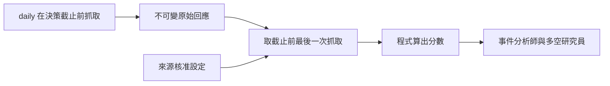

# 台股恐懼貪婪指標

## 這是什麼

一個由程式算出的 0～100 分數，用來描述「現在整個台股市場偏恐懼還是偏貪婪」。

- 本專案自建，**不是** CNN Fear & Greed Index（那是美股的）。
- 只描述情緒，不是買賣訊號，不產生候選、權重或訂單。
- 什麼時候用：第三位分析師的全市場情緒優先看新聞（見[全市場新聞](market_news_integration.md)）；新聞不可用時才改用這個指標。兩者都不可用就維持「不可用」。
- 程式在 `src/etf_agent/perception/market_fear_greed/`，指令為 `cli/market_fear_greed.py`。

## 一天怎麼跑



1. `./start.sh daily` 在決策截止前執行 `capture`。失敗只會讓市場情緒降級，不會中止每日流程。
2. 建決策輸入時，選出「全部資料都在截止前取得」的最後一次抓取，連同來源核准算出分數。
3. 輸入驗證、分析報告驗證與報告渲染都會用原始回應重算，分數被改就拒絕。

## 怎麼計分

目前（2026-11-04 起的新抓取）用三項指標：

| 指標 | 資料 | 方向 |
| --- | --- | --- |
| 臺指選擇權波動率指數（VIX） | 期交所 | 越高越恐懼 |
| 融資金額 5 日變化率 | FinMind（集中市場融資金額） | 越高越貪婪 |
| 融資水位 | 融資金額 ÷ 證交所加權指數，看近 250 個交易日的百分位 | 越高越貪婪 |

計算方式：

1. VIX 與融資 5 日變化率各取最近 20 個交易日（含當日）的百分位，同值各算一半，換成 0～100 分；恐懼方向的指標用「100 減百分位」。
2. 已核准且可用的指標取平均，至少要 2 項，否則「不可用」。
3. 分數區間：25 以下極度恐懼、45 以下恐懼、55 以下中性、75 以下貪婪、其餘極度貪婪。恐懼對應負面，中性對應中性，貪婪對應正面。

融資水位的條件：

- 需要融資金額與加權指數至少 250 個共同交易日；不足、過期或缺任一份原始回應，該項就不可用，不補值。
- 要 FinMind 融資與證交所加權指數「兩者都已核准」才計入正式分數。加權指數已於 2026-11-04 由使用者核准（限比賽研究、非商業；證交所條款頁查不到，是使用者自行承擔的判斷），依據見[融資水位來源核對](source_audit/2026-11-04_margin_level_sources.md)，設計說明見[融資水位設計](margin_level_signal_plan.md)。
- 第一次 `capture` 會回填近 14 個月加權指數（逐月、每次間隔 3 秒）；已收盤的月份直接沿用之前保存的回應，每天只重抓當月與尚未收盤時抓過的月份。融資一次抓近 400 個日曆日。回填完成前的決策截止時間看不到這些資料，不會回填到過去。

舊版本（舊封存照原樣重建）：

| 版本 | 內容 |
| --- | --- |
| 1.0／v1 | VIX、Put/Call 比、融資 5 日變化率 |
| 1.1／v2 | 再加融資水位 |
| 1.2／v3（現行） | 不再抓 Put/Call 比（政府資料只有約 20 個交易日，常因差一天而不可用）；若 1.2 資料包帶 Put/Call 就拒絕 |

分數常數集中在 `contracts.py`；改計分必須換新的計分版本。

## 資料出問題時

| 情況 | 處理 |
| --- | --- |
| 單一來源失敗、欄位變更、樣本少於 20 日、最新資料距截止超過 5 天 | 該項不可用，記錄缺口 |
| 來源未核准，或核准時間晚於決策截止 | 只算進診斷分數，不進正式分數 |
| 原始回應雜湊不符、取得時間晚於截止、時間缺時區、網址不在白名單、同日數值衝突、結果被改寫 | 整份拒絕 |

沒有指標資料的舊封存，市場通道輸出與先前完全相同，照原樣重建。

## 與全市場新聞的關係

- 新聞可用時以新聞為準；新聞不可用而指標可用，市場情緒改用指標。
- 指標另存一份，不和新聞結論合成一個分數。

## 授權

核准紀錄在 `config/market_fear_greed_sources.json`，依據見[來源核對](source_audit/2026-10-23_market_fear_greed_sources.md)。

- 融資資料的原始來源在政府資料開放平臺，授權為政府資料開放授權條款第 1 版。
- VIX 不在開放平臺；期交所條款要求書面同意，且未列非商業例外。目前依使用者決定以非商業比賽研究用途核准，這**不是**期交所的同意。

## 手動操作

```bash
# 手動抓一次（需要 FINMIND_TOKEN 才有融資資料）
.venv/bin/python cli/market_fear_greed.py capture

# 用現在時間當截止時間檢視分數，不寫入任何決策輸入
.venv/bin/python cli/market_fear_greed.py show
```

結束碼：`0` 完整，`2` 部分來源失敗或結果不可用，`1` 輸入或驗證錯誤。

## 限制

- 20 日百分位只代表近期相對位置；融資水位用 250 日窗口補這個缺口。
- 期交所 VIX 月檔只保留約 4 個月，更早的歷史只能靠每天保存，不能事後補成當時可得。
- 只有選擇權波動與融資兩類訊號，沒有成交廣度、資金流等其他面向。

## 附錄：名稱對照

| 白話說明 | 程式名稱 |
| --- | --- |
| 期交所 VIX | `TAIFEX_VIX` |
| 期交所 Put/Call 比（舊版） | `TAIFEX_PCR` |
| 融資 5 日變化率 | `FINMIND_MARGIN` |
| 融資水位 | `FINMIND_MARGIN_LEVEL` |
| 證交所加權指數 | `TWSE_TAIEX`（月檔 `FMTQIK`） |
| 計分版本 | `fear-greed-v1`／`v2`／`v3` |
| 資料包版本 | `market-fear-greed-1.0`／`1.1`／`1.2` |
| 決策輸入欄位 | `market_fear_greed_input`；結果另存於 `market_sentiment.fear_greed` |
| 來源核准設定 | `config/market_fear_greed_sources.json` |
