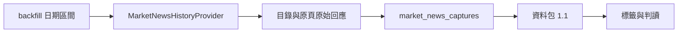

# 市場新聞缺日補抓

## 用途與範圍

RSS 只保留最近項目。本功能依明確日期從公開目錄補抓歷史原頁，並以資料包 1.1 同時接收 RSS 與原頁。

- 只收集指定來源與目錄，不是「全部新聞」。
- 原頁只使用標題與摘要，不當作全文。
- 後續標籤、門檻與接入規則同[全市場新聞收集與接入](market_news_integration.md)。

## 運作方式



核心收集器為 `src/etf_agent/perception/market_news/history.py`。

### 收集範圍

| 來源代碼 | 媒體 | 目錄 | 原頁路徑 |
| --- | --- | --- | --- |
| `CNA_ARCHIVE` | 中央社 | 台股標籤頁（`/tag/21566/`）、證券列表（`/list/asc.aspx`） | `/news/<類別>/<12 位數字>.aspx` |
| `LTN_ARCHIVE` | 自由時報 | `search.ltn.com.tw/list`，關鍵字「台股」、依日期排序 | `ec.ltn.com.tw` 的 `/article/breakingnews|paper/<編號>` |

範圍寫入查詢紀錄；報告不使用沒有範圍的「全部新聞」說法。

## 契約與規則

### 收集器限制

| 項目 | 規則 |
| --- | --- |
| 日期 | 起日不得晚於迄日、不得為未來日期、區間不超過 31 日 |
| 主機 | 只連白名單公開主機，僅 HTTPS，重新導向到其他主機即失敗 |
| 查詢參數 | 自由時報只允許 `keyword=台股`、`sort=date`、`type=all` 與日期、頁碼 |
| 分頁 | 跟隨實際的下一頁，最多 20 頁；重複連結視為循環並拒絕；中文網址會編碼 |
| 回應大小 | 單一回應上限 2,000,000 位元組 |
| 保存 | 目錄、原始回應與分頁是否走完 |
| 失敗 | 網路失敗不宣稱完成，不補零或補假新聞 |

### 資料包 1.1

| 規則 | 說明 |
| --- | --- |
| 輸入 | 同時接收 RSS 與歷史原頁 |
| 原頁必要欄位 | 帶時區的 `published_at`、實際 `available_at`、標題、原始內容雜湊 |
| 媒體數 | 以媒體計；同媒體的 RSS 與原頁不增加來源數 |
| 缺口 | 不再固定加入「RSS 不涵蓋全部歷史」，改述實際收集範圍 |
| 舊版 | 1.0 成對輸入維持原版本重建，封存內容不改寫 |

### 時間點

- `available_at` 是實際取得時間，今天補抓的原頁不得回填成過去已可得。
- 取得日的頁面可能已被更新，不能用目前版本加入取得日之前的正式回測。
- 真正的歷史回測需要當時的內容版本與可得時間證據；只改 `published_at` 不行。

## 使用方式

```bash
.venv/bin/python cli/market_news.py backfill \
  --start-date 2026-10-01 --end-date 2026-10-03 \
  --database var/etf_agent.db \
  --output-root artifacts/market_news_history
```

- `--database` 選配；提供時，captures 追加存入 `market_news_captures`，不覆寫既有版本或不可變 run。
- 補抓後依[接入文件](market_news_integration.md)進行標籤、判讀與 `integrate`。

## 限制與注意事項

- 中央社與自由時報 RSS 條款允許個人與非營利組織的非商業用途並須註明來源，提供標題、前言與連結，不是全文轉載授權。條款未逐名指定 AI CUP，是否屬非商業範圍取決於實際使用方式。
- 本地收集與研究測試不因此停止；正式比賽資料包仍要求 `approved`，診斷結果不得改寫成已核准的正式結果。
- 不以 RSS 條款宣稱取得全部原頁、全文或其他用途的授權。
- 來源規範原始頁與核對紀錄由 `market_news_source_reviews` 保存（見接入文件）。
- 實測參考（2026-10-05）：補入 10/1～10/4 共 92 篇原頁，加上 60 則 RSS，輸入 152 項、去重後 151 則。

來源規範：[中央社 RSS](https://www.cna.com.tw/about/rss.aspx)、[自由時報 RSS](https://service.ltn.com.tw/RSS)

## 尚未實作

- 涵蓋全部過去新聞的完整索引（目前僅限上述目錄與搜尋）。
- 當時內容版本與可得時間證據，因此尚不能用於正式歷史回測。
- 比賽使用權核准（見[接入文件](market_news_integration.md)）。
