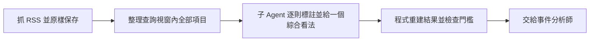

# 全市場新聞收集與接入

## 這是什麼

第三位分析師（事件與市場情緒）要回答兩件事：每家公司有沒有重大事件；整個台股的情緒偏正面、中性還是負面。後者「整個台股只判斷一次」，資料來自財經新聞。這份文件說明新聞怎麼抓、怎麼判讀、怎麼確認結論沒被改過。

- 全市場新聞只決定「市場情緒」，不產生買賣、權重或訂單。
- 個股新聞（FinMind）是另一條路，只進公司事件，不進這裡，見[資料來源清單](data_sources_inventory.md#個股新聞)。
- 歷史缺日補抓見[市場新聞缺日補抓](market_news_history.md)。

## 一天怎麼跑



| 階段 | 誰做 | 做什麼 |
| --- | --- | --- |
| 抓取保存 | 程式 | `./start.sh daily` 在決策截止前抓 RSS，保存原始回應、內容雜湊與實際取得時間（存在 `artifacts/data/market_news/`） |
| 標註與判讀 | 子 Agent | 讀視窗內全部標題與前言，逐則標註，並給一個綜合看法；指令列工具本身不呼叫模型、不自動算標籤 |
| 核對重建 | 程式 | 檢查覆蓋、引用、時間與門檻，重建結果 |
| 接入 | 程式 | 把資料與結果交給事件分析師，並重跑輸入驗證 |

- 決策跑的時候，取截止前最後一份抓取，查詢視窗為截止前 3 天（涵蓋週末）。
- 新聞步驟失敗只會記錄錯誤，市場情緒改用[恐懼貪婪指標](market_fear_greed.md)，不中止每日流程。
- 全市場情緒每次決策只輸出一次，不需要第四位分析師。
- 程式在 `src/etf_agent/perception/market_news/`，每日串接在 `src/etf_agent/automation/market_news_stage.py`。

## 來源與保存

| 來源 | 媒體 | 類型 |
| --- | --- | --- |
| 中央社財經 | 中央通訊社 | RSS |
| 自由時報財經 | 自由時報 | RSS |

- RSS 只有標題與前言，不當作全文。來源與原文主機採白名單，回應上限 2,000,000 位元組，轉向到未允許的主機即視為失敗。
- 抓取結果只追加不覆寫，且和個股新聞分開存放。
- 來源使用核對也是只追加，記錄來源、核對結果、用途、核對時間與規範頁原文的雜湊。

## 判讀規則

### 逐則標註

每則新聞要標兩個欄位，並附中文理由：

| 欄位 | 可選值 |
| --- | --- |
| 相關性 | 全市場、個別公司、無關、無法判斷 |
| 立場 | 正面、負面、中性、正負並存 |

- 必須覆蓋視窗內全部項目，不得少標、重標或改內容識別；內容相同的重複項目標籤要一致。
- 只有標為「全市場」的項目能支持全市場結論。
- 聚合前先去重（以「標題正規化＋發布日」判斷同一內容）。不同標題描述同一事件仍可能有多列，所以不能用列數放大結論。

### 綜合看法

- 結論只有四種：正面、中性、負面、不明；每個發現要附引用。
- 不用篇數、固定權重或股價漲跌公式決定方向。程式只核對引用與時間。
- 結論不是「不明」時，必須有全市場項目與發現作依據。

### 什麼時候才算「可用」

下列全部成立才輸出正式結果：

| 條件 | 要求 |
| --- | --- |
| 樣本 | 至少 5 則獨立的全市場內容 |
| 來源 | 至少 2 家獨立媒體 |
| 覆蓋 | 視窗內全部項目都有標籤 |
| 取得 | 沒有來源抓取失敗 |
| 授權 | 相關來源皆已核准、用途為比賽研究，且有核准依據 |
| 方向 | 綜合看法不是「不明」 |

不符合時，正式結果是「不可用、方向不明、沒有發現」。原本的判讀只留在診斷欄位，不得複製成正式結論。

### 報告用語

| 情況 | 寫法 |
| --- | --- |
| 只有使用範圍未確認 | 「來源使用範圍尚未確認，正式結果暫不提供」 |
| 同時缺樣本、來源或完整輸入 | 「資料不足」 |

## 授權核對

- 目前四個來源（兩家 RSS 與兩家歷史原頁目錄）已由使用者於 2026-10-23 核准，只對之後的決策截止時間生效，依據見[稽核紀錄](source_audit/2026-10-23_market_news_sources.md)。
- 中央社與自由時報的 RSS 條款允許個人與非營利組織的非商業用途並須標示出處；歷史原頁屬使用者自行判斷。
- 核准只能來自真實的條款核對。測試用 fixture 的核准與真實授權無關，系統也不會把「未核准」自動升為「已核准」。
- 寫入或撤回核准（只在狀況改變時執行；省略 `--source` 即全部四個來源，撤回用 `--status restricted`）：

```bash
.venv/bin/python cli/market_news.py review \
  --database var/etf_agent.db \
  --source CNA_FINANCE --source LTN_BUSINESS \
  --status approved \
  --evidence "稽核紀錄路徑與判斷"
```

## 驗證

- 輸入驗證與報告驗證都從原始抓取與標籤重建結果，並確認 Snapshot 與截止時間相同；任何一處被改就拒絕。
- 沒有接入全市場新聞時使用原本的降級通道（恐懼貪婪指標，或維持不可用）。
- 診斷看法是新聞材料的研究推論，不是投資人民調，也不驗證投資效果。

## 手動操作

| 目的 | 指令 |
| --- | --- |
| 補抓並保存 | `.venv/bin/python cli/market_news.py capture --window-start 2026-10-05T00:00:00+08:00 --database var/etf_agent.db --output-root artifacts/market_news_captures` |
| 接入某份決策輸入 | `.venv/bin/python cli/market_news.py integrate --decision-input <決策輸入檔> --market-pack <資料包檔> --output-root artifacts/market_news_research --database var/etf_agent.db` |

- `integrate` 的結果另存於輸出目錄下的新決策輸入，不覆蓋既有檔案；驗證失敗會以「接入驗證失敗」中止。`--database` 選配，用來讀截止前已保存的來源核對。
- 資料包要由分析師依 Skill 交付完整標籤與綜合看法，與抓取內容組成有雜湊的資料包。

## 限制

- RSS 只保留最近的項目，不能單靠 RSS 宣稱涵蓋整段歷史。
- 個股新聞的核對另存一個表，核准後只進事件分析師的公司事件，不能代表整體台股。

## 尚未接入

- 完整歷史新聞庫（含當時內容版本與可得時間證據），所以不能做正式歷史回測。

來源規範：[中央通訊社 RSS](https://www.cna.com.tw/about/rss.aspx)、[自由時報 RSS](https://service.ltn.com.tw/RSS)

## 附錄：名稱對照

| 白話說明 | 程式名稱 |
| --- | --- |
| 中央社財經 RSS | `CNA_FINANCE` |
| 自由時報財經 RSS | `LTN_BUSINESS` |
| 全市場新聞抓取表 | `market_news_captures`（範圍 `TW_STOCK_MARKET`） |
| 新聞資料包版本 | `market-news-1.0`（含標籤、綜合看法、核准）；`1.1` 另含歷史原頁 |
| 來源使用核對表 | `market_news_source_reviews` |
| 個股新聞核對表 | `company_news_source_reviews` |
| 逐則標籤欄位 | `relevance`（`market`／`company`／`unrelated`／`ambiguous`）、`stance`（`positive`／`negative`／`neutral`／`mixed`） |
| 綜合看法 | `synthesis`（`outlook`、`findings`） |
| 診斷用判讀 | `diagnostic_outlook`、`diagnostic_findings` |
| 決策輸入欄位 | `market_news_input` |
