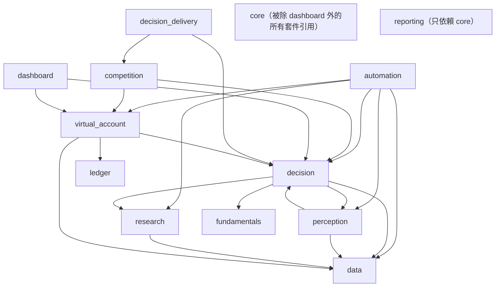
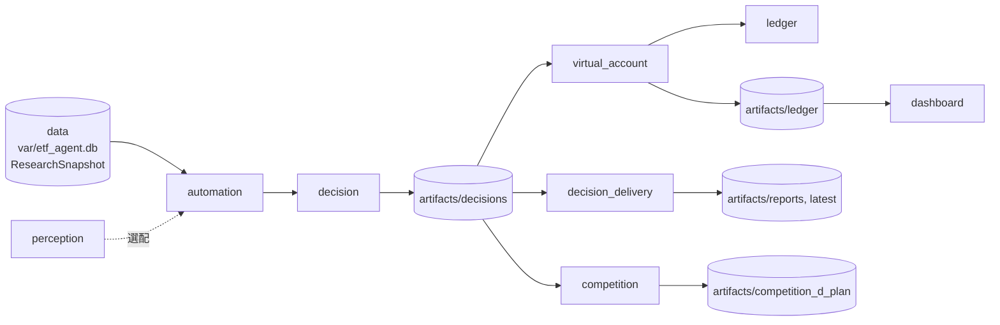

# 模組總覽

`src/etf_agent/` 下 14 個子套件的職責、相依關係與各自 README 的索引。每日決策鏈的流程與契約見 [architecture.md](architecture.md)；開發規則見 [AGENTS.md](../AGENTS.md)。

## 依賴圖

箭頭 `A --> B` 表示 A 的程式 import B（含函式內的延遲 import；以 AST 掃描 `src/etf_agent/` 全部 `.py` 的結果為準）。為避免版面雜亂，圖中省略對 `core` 的箭頭：除 `dashboard` 外，其餘 12 個子套件都 import `core`，`core` 本身不依賴其他子套件。

說明：

- `decision` 與 `perception` 互相 import：`decision`（`analysts.py`、`input_validator.py`、`market_scope.py`）用 `perception`。
- `perception.market_news.service` 與 `perception.market_fear_greed.service` 用 `decision.contracts.decision_bundle_sha256`；改動這兩個套件時需檢查循環 import。
- `data`、`fundamentals`、`ledger`、`reporting` 只依賴 `core`。
- `reporting` 沒有其他子套件 import，圖中以獨立節點表示。
- `reporting` 的輸入 artifact 由 CLI 以檔案傳入。

## 各套件 README

| 套件 | 職責（一句話） | README | 主要入口 |
| --- | --- | --- | --- |
| `core` | 雜湊、時間、Decimal、不可變 run 封存與 run 佈局等共用基礎 | [core/README.md](../src/etf_agent/core/README.md) | 被所有套件引用 |
| `data` | 行情與公司資料收集、版本化、交易狀態與日曆、`ResearchSnapshot` | [data/README.md](../src/etf_agent/data/README.md) | `cli/data_agent.py`、`scripts/collect_*.py` |
| `fundamentals` | 由 Snapshot 財報確定性計算基本面指標並驗證 | [fundamentals/README.md](../src/etf_agent/fundamentals/README.md) | `cli/fundamental_research.py` |
| `perception` | 市場情緒、分析師共識、新聞候選核對、全市場新聞與恐懼貪婪指標 | [perception/README.md](../src/etf_agent/perception/README.md) | `cli/sentiment_research.py`、`cli/news_sentiment.py`、`cli/market_news.py`、`cli/market_fear_greed.py` |
| `research` | Event Research Agent（獨立研究與舊封存），四子 Agent 辯論驗證 | [research/README.md](../src/etf_agent/research/README.md) | `cli/event_research.py` |
| `reporting` | Research Report V0：同源 JSON／Markdown 與重建驗證 | [reporting/README.md](../src/etf_agent/reporting/README.md) | `cli/research_report.py` |
| `decision` | 分析團隊、多空研究、交易、配置、風控與最終決策封存 | [decision/README.md](../src/etf_agent/decision/README.md) | `cli/portfolio_decision.py` |
| `automation` | 每日決策鏈編排、子 Agent runner、分批合併與預檢 | [automation/README.md](../src/etf_agent/automation/README.md) | `scripts/run_daily_pipeline.py`（`./start.sh run`） |
| `decision_delivery` | 風控後中文 JSON／Markdown 最終交付與 latest 索引 | [decision_delivery/README.md](../src/etf_agent/decision_delivery/README.md) | `cli/decision_delivery.py` |
| `competition` | D-Plan v4.3 context 整理、候選匯出與本地驗證 | [competition/README.md](../src/etf_agent/competition/README.md) | `cli/dplan.py` |
| `ledger` | 整張成交模擬與交易日現金帳務 | [ledger/README.md](../src/etf_agent/ledger/README.md) | 由 `virtual_account` 使用 |
| `virtual_account` | 虛擬帳戶初始化、每日快照、結算與決策套用 | [virtual_account/README.md](../src/etf_agent/virtual_account/README.md) | `cli/virtual_account.py` |
| `dashboard` | 唯讀績效儀表板（FastAPI） | [dashboard/README.md](../src/etf_agent/dashboard/README.md) | `cli/dashboard.py`（`./start.sh`） |

## 每日資料與決策流向

- 此圖是資料與產物的流向，與上方 import 圖不同。
- 例：帳本快照由 `virtual_account` 產生後提供給 `automation` 與 `decision` 作為輸入，import 方向則是 `automation --> virtual_account`。

## 分層與邊界

- `core`：與市場無關的基礎。
- `data`、`fundamentals`、`perception`、`research`、`reporting`：資料與研究輸入，只提供事實、來源證據與驗證，不產生權重或訂單。
- `decision`、`automation`：決策與編排；確定性程式負責數字，子 Agent 只輸出解讀、論點、意圖與信心等級。
- `decision_delivery`、`competition`、`virtual_account`、`ledger`、`dashboard`：決策之後的交付、模擬帳務與呈現；不自動下單或送件。

新增或調整套件邊界、契約或開發順序時，同步更新本文件、[README.md](../README.md) 與相關 `docs/`。
