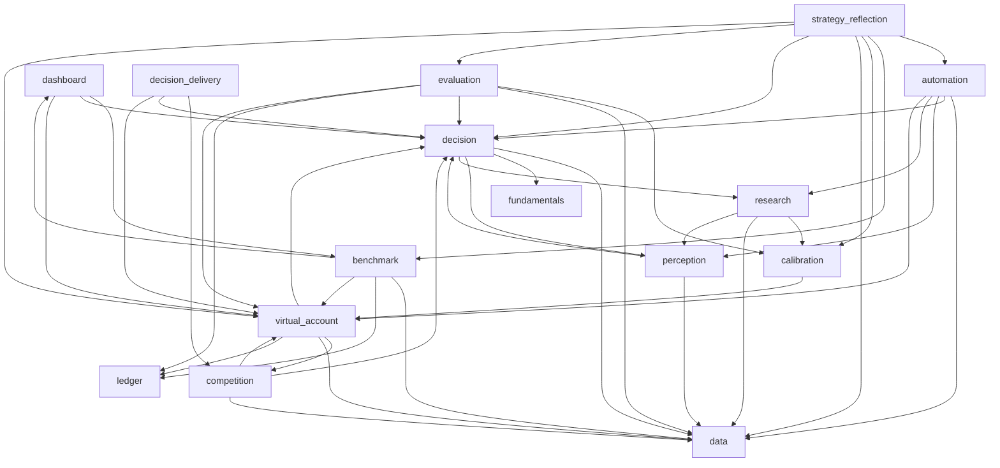
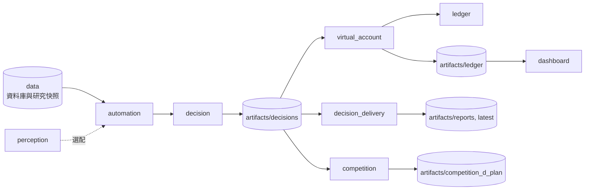

# 模組總覽

`src/etf_agent/` 底下有 17 個套件。這份文件說明每個套件做什麼、誰依賴誰、改動時要注意什麼。每日決策流程見[每日決策架構](architecture.md)，開發規則見 [AGENTS.md](../AGENTS.md)。

## 套件分工

| 套件 | 做什麼 | 說明文件 | 主要入口 |
| --- | --- | --- | --- |
| `core` | 共用基礎：雜湊、時間、數值、不可變封存 | [core](../src/etf_agent/core/README.md) | 被所有套件使用 |
| `data` | 收集並版本化行情與公司資料，建立研究快照 | [data](../src/etf_agent/data/README.md) | `cli/data_agent.py`、`scripts/collect_*.py` |
| `fundamentals` | 由財報確定性計算基本面指標並驗證 | [fundamentals](../src/etf_agent/fundamentals/README.md) | `cli/fundamental_research.py` |
| `perception` | 市場情緒、全市場新聞、個股新聞、恐懼貪婪指標、隔夜背景 | [perception](../src/etf_agent/perception/README.md) | `cli/market_news.py`、`cli/market_fear_greed.py`、`cli/company_news.py`、`cli/overnight_market.py` |
| `research` | 獨立的事件研究（四個子 Agent 辯論）與跨市場離線研究，不在每日決策鏈 | [research](../src/etf_agent/research/README.md) | `cli/event_research.py` |
| `reporting` | 研究報告：整合已驗證結果並重建驗證 | [reporting](../src/etf_agent/reporting/README.md) | `cli/research_report.py` |
| `decision` | 分析團隊、多空研究、交易、配置、風控與最終決策封存 | [decision](../src/etf_agent/decision/README.md) | `cli/portfolio_decision.py` |
| `automation` | 每日決策鏈編排：呼叫子 Agent、重試、分批合併 | [automation](../src/etf_agent/automation/README.md) | `scripts/run_daily_pipeline.py`（`./start.sh run`） |
| `decision_delivery` | 風控後的中文報告與 latest 索引 | [decision_delivery](../src/etf_agent/decision_delivery/README.md) | `cli/decision_delivery.py` |
| `competition` | D-Plan 整理、匯出、備援候選 | [competition](../src/etf_agent/competition/README.md) | `cli/dplan.py` |
| `ledger` | 整張成交模擬與現金帳務 | [ledger](../src/etf_agent/ledger/README.md) | 由 `virtual_account` 使用 |
| `virtual_account` | 虛擬帳戶開帳、每日快照、結算 | [virtual_account](../src/etf_agent/virtual_account/README.md) | `cli/virtual_account.py` |
| `dashboard` | 唯讀績效儀表板 | [dashboard](../src/etf_agent/dashboard/README.md) | `cli/dashboard.py`（`./start.sh`） |
| `benchmark` | 帳戶對 0050、交易池等權買入持有的基準比較 | [benchmark](../src/etf_agent/benchmark/README.md) | `cli/benchmark.py` |
| `calibration` | 校準旁觀者：事後檢查信心等級準不準 | [calibration](../src/etf_agent/calibration/README.md) | `cli/calibration.py` |
| `evaluation` | Agent 評測、多日回放與回測格子 | [evaluation](../src/etf_agent/evaluation/README.md) | `cli/agent_eval.py`、`cli/policy_replay.py` |
| `strategy_reflection` | 每週策略反思：提出調整建議，驗證後才改設定 | [strategy_reflection](../src/etf_agent/strategy_reflection/README.md) | `cli/strategy_reflection.py` |

## 分層：誰可以做什麼

- 基礎層（`core`）：與市場無關。
- 資料與研究輸入層（`data`、`fundamentals`、`perception`、`research`、`reporting`）：只提供事實、來源證據與驗證，不產生權重或訂單。
- 決策層（`decision`、`automation`）：程式負責所有數字；子 Agent 只輸出解讀、論點、意圖與信心等級。
- 決策之後（`decision_delivery`、`competition`、`virtual_account`、`ledger`、`dashboard`、`benchmark`）：交付、模擬帳務、呈現與比較。不自動下單或送件，基準比較也不回饋到決策。
- 旁觀者（`calibration`、`evaluation`、`strategy_reflection`）：事後檢查與提出建議，不在每日決策鏈上。`decision/`、`automation/` 不得匯入 `strategy_reflection`，也不得匯入 `evaluation` 的回測格子與 HTML 報告。

## 誰依賴誰

箭頭 `A --> B` 表示 A 的程式有匯入 B（含函式內延遲匯入，以掃描 `src/etf_agent/` 的結果為準）。為了版面乾淨，省略所有指向 `core` 的箭頭；除 `core` 本身外，每個套件都依賴它（`dashboard` 只透過其他套件間接使用）。

需要小心的地方：

- `decision` 與 `perception` 互相匯入；改動這兩個套件時要檢查有沒有循環匯入。
- `benchmark` 與 `dashboard` 也互相匯入，但 `dashboard` 是在函式內才匯入 `benchmark`，所以沒有循環。
- `virtual_account` 與 `competition` 之間也有互相匯入，改動時同樣先確認匯入順序。
- `data`、`fundamentals`、`ledger`、`reporting` 只依賴 `core`；`reporting` 的輸入檔由命令列以檔案傳入。

## 每日資料與產物怎麼流動

這張圖畫的是資料與檔案的流向，跟上面的匯入圖不同。

例：帳本快照由 `virtual_account` 產生後，交給 `automation` 當決策輸入（資料流向），而匯入方向是 `automation` 匯入 `virtual_account`。

新增或調整套件邊界時，同步更新本文件、[根目錄 README](../README.md) 與相關 `docs/`。
