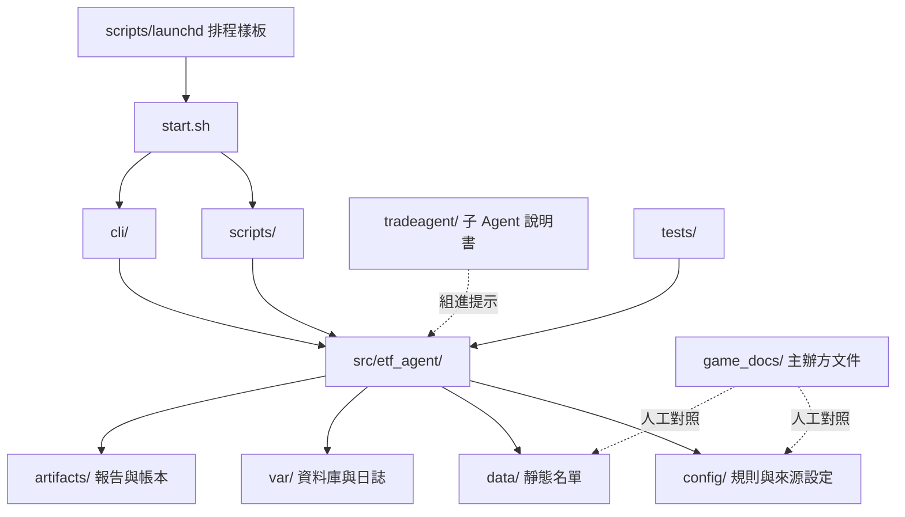
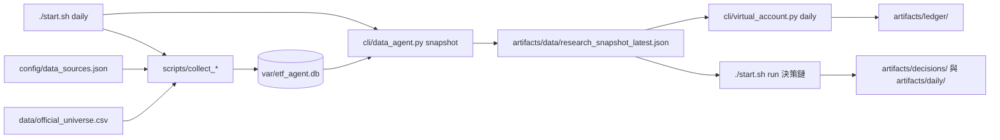

# 專案目錄架構

這份文件告訴你：專案根目錄每個資料夾放什麼、誰會讀誰。每日決策本身（分析團隊、多空研究、交易、風險）請看[每日決策架構](architecture.md)，這裡只談資料夾分工。

## 一句話版本

`start.sh` 啟動腳本與命令列工具，呼叫 `src/etf_agent/` 的核心程式；核心程式讀 `config/` 的規則與 `data/` 的名單，把資料存進 `var/`，把報告與帳本存進 `artifacts/`。`tradeagent/` 是給 AI 子 Agent 的工作說明書。

- 實線是執行時的呼叫或讀寫，虛線是參照。
- `tradeagent/` 的說明書只含工作流程，不含計算；數字都由 `src/` 的程式算。
- `game_docs/` 程式不讀，裡面的名單與規則已經轉成 `config/` 和 `data/`。
- Docker 以唯讀掛載程式與設定，只有 `var/`、`artifacts/` 可寫（見 `compose.yaml`）。

## 頂層資料夾

| 路徑 | 放什麼 | 詳細說明 |
| --- | --- | --- |
| `start.sh` | 日常入口：儀表板、更新資料、每日流程、看狀態 | [根目錄 README](../README.md) |
| `src/etf_agent/` | 核心程式：資料、決策、帳本、報告、儀表板等 17 個套件 | [模組總覽](modules.md) |
| `cli/` | 單步命令列入口，只解析參數、不放邏輯 | [cli/README.md](../cli/README.md) |
| `scripts/` | 維運與補抓腳本，含每日流程與排程樣板 | [scripts/README.md](../scripts/README.md) |
| `config/` | 競賽規則、決策規則、資料來源與核准狀態、隊伍設定 | [config/README.md](../config/README.md) |
| `data/` | 150 檔交易池、主動型 ETF 名單與持股、產業分類 | [data/README.md](../data/README.md) |
| `game_docs/` | 主辦方原始文件，唯讀 | [game_docs/README.md](../game_docs/README.md) |
| `tradeagent/` | 子 Agent 的工作說明書，依分析、研究、交易、風險、報告、資料分組 | [tradeagent/README.md](../tradeagent/README.md) |
| `tests/` | 自動化測試與測試用小資料 | [tests/README.md](../tests/README.md) |
| `docs/` | 本資料夾；`source_audit/` 是資料來源核對證據，程式與設定會引用，不可刪 | [文件索引](README.md) |
| `var/` | 執行時資料：資料庫、日誌、策略反思、主辦方資料包；不進 git | [執行產物](runtime-artifacts.md) |
| `artifacts/` | 執行時產物：最新報告、每日狀態、決策封存、D-Plan、帳本；不進 git | [執行產物](runtime-artifacts.md) |
| `compose.yaml`、`Dockerfile`、`requirements.txt`、`requirements.lock` | 容器與依賴；本機 `.venv` 與 Docker 共用同一份依賴 | [Docker 說明](docker.md) |
| `pytest.ini` | 測試設定 | [tests/README.md](../tests/README.md) |
| `AGENTS.md` | 開發規則：Agent 邊界、證據規則、測試與 commit 格式 | 根目錄 |

## 一次資料更新怎麼流動

白話說明：先抓資料存進資料庫，再用資料庫建出「研究快照」（某個時間點全部可得資料的凍結版本），帳本與決策都以這份快照為準。
