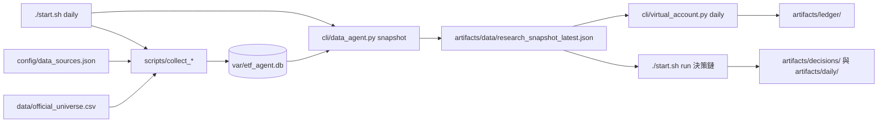

# 專案目錄架構

本文件說明整個 repo 的頂層資料夾如何互相關聯。每日決策鏈本身（分析團隊 → 多空研究 → 交易 → 風險）請看[目前每日決策架構](architecture.md)；本文只談資料夾分工。

## 架構圖

```mermaid
flowchart TD
    START[start.sh] --> SCRIPTS[scripts/]
    START --> CLI[cli/]
    LAUNCHD[scripts/launchd 排程樣板] --> START
    LAUNCHD --> SCRIPTS
    SCRIPTS --> SRC[src/etf_agent/]
    CLI --> SRC
    SRC --> CONFIG[config/ 規則與來源設定]
    SRC --> DATA[data/ 靜態輸入]
    SRC --> VAR[var/ SQLite 與暫存]
    SRC --> ART[artifacts/ 不可變 run 與報告]
    TRADE[tradeagent/ Skill 來源] -. SKILL.md 路徑 .-> SRC
    GAME[game_docs/ 主辦方文件] -. 人工對照 .-> CONFIG
    GAME -. 人工對照 .-> DATA
    TESTS[tests/] --> SRC
    TESTS --> CLI
    DOCS[docs/] -. 說明 .-> SRC
```

- 實線代表執行時的呼叫或讀寫；虛線代表參照關係。
- `tradeagent/` 的 `SKILL.md` 由 `src/etf_agent/automation/` 組進子 Agent 提示；Skill 本身不含計算邏輯。
- `game_docs/` 不被程式讀取，名單與規則已轉成 `config/`、`data/`。
- `docker compose` 以唯讀掛載 `src`、`cli`、`scripts`、`tradeagent`、`tests`、`config`、`data`，並可寫入 `var`、`artifacts`（見 `compose.yaml`）。

## 頂層資料夾

| 路徑 | 一行說明 | 詳細說明 |
| --- | --- | --- |
| `start.sh` | 日常入口：儀表板、`auto`／`daily`／`run`／`status`／`check` | 根目錄 [README](../README.md) |
| `src/etf_agent/` | 核心邏輯：data、perception、research、decision、virtual_account、competition、automation、dashboard 等子套件 | [架構](architecture.md) |
| `cli/` | 單步 CLI 薄包裝，只解析參數並呼叫 `src/` | [cli/README.md](../cli/README.md) |
| `scripts/` | 維運與補抓腳本，含每日流程 `run_daily_pipeline.py` 與 `launchd/` 排程樣板 | [scripts/README.md](../scripts/README.md) |
| `config/` | 競賽與決策規則、策略樣板、資料來源白名單、交易狀態核准、隊伍設定 | [config/README.md](../config/README.md) |
| `data/` | 150 檔交易池、主動型 ETF 名單與持股基準、產業分類 | [data/README.md](../data/README.md) |
| `game_docs/` | 主辦方原始文件（D-Plan 指南與 schema、DataPack 規格、名單、策略說明格式），唯讀 | [game_docs/README.md](../game_docs/README.md) |
| `tradeagent/` | Agent Skill 來源，依 analysis／research／trading／risk／reporting／data 分組 | [tradeagent/README.md](../tradeagent/README.md) |
| `tests/` | `unittest.TestCase` 風格的自動化測試與 fixtures | [tests/README.md](../tests/README.md) |
| `docs/` | 架構、資料來源清單、Docker、計畫與來源稽核文件 | 本資料夾 |
| `var/` | 執行期資料：`etf_agent.db`（SQLite）；被 `.gitignore` 排除 | [runtime-artifacts.md](runtime-artifacts.md) |
| `artifacts/` | 執行產物：`latest/`、`daily/`、`decisions/`、`reports/`、`competition_d_plan/`、`ledger/`、`data/`、`debug/`、`archive/`；被 `.gitignore` 排除 | [runtime-artifacts.md](runtime-artifacts.md) |
| `compose.yaml`、`Dockerfile`、`requirements.txt` | 容器與依賴定義，本機 `.venv` 與 Docker 共用同一份 `requirements.txt` | [Docker 說明](docker.md) |
| `pytest.ini` | pytest 設定（`testpaths`、`pythonpath`） | [tests/README.md](../tests/README.md) |
| `AGENTS.md` | 專案指引：Agent 邊界、時間點與證據規則、測試與 commit 規範 | 根目錄 |

## 一次資料更新的資料流



路徑與命令取自 `start.sh`、`scripts/`、`cli/`。
