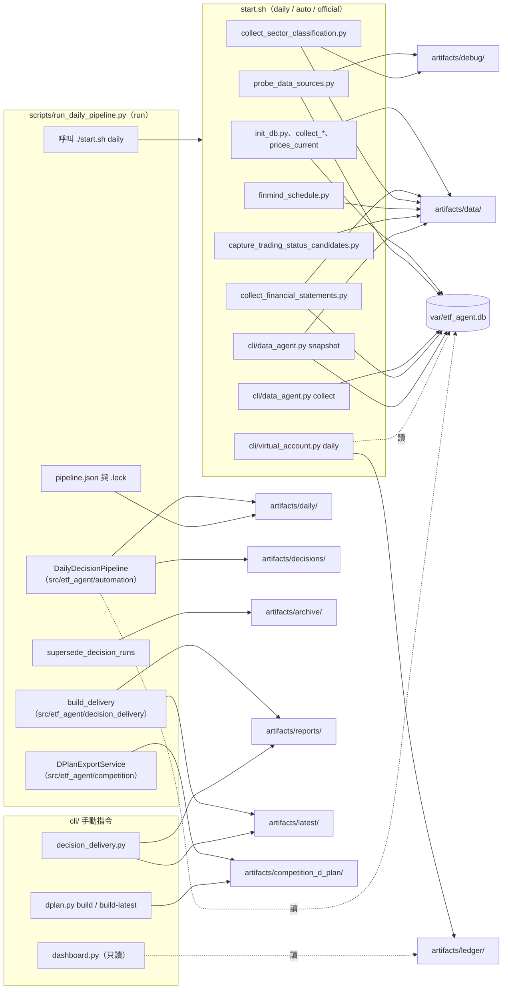

# 執行時資料夾：`artifacts/` 與 `var/`

專案根目錄下 `artifacts/` 與 `var/` 兩個執行時資料夾：誰寫入、放什麼、能不能刪。內容依 `start.sh`、`scripts/`、`cli/`、`src/etf_agent/` 的程式與 2026-10-22 的實際目錄整理。

| 項目 | 說明 |
| --- | --- |
| git | 兩者都不進 git；`.gitignore` 排除 `artifacts/*`（留 `.gitkeep`）、`var/*.db*`、`var/logs/`、`var/*.json`（留 `.gitkeep`） |
| 新環境 | 一開始是空的 |
| 寫入者 | `./start.sh` 與每日管線 `scripts/run_daily_pipeline.py` |
| Docker | `agent` 服務可寫 `./var`、`./artifacts`；`dashboard` 服務只讀 `./artifacts`、`./var`、`./config`、`./data`（基準比較需讀行情資料庫與設定；`compose.yaml`） |
| 內容性質 | 真實執行產物，不是 fixture（測試資料在 `tests/fixtures/`） |
| 建立時機 | 各資料夾在對應步驟第一次成功寫入時建立 |
| 2026-10-22 本機實際存在 | `artifacts/` 的 `daily`、`data`、`debug`、`ledger`；其餘（`latest`、`decisions`、`reports`、`competition_d_plan`、`archive`）的說明來自程式 |

## 1. 流程步驟寫入哪個資料夾



說明：

- 實線是寫入，虛線是只讀。
- `./start.sh run` 直接 `exec` 到 `scripts/run_daily_pipeline.py`，後者再呼叫 `./start.sh daily` 完成資料、Snapshot 與虛擬帳本，接著跑決策鏈、交付與 D-Plan。
- `./start.sh dashboard` 只做 `cli/virtual_account.py ensure-init`（寫 `artifacts/ledger`），然後啟動只讀的儀表板。

## 2. `artifacts/` 逐項說明

「誰寫入」欄位只列實際在程式裡找到的寫入者。「能刪嗎」欄位是依程式行為推論後的建議，刪除前請自行評估。

### 2.1 頂層資料夾

| 路徑 | 用途 | 誰寫入 | 進 git | 能刪嗎／刪了會怎樣 |
| --- | --- | --- | --- | --- |
| `artifacts/.gitkeep` | 讓空資料夾存在於 git | 手動維護 | 是 | 不要刪 |
| `artifacts/latest/` | 最新中文報告捷徑 | `src/etf_agent/decision_delivery/repository.py` 的 `publish()`，由 `build_delivery`／`save_failure` 呼叫（`scripts/run_daily_pipeline.py`、`cli/decision_delivery.py`） | 否 | 可刪，下次交付或 `cli/decision_delivery.py` 重建會再產生；內容由 `reports/` 的封存重建 |
| `artifacts/daily/` | 每日流程狀態與 Agent 中間產物 | `scripts/run_daily_pipeline.py`、`src/etf_agent/automation/daily_pipeline.py` | 否 | 可刪舊日期；刪了無法續跑（`--resume`）與審計當日 Agent 原始輸出；最終決策仍在 `decisions/` |
| `artifacts/decisions/` | 不可變決策封存（含 `decision_input`） | `DailyDecisionPipeline` 透過 `DecisionRepository.save`（`src/etf_agent/decision/service.py`、`finalization.py`） | 否 | 不建議刪。這是 Finalizer、Validator、交付報告、D-Plan 與帳本綁定的重建依據；刪了則該日報告與 D-Plan 無法重建，帳本要結算該決策時也會失敗 |
| `artifacts/reports/` | 決策報告的封存、閱讀副本與日期副本 | `DeliveryRepository`（`src/etf_agent/decision_delivery/repository.py`） | 否 | 不建議刪。`artifacts/latest/` 指向這裡的閱讀副本；刪了需用 `cli/decision_delivery.py build` 從 `decisions/` 重建 |
| `artifacts/competition_d_plan/` | D-Plan v4.3 候選與內部 context | `DPlanExportService.export`（`src/etf_agent/competition/service.py`），入口為 `run_daily_pipeline.py` 或 `cli/dplan.py` | 否 | 若已人工上傳就可刪；同一交易日重跑時，新決策的 D-Plan 直接取代同名主檔（已上傳的檔案不會跟著更新），每版另存於 `versions/<交易日>/`；`contexts/` 以決策 ID 命名，已存在則拒絕覆寫。由 `decisions/` 與 `ledger/` 可重建 |
| `artifacts/ledger/` | 虛擬帳本（雜湊鏈）與帳戶快照 | `src/etf_agent/virtual_account/service.py` 的 `VirtualAccountRepository`，入口 `cli/virtual_account.py`（`start.sh` 呼叫） | 否 | 不要刪。這是帳戶唯一狀態來源，刪了帳戶歷史與績效消失，只能重建新帳戶 |
| `artifacts/data/` | 最新資料快照與資料收集狀態 | `start.sh` 各階段與 `scripts/`（見 2.5） | 否 | 多數可刪，下次收集重建；`trading_status/` 刪了需重新抓才能判定交易日 |
| `artifacts/debug/` | 來源原始抓取與探測報告 | `scripts/probe_data_sources.py`、`scripts/collect_sector_classification.py` | 否 | 可刪。平常不用看，只在稽核來源時用 |
| `artifacts/archive/` | 被取代的決策 | `supersede_decision_runs`（`src/etf_agent/virtual_account/daily.py`，由 `run_daily_pipeline.py` 呼叫）與 `DailyAccountRunner.supersede_unstarted_decision`（交件期限前重建 Snapshot 時） | 否 | 可刪；這些決策已被新決策取代，不再參與帳本 |

### 2.2 `artifacts/latest/` 與 `artifacts/reports/`

| 路徑 | 內容 | 誰寫入 | 備註 |
| --- | --- | --- | --- |
| `latest/latest.md` | 最新中文報告，第一行是 `<!-- delivery_id: ... -->` | `DeliveryRepository.publish` | 只在新交付的 `started_at` 不早於舊的才會覆寫 |
| `latest/latest.json` | 最新交付索引（`delivery_id`、`status`、`report` 閱讀副本路徑） | 同上 | 權威檔，`latest.md` 是捷徑 |
| `latest/.publish.lock` | 發布鎖 | `publication_lock` | 執行時用的鎖，可忽略 |
| `reports/runs/<日期>/delivery-<雜湊>/` | 交付紀錄：`request.json`、`delivery_status.json`、`validation.json`、`rendering.json`、`report.json`（失敗診斷時沒有 `report.json`）、`manifest.json` | `DeliveryRepository.save_delivery`（繼承 `ImmutableRunStore`，dated） | 目錄名稱是內容雜湊，不可改名 |
| `reports/views/<日期>/delivery-<雜湊>/report.md` | 與 `rendering.json` 完全一致的 Markdown 閱讀副本 | `save_delivery` | 與封存不一致時驗證失敗 |
| `reports/dated/<日期>/決策報告_<日期>_<時間>_<決策狀態>.md` | ready 報告的人類易找副本 | `publish_dated_copy` | 失敗診斷報告不產生 |
| `reports/.publish.lock` | 發布鎖 | `publication_lock` | 可忽略 |

### 2.3 `artifacts/daily/` 與 `artifacts/decisions/`

| 路徑 | 內容 | 誰寫入 | 備註 |
| --- | --- | --- | --- |
| `daily/.lock` | 防止兩個每日流程同時跑的檔案鎖 | `scripts/run_daily_pipeline.py` | 實際目錄已存在，可忽略 |
| `daily/<日期>/daily-<YYYYMMDD>-<HHMMSS>/pipeline.json` | 每日執行狀態、決策 run ID、交付結果、D-Plan 結果、阻擋原因；取代又還原時記 `superseded_pending` 與 `rolled_back`；決策跑完已過交件期限且沒有備案時記 `late_decision_archived_to`（舊版第一次 run 沒有時間後綴） | `run_daily_pipeline.py`（`write_json`） | D-Plan 匯出時作為 `daily_run` 輸入；`export_latest` 也掃它 |
| `.../trading_status.json` | 當次交易狀態 bundle 與 assessment | `run_daily_pipeline.py` | 讓重建不依賴舊的 `data/trading_status` 封存 |
| `.../decision_input.json` | 決策輸入 bundle（Snapshot、帳戶快照等） | `DailyDecisionPipeline` | 決策封存也會保存一份 |
| `.../momentum.json`、`fundamental_metrics.json`、`analyst_data_availability.json` | 程式計算的動能、財務指標與資料可用性 | `DailyDecisionPipeline.save_artifact` | 確定性計算結果 |
| `.../brief_<分析師>_b<N>.json` | 給子 Agent 的分批任務簡報（`technical_gate` 時含 `momentum_only_symbols`、`full_history_symbols`） | 同上 | 供審計當日餵給 Agent 的內容 |
| `.../analyst_technical.json` 等 `analyst_<名稱>.json` | 分析師報告 | 同上 | 分析團隊輸出 |
| `.../<task>_raw_<N>.json`（例如 `technical_b0_raw_1.json`） | 子 Agent 原始輸出；`pipeline.json` 的 `agent_calls` 另記每次呼叫耗時、用量，驗證失敗時記 `validation_errors` 與前三項錯誤；CLI 逾時、非零結束或輸出不是 JSON 的失敗嘗試另記一筆（`transient_error`、`transient_retry`，用量記 0、無原始輸出檔），之後間隔 30 秒再試一次 | `DailyDecisionPipeline`（第 276 行附近） | 續跑時以這些檔判定已完成的呼叫 |
| `.../decision_chain.json` | 決策鏈摘要 | 同上 | |
| 另有（視流程走到哪）：`perception_bundle.json`、`perception_result.json`、`policy_base.json`、`policy.json`、`<role>_stance.json`、`research_debate.json`、`trade_decision.json`、`cash_stance.json`、`proposal.json`、`scenario.json`、`guard.json`、`risk_review.json`、`revision_history.json`、`decision.json`、`team_inputs.json`、`trader_report.md`、`review_*_r<N>.json`、`<proposal／scenario／guard／sector_exposure／liquidity_exposure>_review_input_r<N>.json` | 多空研究、交易、風險與修正循環的中間檔 | `DailyDecisionPipeline` | 檔名來自 `save_artifact` 與第 650 行的 `trader_report.md`；目前實際目錄只走到分析師階段，這些檔案尚未出現 |
| `daily/data-launchd.log`、`finmind-news-launchd.log` | `data` 與 `finmind-news` 排程的標準輸出（`daily` 排程已改寫到 `var/logs/launchd.log`，見第 3 節） | `scripts/launchd/*.plist.template` 設定的 `StandardOutPath` | 只有安裝排程後才有；舊的 `daily/launchd.log` 是改版前留下的，可刪 |
| `decisions/<日期>/decision-<UTC時間>Z/` | 一次決策的封存：`decision_input`、`momentum`、`debate`、`intent`、`policy`、`proposal`、`scenario`、`guard`、`risk_review`、`revision_history`、`decision`、`team_inputs` 各一個 `.json`，加 `manifest.json` | `DecisionRepository.save`，必要名單在 `src/etf_agent/decision/service.py` 的 `required` | 雜湊封存，內容不得被修改；`ImmutableRunStore.verify` 會檢查檔案集合與 SHA-256 |

### 2.4 `artifacts/ledger/`、`artifacts/competition_d_plan/`、`artifacts/archive/`

| 路徑 | 內容 | 誰寫入 | 備註 |
| --- | --- | --- | --- |
| `ledger/<account_id>/latest.json` | 指向最新已驗證狀態的 `run_id` 與 `state_sha256` | `VirtualAccountRepository.save` | 預設 `account_id=ai-cup-2026` |
| `ledger/<account_id>/account_snapshot_latest.json` | 決策前帳戶快照，每日決策與 preflight 讀它 | `cli/virtual_account.py daily --account-output`（`start.sh` 傳入） | 可重新產生，但要有帳本 |
| `ledger/<account_id>/rolled_back/prepare-<UTC時間>Z/` | 開盤前重跑沒產生新 D-Plan 而退回的 prepare（`restore_superseded_decision`） | `VirtualAccountRepository.rollback_latest`（`shutil.move`） | 不在帳本鏈上，可刪 |
| `ledger/<account_id>/runs/genesis/` | 初始狀態：`genesis.json`、`state.json`、`manifest.json` | `cli/virtual_account.py ensure-init` | 刪了帳戶就沒有起點 |
| `ledger/<account_id>/runs/prepare-<UTC時間>Z/` | 每日推進後的帳本：`state.json`、`account_snapshot.json`、`snapshot.json`、`corporate_actions.json`、`manifest.json` | `cli/virtual_account.py daily`（run ID 來自 `start.sh` 的 `ACCOUNT_RUN_ID`） | 狀態 `sequence` 必須連續，`parent_state_id` 必須接最新父狀態 |
| `ledger/<account_id>/.write.lock` | 寫入時暫時建立、結束即刪除的鎖 | `VirtualAccountRepository.save` | 若殘留代表上次寫入中斷，確認沒有程式在跑才可刪 |
| `competition_d_plan/D-Plan_<team_id>_<交易日>.json` | D-Plan v4.3 候選，待人工驗證與上傳 | `DPlanExportService.export`；也可由 `cli/dplan.py build` 指定 `--output` | 不自動送件；同交易日重跑直接取代主檔，結果帶 `replaced_existing_output` |
| `competition_d_plan/versions/<交易日>/D-Plan_<team_id>_<交易日>_<台北時間>.json` | 每個決策各一份 D-Plan，時間取自決策 ID（換成台北時間），可對回已上傳的是哪一版 | `DPlanExportService.export`，結果帶 `version_output` | 已存在則拒絕覆寫，不刪舊版 |
| `competition_d_plan/contexts/context_<decision_run_id>.json` | 內部 context（綁定決策與帳本） | 同上 | |
| `archive/superseded_decisions/<日期>/<decision-run-id>/` | 同一份帳戶快照重跑、或交件期限前用新 Snapshot 重跑後被取代的舊決策整個搬到這裡 | `supersede_decision_runs`、`supersede_unstarted_decision`（`shutil.move`） | 只保留不再使用的 run；早上重跑沒產生新 D-Plan 時，被取代的決策會搬回 `decisions/` |

### 2.5 `artifacts/data/` 與 `artifacts/debug/`

| 路徑 | 內容 | 誰寫入 | 能刪嗎／刪了會怎樣 |
| --- | --- | --- | --- |
| `data/research_snapshot_latest.json` | 最新 `ResearchSnapshot` | `start.sh`：`cli/data_agent.py snapshot --output` | 可刪，但每日決策與 preflight 需要它，下次 `start.sh daily` 重建 |
| `data/financial_statements_latest.json` | 官方財報收集報告 | `scripts/collect_financial_statements.py --report` | 可刪，只是報告 |
| `data/sector_classification_latest.json` | 產業分類候選輸出 | `scripts/collect_sector_classification.py --output`（`start.sh` 傳入） | 可刪。正式決策使用的是已核准的 `data/sector_classification.json`，不是這個候選檔 |
| `data/finmind_schedule.json` | FinMind 財報補抓狀態（`backfilled_from`、`last_done`） | `scripts/finmind_schedule.py done` | 可刪；刪了會視為首次補抓，重新消耗 FinMind 額度 |
| `data/official_history/latest.json` | 帳本官方個股價量補抓報告 | `scripts/collect_official_history.py --report`（預設路徑） | 可刪，只是報告；實際行情在 `etf_agent.db` |
| `data/trading_status/<日期>/<UTC時間>Z/` | 八份政府開放 CSV（`TWSE_CALENDAR_OGD.csv`、`*_HALTS_*`、`*_DISPOSAL_*`、`*_ATTENTION_*`、`*_SPECIAL_*` 等）與 `manifest.json` | `scripts/capture_trading_status_candidates.py`、`run_daily_pipeline.py` 的 `capture_trading_sources` | 刪了則虛擬帳本算不出交割日、也無法判定開休市；`--only-if-missing` 與 `ensure_calendar_capture` 會嘗試重抓，但必須在固定 cutoff 之前。八份全部成功才刪舊封存，只留最新一份。臨時休市日（颱風假）推斷紀錄已改放 `var/inferred_closed_days.json`，不在 artifacts 內；`cli/virtual_account.py` 找不到日期表時也會先自動重抓 |
| `data/market_news/market-news-<雜湊>/` | 全市場新聞 RSS 原始回應（`captures.json`）與整理項目，每次 `start.sh daily` 在 cutoff 前抓一次 | `start.sh`：`cli/market_news.py capture` | 可刪舊的；每日決策只取截止前最後一份，刪了當天新聞改用恐懼貪婪指標 |
| `data/decision_input_latest.json`、`data/perception_data_latest.json` | 手動 CLI 的預設路徑（`cli/portfolio_decision.py`、`cli/sentiment_research.py`），每日流程不寫 | 該些 CLI | 目前實際目錄沒有 |
| `debug/source_probe/<日期>/source_probe_<日期>_<時間>.json`、`universe_check_*.json` | 來源可行性探測與交易池核對報告（檔名另有短雜湊形式） | `scripts/probe_data_sources.py`（`write_json_artifact`），同時寫入資料庫 | 可刪；資料庫另存一份 |
| `debug/source_audit/sector_classification/<日期>/<UTC時間>Z/{TWSE,TPEX}_COMPANY_PROFILE.json` | 官方公司基本資料原始回應 | `scripts/collect_sector_classification.py`（`--raw-dir`） | 可刪；只為稽核來源 |

### 2.6 其他 CLI 的預設輸出（每日流程不使用，目前實際目錄沒有）

這些只在手動執行對應 CLI 時才出現在 `artifacts/` 頂層：

| 路徑 | 寫入者 |
| --- | --- |
| `artifacts/research_report.json`、`research_report.md` | `cli/research_report.py` 預設輸出 |
| `artifacts/event_research_validated.json` | `cli/research_report.py` 預設讀取（事件研究驗證結果） |
| `artifacts/market_context_probes/` | `cli/market_context_probe.py` |
| `artifacts/fundamental_repairs/` | `cli/fundamental_repair.py` |
| `artifacts/evaluation/coverage_latest.json`、`suites/<名稱>.json`、`runs/eval-<UTC時間>/`（`manifest.json`、`report.json`、`report.md`、每份考卷每次重跑的 run 目錄與自己的 `decisions/`） | `cli/agent_eval.py` |
| `artifacts/evaluation/replays/<replay_id>/`（不可變 run：`report.json`、每日 `dNN_policy`／`proposal`／`scenario`／`guard`／`decision`／`execution_market`／`close_market`／`execution`／`close`、`manifest.json`）、旁邊的 `<replay_id>.md` 與 `compare-<A>-vs-<B>.json/.md` | `cli/policy_replay.py` |

## 3. `var/` 逐項說明

| 路徑 | 用途 | 誰寫入 | 進 git | 能刪嗎／刪了會怎樣 |
| --- | --- | --- | --- | --- |
| `var/.gitkeep` | 讓空資料夾存在於 git | 手動維護 | 是 | 不要刪 |
| `var/etf_agent.db` | SQLite：行情、公司文件、財報事實、來源原文、快照與時間／版本。目前實際約 1.4 GB。資料表包含 `daily_prices`（append-only 版本表：主鍵含 `fetched_at`，同一檔同日同來源只在內容改變時新增版本，讀取端一律取 cutoff 前最新版本；schema 版本 10 由 `cli/data_agent.py migrate` 或任何 `initialize()` 自動遷移）、`source_documents`、`raw_payloads`、`financial_statements`、`research_snapshots`、`snapshot_documents`、`snapshot_prices`、`finmind_news_candidates`、`market_news_captures`、`collection_runs`、`quality_issues` 等 | `scripts/init_db.py` 建表；`scripts/collect_*.py`、`collect_latest_prices.py`、`collect_official_history.py`、`collect_supplemental_sources.py`、`probe_data_sources.py`、`repair_pending_tpex_close.py`、`cli/data_agent.py`、`cli/news_sentiment.py` 等寫入 | 否 | 不要隨意刪。所有資料版本、來源原文與 `available_at` 都在這裡；刪了 Snapshot 與決策輸入無法依原時間點重建，歷史來源原文也不可能完全重抓還原 |
| `var/etf_agent.db-wal`、`-shm` | SQLite 的寫前日誌（`.gitignore` 已列入）；目前不存在 | SQLite 自動 | 否 | 資料庫使用中不要手動刪 |
| `var/datapack/` | 人工從參賽者後台下載的主辦方資料包（`.gitignore` 已列入）；每日 `run` 依隊伍與交易日自動尋找，對帳副本存入該次 `artifacts/daily/<日期>/<run_id>/datapack.json` | 人工放入 | 否 | 可刪舊檔；當天的不要刪，續跑時會比對同一份 |
| `var/logs/daily-<YYYY-MM-DD>.log` | `run_daily_pipeline.py` 自己的訊息（與終端相同內容），台北日期一天一檔，附加寫入；超過 30 天的舊檔由下一次執行自動刪除（只刪此命名格式） | `scripts/run_daily_pipeline.py`（`open_daily_log`／`prune_daily_logs`） | 否（`.gitignore` 排除 `var/logs/`） | 可刪；不含 `start.sh daily` 子程序的輸出 |
| `var/logs/launchd.log` | `com.etf-agents.daily` 排程整個行程的 stdout／stderr（含子程序輸出與未捕捉例外）；launchd 只追加不輪替 | `scripts/launchd/com.etf-agents.daily.plist.template` 的 `StandardOutPath` | 否 | 只有安裝排程後才有；安裝前先 `mkdir -p var/logs`；變大時可清空 |
| `var/yahoo_industries.json`、`var/current_price_snapshot.json`、`var/current_strategy_proposal.json` | 2026-09-13 的舊版遺留檔；`src/`、`scripts/`、`cli/`、`config/`、`docs/`、`tests/` 沒有引用 | 無 | 否（被 `var/*.json` 忽略） | 沒有程式使用，確認不需要後可刪 |

`var/` 目前只有上述資料庫、三個舊 JSON 與 `logs/` 日誌，沒有其他快取檔。

## 4. 真實目錄樹範例

以下是 2026-10-22 在本機執行 `find artifacts var -maxdepth 3` 的結構（只列結構，已省略檔案內容；`var/` 的 `etf_agent.db` 約 1.4 GB）：

```text
artifacts/
├── .gitkeep
├── daily/
│   ├── .lock
│   └── 2026-10-22/
│       └── daily-20261022/          # pipeline.json、brief_*.json、analyst_*.json、*_raw_*.json 等
├── data/
│   ├── research_snapshot_latest.json
│   ├── financial_statements_latest.json
│   ├── sector_classification_latest.json
│   ├── finmind_schedule.json
│   ├── official_history/
│   │   └── latest.json
│   └── trading_status/
│       └── 2026-10-22/
│           └── 20261022T095715219841Z/   # 八份 *_OGD.csv 與 manifest.json
├── debug/
│   ├── source_audit/
│   │   └── sector_classification/
│   │       └── 2026-10-22/
│   │           └── 20261022T0949...Z/    # TWSE_COMPANY_PROFILE.json、TPEX_COMPANY_PROFILE.json
│   └── source_probe/
│       └── 2026-10-22/                   # source_probe_*.json、universe_check_*.json
└── ledger/
    └── ai-cup-2026/
        ├── latest.json
        ├── account_snapshot_latest.json
        └── runs/
            ├── genesis/                  # genesis.json、state.json、manifest.json
            └── prepare-20261022T095839Z/ # state.json、account_snapshot.json、snapshot.json、
                                          # corporate_actions.json、manifest.json
var/
├── .gitkeep
├── etf_agent.db
├── yahoo_industries.json
├── current_price_snapshot.json
└── current_strategy_proposal.json
```

程式完整跑完一次決策後，預期還會多出下列結構（來自程式，非目前實際內容）：

```text
artifacts/
├── latest/                  # latest.md、latest.json
├── decisions/<日期>/decision-<UTC時間>Z/     # 12 個 artifact .json 加 manifest.json
├── reports/
│   ├── runs/<日期>/delivery-<雜湊>/
│   ├── views/<日期>/delivery-<雜湊>/report.md
│   └── dated/<日期>/決策報告_*.md
├── competition_d_plan/
│   ├── D-Plan_<team_id>_<交易日>.json
│   └── contexts/context_<decision_run_id>.json
└── archive/superseded_decisions/<日期>/<decision-run-id>/
```

## 5. 保存規則與歷史名稱

### 5.1 依日期分資料夾

| 項目 | 規則 |
| --- | --- |
| 日期資料夾 | `daily`、`decisions`、`reports`（`runs`／`views`／`dated`）、`debug/source_audit/sector_classification`、`debug/source_probe` 皆為 `<資料夾>/YYYY-MM-DD/<名稱>`（台北日期） |
| 日期的角色 | 只是排列方式；run ID、manifest 與雜湊不含日期 |
| 重複 run ID | 同一個 run ID 出現在兩個日期資料夾時被拒絕 |
| 不分日期 | `ledger/`（雜湊鏈）與 `archive/`（手動整理） |

### 5.2 FinMind 財報候選

- FinMind 財報是候選資料，不進正式 Snapshot。
- 首次補 `FINMIND_YEARS` 年歷史（預設 3，可設 2～5）。
- 之後只在財報公布區間每天更新一次：約 2/15–4/10、4/20–5/25、7/20–8/24、10/20–11/24；區間外略過。
- 狀態記在 `artifacts/data/finmind_schedule.json`；`FORCE_FETCH=1` 可強制更新。
- 補抓的歷史財報以抓取時間為 `available_at`，不回填到過去的決策。

### 5.3 交易狀態封存（`artifacts/data/trading_status/`）

- 內容：政府開放 CSV 八份（開休市日期表、注意、處置、暫停交易、特殊標的）。
- 每次八份全部抓成功才刪除舊封存，只留最新一份。
- 有任何一份失敗，保留舊封存當後備。
- 每日決策把當次交易狀態寫進 `artifacts/daily/<日期>/<run_id>/trading_status.json`，重建不依賴舊封存。

### 5.4 舊名稱

2026-10-22 起頂層資料夾使用本文件的名稱。

| 舊名稱 | 現況 |
| --- | --- |
| `daily_runs`、`decision_runs`、`decision_reports`、`latest_reports`、`virtual_accounts` | 已清除，無相容連結 |
| `source_audit`、`source_probe_reports`、`official_history` | 已清除，無相容連結 |
| 頂層 `*_latest.json` | 已清除，無相容連結 |

舊名稱的資料夾不要搬回來。

## 6. 我想找 X 該看哪裡

| 我想找 | 看哪裡 |
| --- | --- |
| 今天最新的中文決策報告 | `artifacts/latest/latest.md`（人類易讀的日期副本在 `artifacts/reports/dated/<日期>/`） |
| 今天流程成功還是失敗、為什麼 | `artifacts/daily/<日期>/daily-<YYYYMMDD>-<HHMMSS>/pipeline.json`；失敗時也看 `artifacts/latest/latest.md` 的失敗診斷 |
| 每日流程當天的訊息 | `var/logs/daily-<YYYY-MM-DD>.log`（台北日期一天一檔，保留 30 天） |
| 排程（launchd）的輸出錯誤 | `daily` 排程：`var/logs/launchd.log`；`data`、`finmind-news` 排程：`artifacts/daily/data-launchd.log`、`finmind-news-launchd.log`（安裝排程後才有） |
| 某個子 Agent 當時回了什麼原文 | `artifacts/daily/<日期>/<run>/<task>_raw_<N>.json`，餵給它的內容在 `brief_*.json` |
| 分析師（技術／基本面／事件）的報告 | `artifacts/daily/<日期>/<run>/analyst_<名稱>.json` |
| 最終決策、委託與風控修正紀錄 | `artifacts/decisions/<日期>/decision-<UTC時間>Z/decision.json`、`proposal.json`、`risk_review.json`、`revision_history.json` |
| 某次決策用了哪份 Snapshot 與帳戶快照 | 同一決策資料夾的 `decision_input.json` |
| 某次決策被取代後去哪了 | `artifacts/archive/superseded_decisions/<日期>/` |
| 要上傳競賽的 D-Plan 候選 | `artifacts/competition_d_plan/D-Plan_<team_id>_<交易日>.json`（context 在 `contexts/`） |
| D-Plan 為什麼沒產生 | `pipeline.json` 的 `dplan` 欄位 |
| 目前帳戶現金、持股、績效 | `artifacts/ledger/<account_id>/runs/<最新>/state.json`（`latest.json` 指向最新 run）；或 `./start.sh` 啟動儀表板 |
| 決策前帳戶快照 | `artifacts/ledger/<account_id>/account_snapshot_latest.json` |
| 最新研究 Snapshot | `artifacts/data/research_snapshot_latest.json` |
| 官方開休市日期表與注意／處置股 CSV | `artifacts/data/trading_status/<日期>/<UTC時間>Z/` |
| 財報／產業分類／官方歷史補抓是否成功 | `artifacts/data/financial_statements_latest.json`、`sector_classification_latest.json`、`official_history/latest.json` |
| FinMind 財報補抓進度 | `artifacts/data/finmind_schedule.json` |
| 官方公司基本資料原始回應 | `artifacts/debug/source_audit/sector_classification/<日期>/<UTC時間>Z/` |
| 資料來源探測、交易池核對結果 | `artifacts/debug/source_probe/<日期>/` |
| 行情、月營收、重大訊息、財報、來源原文與時間版本 | `var/etf_agent.db`（用 `./start.sh status` 或 `scripts/data_status.py` 看狀態） |
| 這份文件之外，來源核對與核准證據 | `docs/source_audit/`（進 git，不是執行產物，不可刪） |
| 交易池與核准的產業分類 | `data/official_universe.csv`、`data/sector_classification.json`（進 git，不是執行產物） |
