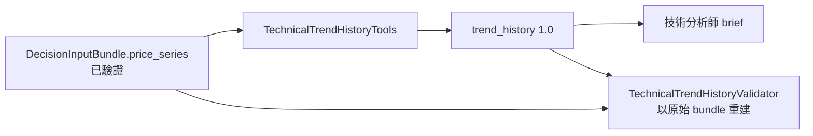

# 技術分析的整段歷史輸入

## 用途與範圍

`build_analyst_brief(..., "technical")` 提供整段封存行情，讓技術分析師沿時間判讀價格與均線結構。

- 只輸出「上升／下跌／盤整」的市場狀態解讀，不執行買賣、排名或配置。
- 以當期 `momentum` 核對目前位置。
- 只有技術分析師收到 `trend_history`；其他三位分析師不會。
- 既有 MomentumResult、AnalystReport 契約與舊封存均不變。

## 運作方式

- 由程式直接建立，不經模型補值。
- Validator 重建全部內容；重簽 hash 後的改值、改日期、股票錯配、少列資料仍不通過。
- cutoff 後行情、缺時區、原始序列 hash 不一致，由 DecisionContext 拒絕。

## 契約與規則

### `trend_history` 欄位

| 欄位 | 意義 |
| --- | --- |
| `schema_version` | 歷史輸入版本 `1.0` |
| `symbol`、`snapshot_id`、`decision_cutoff`、`bundle_hash` | 股票、快照、含時區截止時間、輸入版本 |
| `source_series_sha256`、`evidence_ids` | 原始行情序列雜湊與已驗證來源證據 |
| `start_date`、`end_date`、`observation_count` | 視窗首末日期與筆數 |
| `rows` | 全部已提供的觀測，不截斷、不選樣 |
| `rows[].trade_date`、`available_at` | 行情日期與當時可得時間 |
| `rows[].close`、`high`、`low`、`volume` | 來源價格與成交量 |
| `rows[].ma20`、`ma60` | 只用該日及之前的觀測計算，六位小數；暖機不足為 `null` |
| `content_sha256` | 整份輸入的 canonical hash |

### 「完整」的定義

- 指 bundle 收錄的整段視窗，不是股票全部上市歷史。
- 均線以已收錄的觀測數計算，不合成缺漏交易日。
- 價格沿用 DecisionInputBuilder 選定的分析價格版本，不混入未調整價格。
- 歷史 `available_at` 若來自重建，須揭露重建限制。

### 模型分工

| 模型負責 | 模型不做 |
| --- | --- |
| 沿時間解讀主趨勢、回檔或反彈是否破壞結構 | 自行產生均線斜率、持續天數、報酬率等數字 |
| 主要尺度無方向時判為盤整；資料不足標 `unknown` | 強制保持昨日標籤 |

- 單日動能或一次穿越均線，不能取代歷史判讀。
- 歷史路徑是事實；趨勢分類與延續性是推論，不保證未來方向或績效。

## 使用方式

- 每日流程使用正式 builder，自動帶入 `trend_history`。
- 驗證：`TechnicalTrendHistoryValidator` 以原始 bundle 重算。
- 測試涵蓋：逐日均線暖機與邊界、完整行情覆蓋與短視窗、技術獨有輸入、重簽 hash 竄改、股票錯配、cutoff 後資料與缺時區、來源版本衝突。
- 歷史模型試跑封存於 `artifacts/archive/experiments/technical_prompt_trials/full-path-20261002/`，與先前「當日摘要版」分開。

## 限制與注意事項

- 加入歷史輸入不代表分類有客觀真值。
- 模型試跑只執行技術分析，不含後續交易與風險 Agent。

## 尚未實作

### 摘要版 `1.1-summary`（研究試驗，未接入）

`TechnicalTrendHistoryTools.summary_for_symbol()` 從完整、同 Snapshot 的 `1.0` 歷史重建：

- 固定 12 個錨點、收盤極值、最大量、最後 5 筆；去重後依日期排序。
- `observation_count` 仍為完整歷史筆數，`rows` 只是抽樣。
- `TechnicalTrendHistoryValidator.validate_summary` 可從原始行情重算。
- 同一 Snapshot 的 150 檔中有 12 檔方向因摘要而改變，待審查證據後再決定是否接入。
- 正式每日 brief 仍用 `for_symbol()` 的完整序列。
