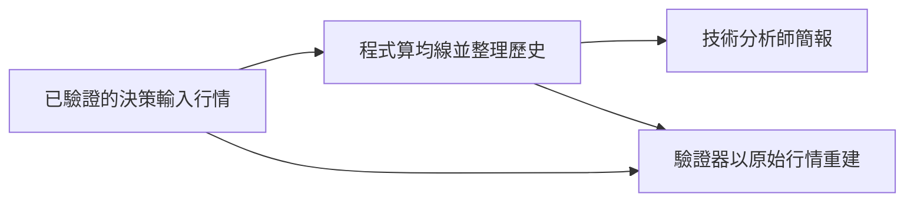

# 技術分析的歷史輸入

## 這是什麼

技術分析師要判斷每檔股票目前是「上升、下跌還是盤整」。為了讓它看到價格怎麼走到現在，程式會替每檔股票準備一份歷史行情與均線，放進它的任務簡報。

- 只有技術分析師收到；其他分析師不會。
- 分析師只輸出趨勢判斷，不買賣、不排名、不配置。
- 均線等數字全由程式計算，模型不自己算。
- 程式在 `src/etf_agent/decision/trend_history.py`。

## 一天怎麼跑

- 驗證器從原始行情重建全部內容。即使有人改值後重算雜湊、改日期、搞錯股票或少列資料，都會被拒絕。
- 截止後的行情、缺時區、原始序列雜湊不一致，在建立決策脈絡時就被拒絕。

## 歷史輸入長什麼樣

| 欄位 | 意義 |
| --- | --- |
| 股票、快照、決策截止時間、輸入版本雜湊 | 對應哪檔、哪份資料 |
| 起訖日期、筆數 | 視窗範圍（是輸入收錄的整段視窗，不是上市以來全部歷史） |
| 每日列 | 日期、當時可得時間、收盤、最高、最低、成交量、20 日與 60 日均線 |
| 證據編號、內容雜湊 | 可追溯到來源，可重算 |

- 均線只用該日與之前的資料，六位小數；資料不足以算均線時為空。不合成缺漏的交易日。
- 價格沿用決策輸入選定的分析價格版本，不混入未調整價格。
- 歷史的可得時間若來自重建，必須揭露限制。

## 兩種版本

| 版本 | 內容 | 現況 |
| --- | --- | --- |
| 完整版（1.0） | 全部觀測逐日列出，不截斷 | 驗證器完整支援，是摘要版的重建基礎；每日技術分析師簡報目前不直接使用 |
| 摘要版（1.1-summary） | 固定 12 個錨點、收盤最高與最低、最大量、最後 5 筆；去重後依日期排序。筆數仍是完整歷史筆數，只有列是抽樣 | 目前每日技術分析師簡報實際使用 |

- 摘要版可由驗證器從原始行情重算。
- 摘要版是為了縮短簡報；改用摘要後，同一 Snapshot 的 150 檔中曾有 12 檔方向改變（試驗證據封存在 `artifacts/archive/experiments/technical_prompt_trials/`）。
- 技術閘門（`technical_gate`）啟用時，趨勢一致的股票只附動能欄位、不附歷史；其餘附歷史。

## 模型與程式的分工

| 模型負責 | 模型不做 |
| --- | --- |
| 沿時間解讀主趨勢；回檔或反彈是否破壞結構 | 自己產生均線斜率、持續天數、報酬率等數字 |
| 主要尺度沒方向就判盤整；資料不足標「不明」 | 為了一致而硬沿用昨天的標籤 |

- 單日動能或一次穿越均線，不能取代歷史判讀。
- 價格路徑是事實；趨勢分類與延續性是推論，不保證未來方向。加入歷史輸入也不代表分類有客觀真值。

## 測試涵蓋

逐日均線暖機與邊界、完整行情覆蓋與短視窗、技術獨有輸入、改值重簽雜湊、股票錯配、截止後資料與缺時區、來源版本衝突（`tests/research/test_technical_trend_history.py`）。

## 附錄：名稱對照

| 白話說明 | 程式名稱 |
| --- | --- |
| 歷史輸入工具 | `TechnicalTrendHistoryTools`（完整版 `for_symbol`、摘要版 `summary_for_symbol`） |
| 驗證器 | `TechnicalTrendHistoryValidator`（摘要版用 `validate_summary`） |
| 欄位名稱 | 簡報中的 `trend_history` |
| 技術閘門 | `technical_gate` |
