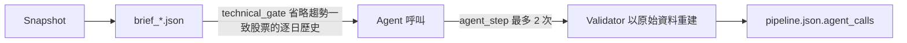

# Token 用量控制

## 用途與範圍

縮小每日決策鏈餵給 Agent 的重複輸入、減少無效重試，**不改變**驗證規則、研究覆蓋與證據可追溯性。

- 原則：確定性歸程式，不確定性歸 LLM；縮減必須先過品質關卡，位元組降幅不是驗收標準。
- 適用：`scripts/run_daily_pipeline.py` 的分析師、多空、交易與現金姿態呼叫。
- 不適用：Validator 與 Guard 的重建驗證（一律用原始資料）。

## 運作方式



- 程式先算出能確定的結論，LLM 只處理例外；Agent 只看 brief，Validator 不看。
- 量測單位是 `brief_*.json` 的 UTF-8 bytes，**不是 token**。

## 措施現況

| 措施 | 狀態 | 說明 |
| --- | --- | --- |
| 技術面閘門 | 已實作，預設開啟 | 見下節 |
| 分級模型 | 已實作 | Claude CLI 分析師與多頭／空頭預設 `sonnet`，交易、現金姿態與風險審查自 2026-10-24 起預設 `opus`（多空用 opus 實跑約 7.3 美元、sonnet 約 2.9）。2026-10-24 分析師改用 `opus` 實跑一次：事件批次 event_b3 兩次都漏分級重大訊息而失敗，單批用量約 2.1 美元（sonnet 約 1.1），因此維持 `sonnet` |
| 交易 brief 去重 | 已接入 | 完整帳戶持倉改為持股代號與檔數，各批少 3,176 bytes；逐股 `held_shares`、雙方 claims 與引用完整保留 |
| 減少無效重試 | 部分 | 單股硬上限減碼改由程式處理；`liquidity_fill_rate` 為 1 |
| 關閉 MCP 外掛 | 已實作 | Claude CLI 加 `--strict-mcp-config`，不載入使用者的 MCP 工具；實測一句 `ok` 的固定開銷由約 50,000 降到約 9,700 cache 建立 token |
| brief 精簡格式 | 已實作 | `save_brief` 不縮排、`symbols` 每檔一行，仍是合法 JSON；多頭第一批由 138,854 降到 79,040 字元 |
| 事件分析師略過無事件股票 | 已實作 | 查詢視窗內無重大訊息者，Validator 本就強制 `unknown`，改由程式輸出（`no_event_item`），不送 Agent；以 10/22 資料算 35／150 檔 |
| 用量量測 | 部分 | bytes 可量；OpenCode 已記 token；Codex／Claude 未量得 |

## 旗標與參數

| 項目 | 預設 | 行為 |
| --- | --- | --- |
| `--technical-gate` / `--no-technical-gate` | 開啟 | 關閉後所有股票附完整歷史 |
| `--analyst-model` | Claude CLI 為 `sonnet` | 只用於技術／基本面／事件分析師批次；`inherit` 沿用 `--model`；Codex／OpenCode 未指定時沿用 `--model` |
| `--model` | 所選 CLI 設定 | 多空、交易、現金姿態使用 |
| `agent_step` 嘗試次數 | 2 | 每個任務最多 2 次 |
| `max_revisions` | 3 | 風險修正上限，`allocation.py` 驗證此值，不放寬 |

`pipeline.json.agent_calls` 記錄每次呼叫實際使用的模型。

## 技術面閘門

- 程式只決定每檔附完整歷史或只附 `momentum`；LLM 仍對全部交易池給 `outlook`，契約與 Validator 不變。
- 規則版本 `TECHNICAL_GATE_VERSION = "1.0"`，只用 `momentum` 已算好的欄位，不重算指標。
- 只附 momentum 的條件：`momentum` 狀態為 available，且收盤同時在 MA20 與 MA60 之上、5／20／60 日報酬皆為正；或同時在兩條均線之下、三段報酬皆為負。
- 資料不足、訊號衝突、欄位缺漏一律附完整歷史。
- brief 內 `technical_gate` 記錄 `version`、`rule`；分批 brief 另列該批 `momentum_only_symbols` 與 `full_history_symbols`。
- 規則是程式常數，不在 Policy 雜湊內；若改為程式直接決定 outlook，須進 Policy 並由 Validator 重算。

### 品質對照（2026-10-20，同 Snapshot 與 cutoff，150 檔）

| 分組 | 檔數 | outlook 改變 |
| --- | --- | --- |
| 被省略歷史 | 84 | 7（8.3%） |
| 兩輪都附完整歷史 | 66 | 16（24%） |
| 全部 | 150 | 23 |

- 結論：未見閘門差異大於模型自身重跑變異；**不是品質已證實**。
- 限制：僅一天一次重跑；66 檔本來就是訊號衝突者；兩輪間程式有調整。
- 若省略歷史股票的改變比例持續高於重跑變異，改用 `--no-technical-gate`。
- 離線輸入大小：技術 brief 約 3.57 MB 降至約 1.61 MB（bytes，非 token）。

## 如何量測

```bash
.venv/bin/python scripts/measure_daily_briefs.py artifacts/<run_dir> [--output 結果.json]
```

- 輸出每份 brief 的 `input_bytes`、`symbol_count`、`saved_attempts`、`total_input_bytes`；`actual_tokens` 固定為 `null`。
- 只讀、不修改 run。續跑的 `agent_calls` 只列當次新呼叫，不能當整輪費用。
- OpenCode runner 對新呼叫記錄 `step_finish.tokens`（`input_tokens`、`cached_input_tokens`、`output_tokens`、`reasoning_output_tokens`）。
- 不從 `estimated_usage_usd=0`（Codex）推算 token 或成本，也不回填舊 run。

### brief 大小基準（bytes，三批）

| Brief | 2026-10-19 Codex（全部完整歷史） | 2026-10-20 Claude（開閘門） |
| --- | --- | --- |
| 技術 | 約 1.92／1.89／1.92 MB | 約 0.76／1.03／0.79 MB |
| 事件 | 462,976／696,313／346,167 | 468,556／747,643／354,949 |
| 基本面 | 85,315～96,391 | 92,426／96,391／85,315 |
| 多頭、空頭（各） | 128,012～156,866 | 144,477～167,996 |
| 交易 | 106,325～113,524 | 105,815～117,267 |

事件 brief 不能先篩掉非 high 事件，因為重大性要由事件分析師判斷。

## 品質關卡

任何新縮減方案須依序通過：

1. 雙側基準：相同 Snapshot、cutoff、Policy 與執行器；完整版也獨立重跑至少一次，比較原版內部變異。
2. 逐階段 A/B，不一次全縮；統計初始輸入、追加讀取、重試與輸出 token、延遲與 bytes。試驗另存，不寫入既有 Decision run。
3. 全部股票／事件與 evidence ID 全量覆蓋；來源授權與 `available_at` 合法；Validator 通過；不新增 `unknown`。
4. 每個 outlook 與 high／medium 變動逐條核對；無法證明是可接受的判斷差異就維持完整輸入。

### 已試驗但未接入

| 方案 | 輸入降幅 | 品質結果 | 結論 |
| --- | --- | --- | --- |
| 技術 brief 摘要（12 錨點、極值、近 5 筆） | 約 81% bytes | 150 檔 Validator 全過，但 12 檔 outlook 改變，兩次試跑彼此有 8 檔不同 | 不接入 |
| 事件 body 首尾摘錄 | 約 17% bytes | 447 則 Validator 全過，但 21 則 materiality 改變（含 10 則 high／medium 互換） | 不接入 |

評估腳本：`scripts/evaluate_technical_brief.py`、`scripts/evaluate_event_brief.py`。

## 限制與注意事項

- 摘要只給 Agent 看，不能取代可重算的原始序列；有資料的股票不得因輸入變小被標成 `unknown`。
- 不把 bytes 換算成確定 token，也不把 API 快取定價套到訂閱 CLI。
- Prompt cache 只減少重複前綴的成本與延遲，不縮小上下文，也不保證跨獨立 CLI 工作階段命中。
- 股數、現金與權重由 Python 與 Guard 負責；情境無法符合硬規則時仍 fail-closed。
- 修改 Agent 輸入契約時，同步更新 `docs/architecture.md` 與相關 Skill 的 `references/`。

## 尚未實作

| 項目 | 狀態 | 說明 |
| --- | --- | --- |
| Codex 用量擷取 | 未實作 | 評估 `codex exec --json` 的 `turn.completed.usage`；成功與失敗／重試分開記錄 |
| 預算式提早警示 | 未實作 | 送交易 Agent 前，用程式預算會使 Guard 失敗的狀況（如持股數貼近上限） |
| 增量執行 | 研究項目，不接入 | 以每檔輸入雜湊沿用前一日已驗證分析；須標明來源 run 與 cutoff，雜湊不同一律重跑；風險最高 |
| 欄位表式編碼 | 未開始 | 欄位表加逐行資料，可逆 `encode → decode` 驗證，先在技術 brief 試；避免單行過長被 CLI Read 截斷 |
| 連續視窗與事件 parent 檢索 | 未開始 | 技術資料連續時間窗，衝突時整檔回退完整序列；事件按 ID 回讀同 Snapshot 原文；SQLite FTS5 僅輔助定位，不得篩掉需分級事件 |
| 外部套件（rank-bm25、LangChain、LlamaIndex） | 不採用 | 專案規則不直接引入；無已驗證可省 token 又維持品質的現成套件 |
