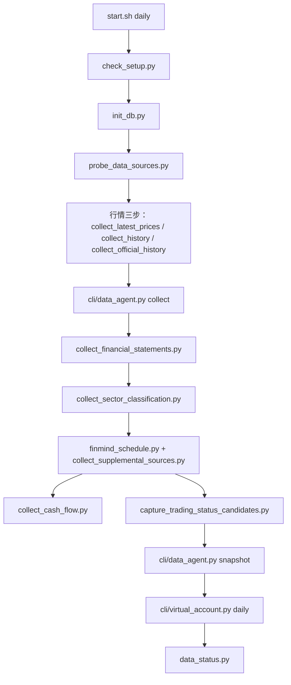
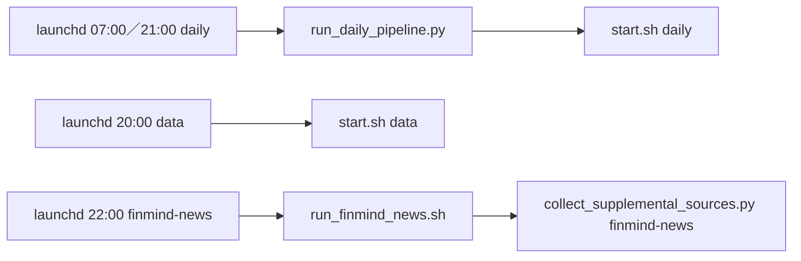

# scripts/：維運與補抓腳本

維運與補抓腳本：解析參數、呼叫 `src/etf_agent/` 的核心邏輯並輸出結果，不複製資料邏輯。

- 日常請用根目錄 `./start.sh`。
- 「被誰呼叫」欄說明哪些腳本自動執行，「何時需手動執行」欄說明人工使用時機。

## 檔案清單

| 腳本 | 用途 | 被誰呼叫 | 何時需手動執行 |
| --- | --- | --- | --- |
| `run_daily_pipeline.py` | 每日一鍵：預檢 → 資料 → 分析／多空／交易／風險子 Agent → 封存 Decision run → 中文交付與通知（macOS 通知）。不下單、不送件 | `./start.sh run`；`launchd/com.etf-agents.daily.plist.template` 直接呼叫。資料階段內部再呼叫 `./start.sh daily` | 一般透過 `./start.sh run`；參數見根目錄 README |
| `check_setup.py` | 檢查規則檔、150 檔交易池、主動型 ETF 名單與持股基準是否載入 | `docker compose run --rm agent`（`compose.yaml` 與 `Dockerfile` 的預設指令），`start.sh` 於非儀表板、非 `run`／`status` 的模式（第 2 步「檢查專案設定」）會跑 | 想單獨確認環境時 |
| `init_db.py` | 初始化 SQLite 資料庫 `var/etf_agent.db` | `start.sh`（資料流程第 3 步） | 一般不用 |
| `collect_latest_prices.py` | 抓 TWSE／TPEx 官方最新價 | `start.sh`（官方最新價步驟） | 行情補抓時 |
| `collect_history.py` | 以 yfinance 增量更新兩年 TWSE／TPEx 日線 | `start.sh`（Yahoo 日線步驟） | 行情補抓時 |
| `collect_official_history.py` | 以官方個股月行情補帳本需要的價量並輸出覆蓋報告 | `start.sh`（`daily` 且官方個股價量尚未定案時） | 帳本缺官方價量時 |
| `prices_current.py` | 判斷資料庫是否已有收盤後定案的完整行情；exit 0 表示可略過該行情步驟，1 表示需抓 | `start.sh` 的 `prices_current` 函式 | 不需要 |
| `collect_twse.py` | 開發模式：只抓 TWSE 最新行情；`--all-listed` 忽略交易池 | `start.sh`（交易池為空時的開發模式） | 一般不用 |
| `collect_financial_statements.py` | 收集官方財報彙總並輸出固定分母覆蓋報告 | `start.sh`（`auto`／`daily`） | 補特定季度時用 `--fiscal-year`／`--fiscal-quarter` |
| `collect_sector_classification.py` | 抓 TWSE／TPEx 官方公司基本資料並建立 150 檔產業代碼分類 | `start.sh`（輸出到 `artifacts/data/`，不覆蓋 `data/sector_classification.json`） | 要更新正式分類檔時，省略 `--output` 會寫入 `data/` |
| `collect_supplemental_sources.py` | 擷取 FinMind 財報或個股新聞候選資料（需 `FINMIND_TOKEN`） | `start.sh`（財報）、`run_finmind_news.sh`（新聞） | 一般不用 |
| `collect_cash_flow.py` | 把已擷取的 FinMind 現金流量表以官方累計稅前淨利核對後轉成快照文件；不連網，部分股票核對不過回傳 2 | `start.sh`（FinMind 之後） | 一般不用 |
| `finmind_schedule.py` | 決定 FinMind 財報資料集今天要不要抓（`plan`），並記錄完成狀態（`done`） | `start.sh` | 不需要；`FORCE_FETCH=1` 可強制 |
| `run_finmind_news.sh` | 讀取 `FINMIND_TOKEN`（環境變數或 `.env`）後擷取當日個股新聞候選 | `launchd/com.etf-agents.finmind-news.plist.template` | 補抓某日新聞：`scripts/run_finmind_news.sh YYYY-MM-DD` |
| `probe_data_sources.py` | 探測白名單官方來源並驗證 150 檔交易池 | `start.sh`（`daily` 流程） | 懷疑來源改版時 |
| `capture_trading_status_candidates.py` | 封存八份政府開放交易狀態候選 CSV（含開休市日期表）的時間版本 | `start.sh`（`daily`，`--only-if-missing`） | 要重新封存時 |
| `normalize_trading_status_candidates.py` | 從封存的八份 CSV 建立 150 檔候選事實報告；不核准來源 | 無（`grep` 未發現呼叫者） | 來源稽核時手動 |
| `verify_ogd_crosscheck.py` | 驗證已封存的政府開放 CSV／官方 JSON 對照；不改正式來源設定 | 無（`grep` 未發現呼叫者） | 來源稽核時手動 |
| `repair_pending_tpex_close.py` | 補齊待結算決策成交日的 TPEx 官方原始價量；不改帳本 | 無（README 的疑難排解指示手動執行） | 帳本顯示缺歷史上櫃價量時 |
| `data_status.py` | 顯示行情、文件與驗證狀態 | `./start.sh status`；`start.sh` 結尾 | 隨時（不需 Docker） |
| `evaluate_event_brief.py` | 固定封存輸入，另存事件分析師精簡摘要的試跑；不建立 Decision run | 無 | 精簡 brief 的對照實驗（相關背景可參考 `docs/token_reduction_plan.md`） |
| `evaluate_technical_brief.py` | 同上，針對技術分析師 | 無 | 同上 |
| `measure_daily_briefs.py` | 只讀量測每日 run 的 Agent brief 與已封存呼叫（bytes，不當 token） | 無 | 同上 |

## 資料收集順序（`./start.sh daily` 為例）

- `./start.sh auto`（別名 `data`）走同一條，略過來源探測、日曆、Snapshot 與帳本。
- 行情三步各自先用 `prices_current.py` 判斷是否已定案，已定案則略過。
- `FORCE_FETCH=1` 強制重抓。
- 順序依 `start.sh` 內容整理，細節以 `start.sh` 為準。

## launchd/

macOS `launchd` 排程樣板（`.plist.template`）。

- 啟用：把 `__PROJECT_ROOT__`、`__HOME__` 換成實際路徑，複製到 `~/Library/LaunchAgents/` 後 `launchctl load`。
- 日誌：`data`、`finmind-news` 寫到 `artifacts/daily/`；`daily` 的 stdout／stderr 寫到 `var/logs/launchd.log`（安裝前先 `mkdir -p var/logs`），`run_daily_pipeline.py` 自己的訊息另存 `var/logs/daily-<YYYY-MM-DD>.log`（台北日期一天一檔，保留 30 天）。
- 樣板設定週一到週五執行。

| 樣板 | Label | 時間（Asia/Taipei） | 執行內容 | 備註 |
| --- | --- | --- | --- | --- |
| `com.etf-agents.data.plist.template` | `com.etf-agents.data` | 平日 20:00 | `start.sh data`（即 `auto`，只更新資料） | 不呼叫決策 Agent |
| `com.etf-agents.finmind-news.plist.template` | `com.etf-agents.finmind-news` | 平日 22:00 | `scripts/run_finmind_news.sh` | 避開 20:00 財報請求額度；需 `FINMIND_TOKEN` |
| `com.etf-agents.daily.plist.template` | `com.etf-agents.daily` | 平日 07:00、21:00 | `.venv/bin/python scripts/run_daily_pipeline.py` | 21:00 做隔天時段的備案決策（須先下載主辦方約 19:00 產生的 DataPack 到 `var/datapack/`）；07:00 在 08:55 交件期限前用新的事件、新聞與情緒資料重做（日線不重抓），帳本把同時段未執行的舊決策移到封存區；重做沒產生新 D-Plan（失敗或被擋）時自動還原帳本、舊決策與 Snapshot，晚上的備案 D-Plan 仍可上傳；決策跑完已過 08:55 時不產生 D-Plan，該 run 不能 `--resume`，要重做改用 `--force`。需 Docker Desktop 已啟動、Claude CLI 已登入、Mac 未休眠；週末、休市日或同一時段 1 小時內已完成由腳本略過（例如 06:30 手動跑完，07:00 不再跑；半夜手動跑的不算，07:00 照常重做） |

