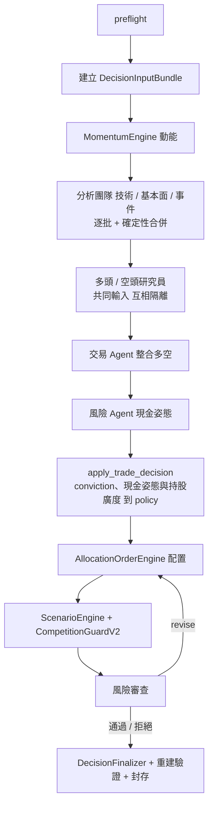

# automation｜每日決策鏈自動化

編排每日決策鏈：預檢環境，依序執行確定性工具與以 CLI 啟動的隔離子 Agent（分析團隊 → 多空研究 → 交易 → 風險現金姿態），分批執行逐檔輸出並確定性合併，最後交給 `decision` 的 Finalizer 重建驗證與封存。原則是「確定性歸程式，不確定性歸 LLM」。

## 檔案清單

| 檔案 | 職責 | 主要公開項目 |
| --- | --- | --- |
| `__init__.py` | 僅模組說明，無匯出 | — |
| `daily_pipeline.py` | 每日決策鏈主流程 `run`（評測用 `run_from_bundle` 從已封存的 DecisionInputBundle 重跑，可只跑到分析師）：DecisionInputBundle、動能、串接各階段、policy、配置／情境／Guard／風險審查迴圈（最多 `max_revisions` 次修正）、finalize 與封存；同時為既有 import 路徑再匯出下列拆出的項目 | `DailyDecisionPipeline`、`validate_research_result`（並再匯出 `PipelineResult`、`degraded_research_result`、`compact_brief_json`、各 Schema 與 runner 型別） |
| `pipeline_base.py` | 執行基礎：`PipelineResult`、輸入摘要序列化、`PipelineBase`（Agent 步驟的驗證重試與續跑、平行任務、artifact 保存、階段計時） | `PipelineBase`（`agent_step`、`save_artifact`、`save_brief`）、`PipelineResult`、`degraded_research_result`、`compact_brief_json` |
| `team_stages.py` | 團隊階段 mixin：分析師、多頭／空頭研究員、交易 Agent（逐批、可平行）；事件分析師只送有重大訊息或已核准個股新聞的股票，批次權重為兩者則數合計 | `TeamStagesMixin`（`run_analyst_team`、`run_research_team`、`run_trader`） |
| `risk_stages.py` | 風險階段 mixin：配置前現金姿態與持股廣度（`cash_ratio_range` 啟用時另給子等級 `cash_grade`，簡報附格點、今日可選子等級與前次比例）、每次修正的風險審查 | `RiskStagesMixin`（`run_cash_stance`、`_review`） |
| `agent_schemas.py` | 各子 Agent 的輸出 JSON Schema 與共用提示規則 | `ANALYST_SCHEMA`、`EVENT_ANALYST_SCHEMA`、`STANCE_SCHEMA`、`TRADE_SCHEMA`、`CASH_STANCE_SCHEMA`、`REVIEW_SCHEMA`、`EVENT_BATCH_SIZE`、`EVENT_BATCH_MAX_EVENTS` |
| `agent_runner.py` | 子 Agent 的共用型別與三種 CLI runner | `DailyPipelineError`、`AgentTask`、`AgentCall`、`AgentRunner`、`ClaudeAgentRunner`、`CodexAgentRunner`、`OpenCodeAgentRunner` |
| `batching.py` | 逐檔輸出的子 Agent 分批與確定性合併 | `BatchMergeError`、`universe_batches`、`merge_batch_items` |
| `perception_stage.py` | 每日情緒標註階段：授權與時間先驗證、全量標註、程式聚合 | `build_daily_perception` |
| `market_news_stage.py` | 每日全市場新聞：取截止前最後一次 RSS 抓取，子 Agent 逐則標註與綜合，程式依核准、樣本與媒體數重建結果；失敗時降級為恐懼貪婪指標 | `build_daily_market_news` |
| `preflight.py` | 抓資料或呼叫子 Agent 前檢查 Docker、各 Agent CLI 登入、帳戶、必要檔案、磁碟 | `PreflightCheck`、`PreflightError`、`run_preflight`、`require_preflight`、`checks_to_dict`、`check_docker`、`effective_research_agent_cli`、`check_codex_ephemeral`、`check_claude`、`check_codex`、`check_opencode`、`check_account`、`check_files`、`check_disk`、`required_files` |

## 對外介面

`__init__.py` 沒有匯出；使用者直接從子模組匯入，例如 `from etf_agent.automation.daily_pipeline import DailyDecisionPipeline`。

## 流程

## 上下游

- 上游（依 import）：`core`、`data`、`decision`、`perception`（`perception_stage.py`）、`research`（`ResearchResultValidator`）、`virtual_account`（`preflight.py`）。
- 下游：`scripts/run_daily_pipeline.py`、`scripts/evaluate_event_brief.py`、`scripts/evaluate_technical_brief.py`。
- 讀：`ResearchSnapshot`、帳戶快照、交易狀態、決策規則、策略樣板、產業分類、資料庫。
- 寫：每日 run 資料夾 `artifacts/daily/<日期>/<run_id>/`（`pipeline.json`、各階段 artifact、`prior_decision_context`、`team_inputs` 等），最後以 `decision.save_run_files` 寫入決策封存 `artifacts/decisions/`。

## 對應的 CLI／scripts／測試

- scripts：`scripts/run_daily_pipeline.py`（由 `./start.sh run` 呼叫）、`scripts/evaluate_event_brief.py`、`scripts/evaluate_technical_brief.py`。
- 測試：`tests/automation/`（`test_agent_runner.py`、`test_daily_pipeline.py`、`test_daily_script.py`、`test_preflight.py`、`test_run_layout.py`、`test_start_*`）、`tests/decision/test_batching.py`、`tests/perception/test_daily_perception_integration.py`。

## 規則與邊界

- 決策鏈版本固定為 `schema_version 2.1`、`event_analysis_mode integrated_analyst`。
- 舊版 run 不可續跑新鏈，需建立新 run。
- 預檢（`run_preflight`）每次 `run` 先執行，失敗即停止。
- 子 Agent 輸出必須通過 Validator；修正最多三次，硬性規則失敗一律拒絕。
- 風險 Agent 不手寫權重、不覆寫 CompetitionGuard；權重、股數、現金由程式計算。
- 不修改研究結論、不放寬風控、不自動下單或送件。
- 事件分析師標為 high 的事件直接交給多空研究員。
- 每日鏈不另跑 Fact／Bull／Bear／Adjudicator；`research` 在此只用於驗證 `ResearchResult`。
- 每次 agent 呼叫的 `duration_seconds` 寫入執行紀錄。
- 每次 agent 呼叫另記 Skill／指令版本指紋（`skill_digest.py`）：`skill_files`（提示詞指名的 SKILL.md 及其連結的 `references/*.md` 逐檔 sha256）、`skill_sha256`（整組合併雜湊）與 `prompt_sha256`（基礎指令去掉 run 目錄／專案根目錄後的雜湊，不含驗證回饋）；`PipelineResult.skill_versions` 彙整整個 run 的逐檔版本。這些只進 `agent_calls` 與執行紀錄，不進 Decision artifact、manifest 或內容雜湊，舊 run 與舊驗證不受影響。
- Claude runner 用 `--output-format stream-json --verbose` 執行，邊跑邊把事件摘要（時間、事件類型、工具與檔名、限流事件，不含模型文字）寫到 `var/logs/agent_trace/<run 目錄名>/<任務名>.jsonl`，供事後查哪一步慢；寫入失敗不影響流程。最後的 `result` 事件仍走原本的結構化輸出與秘密外洩檢查，沒有 `result` 事件即視為暫時性失敗。
- OpenCode 的 read 權限拒絕 `.env`、`.env.*`、`.envrc`、`.pem`、`.key`、`.netrc`、`.p12`、`.pfx`、`id_rsa*`、`.token`、`.npmrc`、`.pypirc`、`.jks` 與含 `credential`／`secret` 的檔案及大小寫變體（見 AGENTS.md）。OpenCode 輸出事件只要 `part` 帶 `tool` 欄位就當工具呼叫檢查（不只認 `tool_use` 型別名稱），非 read 工具一律安全拒絕。
- 續跑沿用既有輸出時，先過秘密外洩檢查（外洩直接停止、不跳過），`build`／`validate` 丟 KeyError、TypeError、ValueError 的壞輸出視為不可沿用而不是讓整個 run 失敗；決策鏈遇到預期之外的例外仍往上拋，但已花的 Agent 呼叫與階段耗時會先保存在 `pipeline.last_result` 並寫入 `pipeline.json`。
- Codex 無法強制 `deny_reads`（runner 以 `enforces_deny_reads` 宣告，未宣告者視為不強制）：帶此欄位的任務在 `CodexAgentRunner` 預設拒絕啟動，只在 `PipelineBase._staged_research_outputs`（研究階段輸出暫存）內以 `AgentTask.stage_isolated` 放行；暫存時多空原始輸出只留記憶體、全部完成才寫入 run 目錄，續跑全有或全無，Codex 研究任務加 `--ephemeral` 且暫存檔不放 run 目錄。這是時序隔離、不是權限隔離，Codex 仍可讀整個專案含舊 run（詳見 [docs/architecture.md](../../../docs/architecture.md)）。`run_preflight` 對研究員 CLI 為 codex 要求登入與 `codex exec --ephemeral` 支援（`research_agent_cli` 檢查）；主 CLI 為 codex 時照常檢查 `codex login status`，研究員 CLI 預設與主 CLI 相同（由 `effective_research_agent_cli` 決定，codex 亦然）。外洩掃描涵蓋 `.env*` 與 `.envrc`。風險審查的修正次數用完仍回 `revise` 時，由程式降級為 `reject` 並加 `REVISION_LIMIT_REACHED` 旗標。
