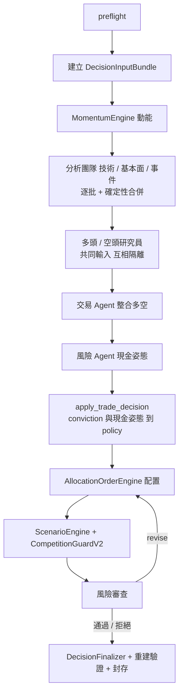

# automation｜每日決策鏈自動化

編排每日決策鏈：預檢環境，依序執行確定性工具與以 CLI 啟動的隔離子 Agent（分析團隊 → 多空研究 → 交易 → 風險現金姿態），分批執行逐檔輸出並確定性合併，最後交給 `decision` 的 Finalizer 重建驗證與封存。原則是「確定性歸程式，不確定性歸 LLM」。

## 檔案清單

| 檔案 | 職責 | 主要公開項目 |
| --- | --- | --- |
| `__init__.py` | 僅模組說明，無匯出 | — |
| `daily_pipeline.py` | 每日決策鏈主流程：DecisionInputBundle、動能、分析師、多空研究、交易、policy／現金姿態、配置／情境／Guard／風險審查（最多 `max_revisions` 次修正）、finalize 與封存 | `DailyDecisionPipeline`（`run`、`run_analyst_team`、`run_research_team`、`run_trader`、`run_cash_stance`、`agent_step`、`save_artifact`）、`PipelineResult`、`degraded_research_result`、`validate_research_result` |
| `agent_runner.py` | 子 Agent 的共用型別與三種 CLI runner | `DailyPipelineError`、`AgentTask`、`AgentCall`、`AgentRunner`、`ClaudeAgentRunner`、`CodexAgentRunner`、`OpenCodeAgentRunner` |
| `batching.py` | 逐檔輸出的子 Agent 分批與確定性合併 | `BatchMergeError`、`universe_batches`、`merge_batch_items` |
| `perception_stage.py` | 每日情緒標註階段：授權與時間先驗證、全量標註、程式聚合 | `build_daily_perception` |
| `preflight.py` | 抓資料或呼叫子 Agent 前檢查 Docker、各 Agent CLI 登入、帳戶、必要檔案、磁碟 | `PreflightCheck`、`PreflightError`、`run_preflight`、`require_preflight`、`checks_to_dict`、`check_docker`、`check_claude`、`check_codex`、`check_opencode`、`check_account`、`check_files`、`check_disk`、`required_files` |

## 對外介面

`__init__.py` 沒有匯出；使用者直接從子模組匯入，例如 `from etf_agent.automation.daily_pipeline import DailyDecisionPipeline`。

## 流程

## 上下游

- 上游（依 import）：`core`、`data`、`decision`、`perception`（`perception_stage.py`）、`research`（`ResearchResultValidator`）、`virtual_account`（`preflight.py`）。
- 下游：`scripts/run_daily_pipeline.py`、`scripts/evaluate_event_brief.py`、`scripts/evaluate_technical_brief.py`。
- 讀：`ResearchSnapshot`、帳戶快照、交易狀態、決策規則、策略樣板、產業分類、資料庫。
- 寫：每日 run 資料夾 `artifacts/daily/<日期>/<run_id>/`（`pipeline.json`、各階段 artifact、`team_inputs` 等），最後以 `decision.save_run_files` 寫入決策封存 `artifacts/decisions/`。

## 對應的 CLI／scripts／測試

- scripts：`scripts/run_daily_pipeline.py`（由 `./start.sh run` 呼叫）、`scripts/evaluate_event_brief.py`、`scripts/evaluate_technical_brief.py`。
- 測試：`tests/automation/`（`test_agent_runner.py`、`test_daily_pipeline.py`、`test_daily_script.py`、`test_preflight.py`、`test_run_layout.py`、`test_start_*`）、`tests/decision/test_batching.py`、`tests/perception/test_daily_perception_integration.py`。

## 規則與邊界

- 決策鏈版本固定為 `schema_version 2.1`、`event_analysis_mode integrated_analyst`。
- 舊版 run 不可續跑新鏈，需建立新 run。
- 預檢（`run_preflight`）每次 `run` 先執行，失敗即停止。
- 子 Agent 輸出必須通過 Validator；修正最多三次，硬性規則失敗一律拒絕。
- 風險 Agent 不手寫權重、不覆寫 CompetitionGuard；權重、股數、現金由程式計算。
- 不修改研究結論、不放寬風控、不自動下單或送件。
- 事件分析師標為 high 的事件直接交給多空研究員。
- 每日鏈不另跑 Fact／Bull／Bear／Adjudicator；`research` 在此只用於驗證 `ResearchResult`。
- 每次 agent 呼叫的 `duration_seconds` 寫入執行紀錄。
- OpenCode 的 read 權限拒絕 `.env`、`.envrc`、`.pem`、`.key` 與含 `credential`／`secret` 的檔案（見 AGENTS.md）。
