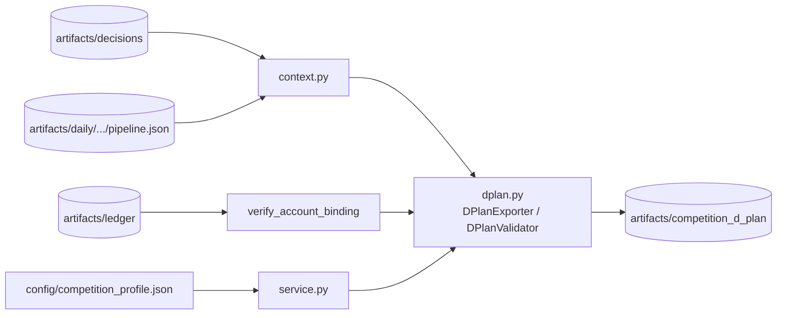

# competition｜D-Plan 整理與匯出

把已封存、通過驗證的 Decision run 確定性地整理成 D-Plan context，匯出 D-Plan v4.3 候選並做本地結構檢查。輸出只是供人工檢查與上傳的候選檔，不自動送件，也不代表通過主辦方平台驗證。

## 檔案清單

| 檔案 | 職責 | 主要公開項目 |
| --- | --- | --- |
| `__init__.py` | 匯出公開介面 | 見下方 |
| `context.py` | 由已驗證決策 run 確定性投影出 D-Plan context | `DPlanContextBuilder`（`build`） |
| `dplan.py` | D-Plan v4.3 匯出與本地驗證、帳本綁定檢查、載入決策 run | `DPlanError`、`DPlanValidator`、`DPlanExporter`、`verify_account_binding`、`load_decision_run` |
| `service.py` | 從已封存的每日 run 產物編排候選匯出；D-Plan 以原子方式取代同交易日舊檔，context 與 CLI 仍以新建為主、拒絕覆寫 | `DPlanExportService`（`code_version`、`trade_date`、`output_paths`、`current_account_run_id`、`export`、`export_latest`）、`read_object`、`write_new_json`、`replace_json` |

## 對外介面

`DPlanError`、`DPlanContextBuilder`、`DPlanExportService`、`DPlanExporter`、`DPlanValidator`、`load_decision_run`、`verify_account_binding`。

## 上下游

- 上游（依 import）：`core`、`decision`、`virtual_account`。
- 下游：`decision_delivery.provider`（呼叫 `load_decision_run`）、`cli/dplan.py`、`scripts/run_daily_pipeline.py`。
- 讀：決策封存、每日 `pipeline.json`、帳本、`config/competition_profile.json`。寫：`artifacts/competition_d_plan/D-Plan_<team_id>_<日期>.json` 與 `contexts/`。

## 對應的 CLI／scripts／測試

- CLI：`cli/dplan.py`（`build-latest`、`build`、`validate`、`build-context`）；每日 `run` 在決策為 `approved`／`no_trade`、競賽設定已確認且帳本綁定通過時自動嘗試匯出。
- scripts：`scripts/run_daily_pipeline.py`。
- 測試：`tests/account/test_competition_dplan.py`。

## 規則與邊界

- `config/competition_profile.json` 的 `strategy_status` 須由人工確認為 `approved`，否則 fail-closed。
- 已存在的輸出檔不覆寫（`DPlanError`）。
- D-Plan 失敗不否定已封存決策，也不阻止中文報告。
- D-Plan 失敗原因寫入同一次 `pipeline.json`。
- 主辦方伺服器驗證與上傳由人工執行，不自動下單或送件。
