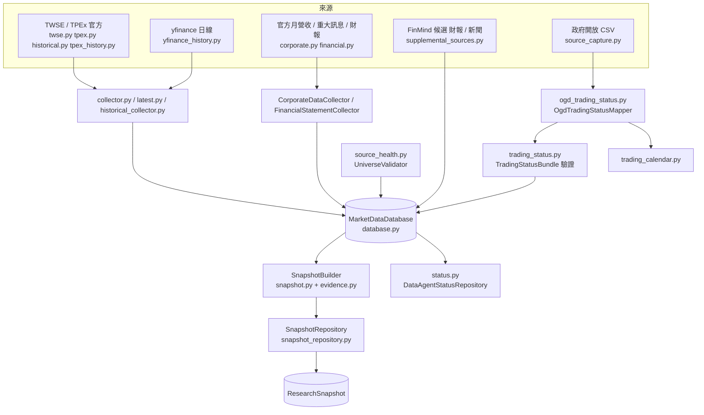

# data｜Data Agent：行情與公司資料收集、版本化與研究快照

收集、驗證並版本化台股行情（TWSE／TPEx 官方、yfinance 研究日線）與公司事件（重大訊息、月營收、財報），寫入 SQLite（`var/etf_agent.db`），並建立不可變 `ResearchSnapshot`。也負責交易狀態（注意／處置／暫停交易等）、開休市日曆、產業分類與來源健康探測。Data Agent 只提供資料事實、來源證據與品質狀態，不建立投資方向、權重或訂單。

## 資料流程

FinMind 財報與新聞是候選資料，未通過授權、時間與覆蓋核對前不進正式 Snapshot（見根 README）。

## 檔案清單

| 檔案 | 職責 | 主要公開項目 |
| --- | --- | --- |
| `__init__.py` | 匯出公開介面 | 見下方「對外介面」 |
| `contracts.py` | Data Agent 工具與快照共用的穩定 JSON 契約 | `SourceEvidence`、`SourceProbeResult`、`SourceFeasibilityReport`、`UniverseInstrumentStatus`、`UniverseValidationResult` |
| `universe.py` | 載入 150 檔官方交易池 CSV | `Instrument`、`UniverseLoader`、`load_universe`、`normalize_symbol` |
| `database.py` | SQLite 資料庫（schema、價格、文件、營收、財報、快照、交易狀態 bundle 等表） | `MarketDataDatabase` |
| `twse.py` | TWSE 每日行情 Provider 與解析 | `DailyPrice`、`TwseDailyProvider`、`parse_roc_date`、`parse_decimal`、`parse_integer` |
| `tpex.py` | TPEx 最新上櫃行情 Provider | `TpexDailyProvider`、`parse_optional_decimal` |
| `tpex_history.py` | 按指定成交日補取 TPEx 官方全市場歷史價量，供帳本結算 | `parse_quotes`、`collect_quotes` |
| `collector.py` | 每日行情收集協調與結果 | `CollectionResult`、`DailyPriceProvider`、`DailyPriceCollector` |
| `latest.py` | 官方 TWSE＋TPEx 最新價合併收集 | `LatestPriceCollectionResult`、`LatestPriceProviderFactory`、`LatestPriceCollector`、`latest_price_providers`、`collect_latest_prices` |
| `historical.py` | TWSE 上市股票歷史月行情 Provider、節流與刷新規劃 | `HistoricalResponse`、`HistoryRefreshBatch`、`HistoricalPriceProvider`、`RequestGate`、`SourceThrottledError`、`SourceBlockedError`、`rolling_start`、`plan_history_refresh`、`month_starts` |
| `historical_collector.py` | 有界並行的月歷史回應批次保存、官方歷史刷新 | `HistoricalPriceCollector`、`OfficialHistoricalRefreshService`、`HistoricalCollectionResult`、`HistoricalCollectionError`、`OfficialHistoryBatchResult`、`OfficialHistoryCoverage`、`OfficialHistoryRefreshResult` |
| `yfinance_history.py` | 透過 yfinance 收集上市／上櫃兩年 OHLCV（研究用調整價） | `YFinanceHistoryCollector`、`YFinanceCollectionResult`、`YFinanceRefreshResult`、`stale_basis_symbols`、`stored_closes`、`close_rebased_symbols` |
| `price_freshness.py` | 判斷資料庫是否已有某交易日收盤後定案行情，供 `start.sh` 略過重複抓取 | `prices_current` |
| `corporate.py`（轉出層）、`corporate_contracts.py`、`corporate_parsing.py`、`corporate_provider.py`、`corporate_collector.py` | 官方公司資料（重大訊息、月營收、財報）：契約、解析、Provider、收集與保存分檔，`corporate.py` 維持舊 import 路徑 | `SourceDocument`、`MonthlyRevenue`、`FinancialStatementFact`、`FinancialStatement`、`CorporateRecord`、`CorporateResponse`、`OfficialCorporateProvider`、`OfficialCorporateProviderFactory`、`CorporateDataCollector`、`CorporateCollectionResult` |
| `financial.py` | 官方財報彙總資料的請求、覆蓋驗收與來源可行性結果 | `FinancialStatementRequest`、`FinancialCoverageGap`、`FinancialCollectionResult`、`FinancialStatementCollector`、`latest_due_quarter` |
| `cash_flow.py` | 以官方累計稅前淨利核對 FinMind 現金流量表，轉成 `cash_flow_statement` 快照文件（不連網） | `VerifiedCashFlowProvider`、`verified_cash_flow_record` |
| `fundamental_repair.py` | 以官方當期金額核對 FinMind 單季口徑，補足去年同期累計財報 | `OfficialCompanyProfileProvider`、`FundamentalRepairProvider`、`verified_prior_record` |
| `supplemental_sources.py` | 版本化擷取 FinMind 財報與個股新聞線索（候選） | `FinMindApiProvider`、`FinMindFundamentalProvider`、`FinMindNewsProvider`、`FinMindFundamentalCollector`、`FinMindNewsCollector`、`SupplementalRepository`、`SupplementalResult` |
| `finmind_schedule.py` | FinMind 財報抓取排程：首次補歷史，之後只在財報公布區間內每天更新 | `FinMindScheduleError`、`in_filing_window`、`history_start`、`load_state`、`plan`、`record_done` |
| `news_content.py` | 新聞原頁核對版本保存；候選不直接升級為正式情緒證據 | `save_news_captures` |
| `sector_classification.py` | 官方公司基本資料的產業代碼分類，供產業曝險檢查使用 | `SectorSource`、`SectorClassificationBuilder`、`SectorClassificationError`、`capture_sector_sources` |
| `evidence.py` | `ResearchSnapshot` 的來源證據輔助（授權、台北時間戳、內容時間） | `SourceEvidenceBuilder`、`source_authority`、`taipei_timestamp`、`daily_content_as_of`、`public_price_url` |
| `snapshot.py` | 研究快照物件與建構流程 | `ResearchSnapshot`、`SnapshotBuilder`、`DataAgentService`、`SnapshotQualityPolicy`、`SnapshotPrice`、`SnapshotMonthlyRevenue`、`SnapshotFinancialStatement`、`SnapshotDocument`、`UniverseValidationState` |
| `snapshot_repository.py` | `ResearchSnapshot` 的 SQLite 存取 | `SnapshotRepository` |
| `source_health.py` | 確定性來源健康探測與交易池驗證 | `SourceHealthProbe`、`SourceProbeDefinition`、`UniverseValidator`、`compute_universe_version`、`load_probe_definitions`、`write_json_artifact` |
| `status.py` | Data Agent 狀態查詢物件 | `DataAgentStatusRepository`、`DataAgentStatus`、`DocumentStatus`、`PriceSourceStatus`、`PriceStatus`、`CollectionRunStatus`、`SourceReportStatus`、`UniverseValidationStatus`、`format_status_time` |
| `trading_status.py` | 官方交易狀態的版本化契約、重建與可交易性判斷 | `TradingStatusBundleBuilder`、`TradingStatusBundleValidator`、`TradingStatusCollector`、`TradingStatusRepository`、`TradingStatusProvider`、`SavedJsonTradingStatusProvider`、`TradingStatusRequest`、`TradingStatusSourceDefinition`、`TradingStatusCollectionResult`、`TradingStatusError`、`parse_trading_status_payload` |
| `trading_calendar.py` | 由官方開休市日期表建立的交易日與交割日曆；可併入臨時休市日 | `TradingCalendar`、`TradingCalendarError` |
| `inferred_closures.py` | 官方日期表未列的臨時休市日（如颱風假）：日曆認定為交易日、資料庫整天沒有行情，且兩市場在該日前後都有官方行情時才推斷（要等後一個交易日確認，當晚不推斷）；證據寫入 `artifacts/data/trading_status/inferred_closed_days.json`，由 `calendar_from_capture` 併入 | `infer_closed_days`、`update_inferred_closed_days`、`load_inferred_closed_days` |
| `source_capture.py` | 封存已列明授權候選的政府開放 CSV；不產生交易許可 | `capture_ogd_candidates` |
| `ogd_trading_status.py` | 把已封存的政府開放 CSV 轉成 `TradingStatusBundle` 的 records／coverage 與交易日曆 | `OgdTradingStatusMapper`、`build_trading_status_from_capture`、`calendar_from_capture`、`latest_calendar_capture_before`、`latest_capture_before`、`closed_dates_from_calendar`、`next_trading_session`、`load_approvals`、`load_not_applicable`、`not_applicable_coverage` |
| `ogd_candidate_facts.py` | 政府開放 CSV 的日期精度候選事實；不產生交易許可或正式 coverage | `extract_ogd_candidate_facts`、`build_candidate_fact_report` |
| `source_audit.py` | 重算政府開放 CSV 與官方 JSON 的候選來源對照；不核准交易來源 | `verify_ogd_crosscheck`、`roc_date_to_iso`、`roc_interval_to_iso` |
| `analyst_availability.py` | 唯讀候選表的資料取得狀態；不把候選升級成投資證據 | `analyst_availability` |

### 子套件 `market_probe/`

全市場交易背景補抓與查核（大盤成交、指數、法人買賣）；不產生情緒方向，只作交易背景。

| 檔案 | 職責 | 主要公開項目 |
| --- | --- | --- |
| `__init__.py` | 匯出 `capture_market_context` | `capture_market_context` |
| `contracts.py` | 來源與錯誤型別 | `MarketProbeError` |
| `provider.py` | 有界讀取公開證交所原始回應，不修改來源核准狀態 | `OfficialMarketProbeProvider` |
| `tools.py` | 從原始回應重建大盤背景事實，不計算情緒 | `market_context_facts` |
| `service.py` | 補抓後以 `ImmutableRunStore` 保存不可變原始回應及重建事實 | `capture_market_context` |

## 對外介面

`__init__.py` 匯出（節錄）：資料庫與交易池（`MarketDataDatabase`、`Instrument`、`UniverseLoader`、`load_universe`）、行情 Provider 與收集器（`TwseDailyProvider`、`TpexDailyProvider`、`HistoricalPriceProvider`、`DailyPriceCollector`、`HistoricalPriceCollector`、`OfficialHistoricalRefreshService`、`LatestPriceCollector`、`collect_latest_prices`、`YFinanceHistoryCollector`）、公司資料（`CorporateDataCollector`、`OfficialCorporateProvider`、`FinancialStatementCollector`）、快照（`SnapshotBuilder`、`ResearchSnapshot`、`DataAgentService`、`SnapshotRepository`、`SnapshotQualityPolicy`）、交易狀態與日曆（`TradingStatusBundleBuilder`、`TradingStatusBundleValidator`、`TradingStatusCollector`、`TradingStatusRepository`、`TradingCalendar`、`OgdTradingStatusMapper`、`build_trading_status_from_capture`、`calendar_from_capture`）、產業分類（`SectorClassificationBuilder`、`capture_sector_sources`）、來源健康與狀態（`UniverseValidator`、`SourceHealthProbe`、`DataAgentStatusRepository`）。完整清單見 `data/__init__.py` 的 `__all__`。

未在 `__init__.py` 匯出、須從子模組匯入的：`supplemental_sources`、`finmind_schedule`、`fundamental_repair`、`news_content`、`price_freshness`、`tpex_history`、`source_capture`、`source_audit`、`ogd_candidate_facts`、`analyst_availability`、`evidence`、`market_probe`。

## 上下游

- 上游：只依賴 `etf_agent.core`（以 import 檢查）。
- 下游（依 import）：`automation`、`decision`（`contracts.py`、`service.py`）、`perception`（`news_service.py`）、`research`（`repository.py`、`tools.py`）、`virtual_account`（`daily.py`）；另有 `cli/` 與 `scripts/` 直接使用。
- 讀：`data/official_universe.csv`、`config/data_sources.json`、`config/trading_status_approvals.json`、官方與候選來源的網路回應。
- 寫：`var/etf_agent.db`（行情、公司文件、來源原文、時間與版本）；`artifacts/data/`（研究快照、財報、產業分類、交易狀態政府開放 CSV 封存等）；`artifacts/debug/`（來源原始抓取與探測）。

## 對應的 CLI／scripts／測試

- CLI：`cli/data_agent.py`（資料狀態、收集、快照）、`cli/trading_status.py`、`cli/fundamental_repair.py`、`cli/market_context_probe.py`。
- scripts（收集）：`init_db.py`、`collect_twse.py`、`collect_latest_prices.py`、`collect_history.py`、`collect_official_history.py`、`collect_financial_statements.py`、`collect_supplemental_sources.py`、`collect_sector_classification.py`、`collect_cash_flow.py`。
- scripts（排程與狀態）：`finmind_schedule.py`、`prices_current.py`、`data_status.py`、`run_daily_pipeline.py`（`./start.sh auto`／`daily`／`run` 串接）。
- scripts（來源與交易狀態）：`probe_data_sources.py`、`capture_trading_status_candidates.py`、`normalize_trading_status_candidates.py`、`verify_ogd_crosscheck.py`、`repair_pending_tpex_close.py`。
- 測試：`tests/data/`（`test_data_agent.py`、`test_data_collection.py`、`test_historical.py`、`test_financial_statements.py`、`test_finmind_schedule.py`、`test_fundamental_repair.py`、`test_cash_flow.py`、`test_trading_status.py`、`test_ogd_trading_status.py`、`test_trading_calendar.py`、`test_inferred_closures.py` 等）；`tests/fixtures/` 有小型行情 fixture。
- 相關文件：[docs/data_sources_inventory.md](../../../docs/data_sources_inventory.md)、[docs/fundamental_data_repair.md](../../../docs/fundamental_data_repair.md)。

## 規則與邊界

- 所有資料保存來源、抓取時間、內容時間、版本及原始回應識別。
- 以 `available_at` 判斷當時是否可用；補抓的歷史資料以抓取時間為 `available_at`，不回填到過去的決策。
- 決策與帳本用價是同日官方原價（`execution_close_price`），研究指標用調整價。
- 缺官方價時退回調整價（見架構文件）。
- FinMind、政府開放 CSV 等候選資料不產生交易許可，通過授權、時間與覆蓋核對前不進正式 Snapshot。
- `source_capture`、`ogd_*`、`source_audit` 不核准交易來源。
- 交易狀態八份政府開放 CSV 全部抓成功才替換舊封存，有失敗則保留舊封存當後備。
- 資料不足、單位衝突、授權不明或版本不一致時停止或降級，不填補假值。
- 網頁、公告與新聞都是不受信任的資料。
