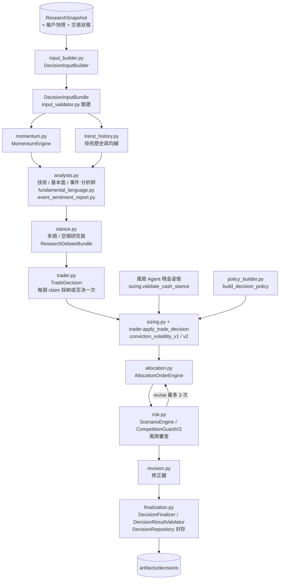

# decision｜分析團隊、多空研究、交易、配置與風控

每日決策鏈的核心契約與確定性程式：建立時間點一致的 `DecisionInputBundle`、動能與技術歷史、三位分析師的報告契約與 Validator、多頭／空頭研究（`StancePacket`、`ResearchDebateBundle`）、交易 Agent 的 `TradeDecision`、conviction 加現金姿態的權重計算、配置與下單、情境與 CompetitionGuard、風險審查與修正鏈、最終決策重建驗證與不可變封存。原則是「確定性歸程式，不確定性歸 LLM」：子 Agent 只輸出解讀、論點、意圖與信心等級、現金姿態；指標、權重、股數、費稅、現金與競賽限制全由本套件的 Python 程式計算並重建驗證。流程編排在 `automation/daily_pipeline.py`。

## 決策流程

## 檔案清單

| 檔案 | 職責 | 主要公開項目 |
| --- | --- | --- |
| `__init__.py` | 匯出公開介面 | 見下方「對外介面」 |
| `contracts.py` | 相容轉出層，維持 `etf_agent.decision.contracts` 既有匯入路徑 | 轉出下列三檔的全部公開名稱 |
| `fields.py` | 時間點一致的共用基礎：列舉、錯誤型別、欄位解析、雜湊、禁用欄位與未知欄位檢查 | `DecisionToolError`、`decision_bundle_sha256`、`decision_rules_sha256`、`artifact_content_sha256`、`validate_forbidden_keys`、`reject_unknown_fields`、`snapshot_execution_price`、`intent_artifact_id` |
| `input_validator.py` | DecisionInputBundle 重建驗證 | `DecisionInputValidator` |
| `input_context.py` | 已驗證的 bundle 查詢視圖與證據對應（含 `company_news_input` 的 `news:finmind:` 證據） | `DecisionContext` |
| `input_builder.py` | 由 `ResearchSnapshot` 組裝時間點一致的 `DecisionInputBundle`；有傳入時附上選配的 `company_news_input` | `DecisionInputBuilder` |
| `active_share.py` | 競賽 Active Share：讀取並驗證主動型 ETF 前 15 大持股（來源核准、可得時間、排名、權重），選取前 15 大並以占淨值權重計算 | `load_active_etf_benchmarks`、`top_weights`、`active_share`、`ACTIVE_SHARE_TOP_N` |
| `momentum.py` | 確定性動能與市場狀態計算與驗證 | `MomentumEngine`、`MomentumResultValidator` |
| `trend_history.py` | 技術分析用整段歷史價格與逐日均線；不產生趨勢標籤 | `TechnicalTrendHistoryTools`、`TechnicalTrendHistoryValidator` |
| `analysts.py` | 分析團隊：確定性輸入摘要、`AnalystReport` 契約與 Validator、技術 gate、基本面指標、事件 high 重大性挑出；資料包含 `company_news_input` 時事件 brief 逐檔帶 `news`（只有標題），事件報告為 `EVENT_NEWS_VERSION`（2.3），否則 2.2 | `company_news`、`event_market_version`、`build_analyst_brief`、`seal_report`、`AnalystReportValidator`、`technical_trend_gate`、`compute_fundamental_metrics`、`growth_signal_quality`、`high_materiality_events`、`sentiment_unavailable_report`、`sentiment_report`、`seal_event_sentiment_report`、`seal_event_market_report`、`compact_event_batch`、`analyst_report_names`、`report_envelope` |
| `event_financial_context.py` | 將同一快照財報接到事件解讀，保留原值、單位、期間與引用 | `event_financial_context` |
| `cash_flow_context.py` | 從已核對的現金流文件計算營業現金流、自由現金流與對稅前淨利比率，給基本面分析師 | `cash_flow_context` |
| `drawdown.py` | 從帳本 NAV 歷史計算峰值回撤，綁進 Policy 的 `drawdown_control`，強制現金姿態下限 | `bind_drawdown`、`measure_drawdown`、`stance_floor`、`stance_meets_floor`、`validate_drawdown_control` |
| `market_scope.py` | 全市場情緒通道狀態：新聞優先，否則用恐懼貪婪指標；個股情緒與交易行情不能代替。另有隔夜市場背景通道（美股指數、台股代理，1.1 另含日韓、VIX、夜盤與 `agreement`，與 `market_sentiment` 分開，只給風險 Agent 現金姿態與報告） | `market_sentiment_channel`、`overnight_market_channel` |
| `fundamental_language.py` | 把指標缺口轉為有期間、報表與欄位的中文說明；不改寫數值或分類 | `explain_metric_gap`、`chinese_gap_explanations`、`period_label`、`render_fundamental_report` |
| `event_sentiment_report.py` | 將已驗證的合併分析報告呈現為繁體中文，不新增結論 | `render_event_sentiment_report` |
| `stance.py` | 研究團隊：多頭／空頭研究員的隔離輸入、`StancePacket`、`ResearchDebateBundle` | `shared_input_sha256`、`stance_role_input_sha256`、`build_stance_brief`、`seal_stance_packet`、`StancePacketValidator`、`build_research_debate`、`ResearchDebateBundleValidator`、`stance_envelope` |
| `trader.py` | 交易 Agent：權衡多空論點的 `TradeDecision` 與確定性配置轉接 | `TradeDecisionValidator`、`seal_trade_decision`、`trade_decision_envelope`、`apply_trade_decision`、`claims_by_symbol`、`support_by_symbol` |
| `prior_decision.py` | 前次決策背景：從決策庫找同帳戶、目標交易時段更早、approved／no_trade 的封存 run（同時段多個時優先帳本結算記錄），整理持股的前次意圖與重估條件為不可引用的 `PriorDecisionContext`，並重建驗證 | `find_prior_decision_run`、`read_decision_run`、`build_prior_decision_context`、`prior_decision_brief`、`prior_reference_tokens`、`PriorDecisionContextValidator` |
| `trader_report.py` | 以已驗證 `TradeDecision` 呈現交易整合結果，不重貼多空全文 | `render_trader_report` |
| `sizing.py` | conviction 等級、現金姿態、持股廣度（`positions_by_breadth` 對應檔數）、換股名額（`rotation`）、入選順序（`selection_tiebreak`）與低波動偏好強度（v2 的 `volatility_exponent`），及其到權重的確定性轉換 | `validate_cash_stance`、`validate_position_sizing`、`breadth_target`、`conviction_weights` |
| `position_review.py` | 持股檢視（停損／停利警示）：程式算帳面報酬與近 20 日高點回落（policy `context: "v1"` 時另附相對交易池的 5／20 日報酬與基本面資料可得時間）、依 `position_review` 門檻標警示，交易 Agent 須處理，Finalizer 重算比對（team_inputs 2.4） | `build_position_review`、`validate_position_review`、`position_review_brief`、`POSITION_REVIEW_VERSION` |
| `selection_ranking.py` | 入選排序：交易 Agent 第二輪在同信心等級內排先後；封存、驗證涵蓋範圍、轉成 `rank_by_symbol` 綁進 policy（team_inputs 2.5） | `SelectionRankingValidator`、`apply_selection_ranking`、`program_ranking`、`selection_ranking_brief` |
| `rotation.py` | 滿檔換股的名額脈絡：程式算好的持股檔數、硬上限、空名額與全池多空強度統計，交給交易 Agent 當背景並由 Finalizer 重算比對 | `build_portfolio_slots`、`validate_portfolio_slots`、`PORTFOLIO_SLOTS_VERSION` |
| `policy_builder.py` | 由策略樣板、bundle 規則與產業資料組成 `DecisionPolicy` | `build_decision_policy` |
| `allocation.py` | 確定性配置、下單、費稅與現金；Policy 與 Proposal 驗證 | `AllocationOrderEngine`、`DecisionPolicyValidator`、`ProposalValidator`、`decision_policy_sha256` |
| `risk.py` | 確定性情境、競賽檢查（Guard，Active Share 以前 15 大比前 15 大）與風險審查契約 | `ScenarioEngine`、`ScenarioValidator`、`CompetitionGuardV2`、`GuardValidator`、`RiskReviewValidator`、`sector_exposure`、`liquidity_exposure`、`revision_effects` |
| `revision.py` | 提案／審查修正鏈的確定性建立與重播 | `RevisionHistoryBuilder`、`RevisionHistoryValidator` |
| `finalization.py` | 最終決策重建與不可變封存（`DecisionRepository` 繼承 `ImmutableRunStore`） | `DecisionFinalizer`、`DecisionResultValidator`、`DecisionRepository`、`build_team_inputs` |
| `service.py` | 對外應用服務，供 `portfolio_decision` CLI 使用：建立輸入、動能、配置、風控、封存；`build_input_file(company_news=True)` 只在 FinMind 個股新聞截止時已核准才加入 `company_news_input` | `PortfolioDecisionApplicationService` |

## 對外介面

`__init__.py` 匯出（節錄）：契約（`DecisionInputValidator`、`DecisionContext`、`DecisionToolError`、`DECISION_SCHEMA_VERSION`、各種 `*_sha256`）、`DecisionInputBuilder`、`MomentumEngine`／`MomentumResultValidator`、`TechnicalTrendHistoryTools`／`Validator`、分析師（`build_analyst_brief`、`AnalystReportValidator`、`seal_report`、`seal_event_market_report`、`sentiment_report`、`ANALYSTS` 等）、研究（`build_research_debate`、`build_stance_brief`、`seal_stance_packet`、`StancePacketValidator`、`ResearchDebateBundleValidator`、`STANCE_ROLES`）、交易（`TradeDecisionValidator`、`seal_trade_decision`、`apply_trade_decision`、`trade_decision_envelope`、`TRADE_INTENTS`、`render_trader_report`、`SIZING_METHOD`）、`build_decision_policy`、`AllocationOrderEngine`、`DecisionPolicyValidator`、`ProposalValidator`、`ScenarioEngine`／`Validator`、`CompetitionGuardV2`／`GuardValidator`、`RiskReviewValidator`、`RevisionHistoryBuilder`／`Validator`、`DecisionFinalizer`、`DecisionResultValidator`、`DecisionRepository`、`build_team_inputs`、`PortfolioDecisionApplicationService`。完整清單見 `decision/__init__.py`。

## 上下游

- 上游（依 import）：`core`、`data`（`input_validator.py`、`service.py`）、`perception`（`analysts.py`、`input_validator.py`、`market_scope.py`、`service.py`）、`fundamentals`（`analysts.py`、`event_financial_context.py`）、`research`（`input_validator.py`、`finalization.py`，用來驗證舊的 `ResearchResult`）。
- 下游：`automation.daily_pipeline`（編排整條鏈）、`virtual_account`（`DecisionInputValidator`、`DecisionRepository`、`DecisionResultValidator`）、`competition`、`decision_delivery`、`dashboard`、`perception.market_news.service`（用 `decision_bundle_sha256`）、`cli/portfolio_decision.py`、`cli/virtual_account.py`、`cli/market_news.py`、`scripts/evaluate_*_brief.py`。
- 循環依賴：`decision` 與 `perception` 互相 import，改動時需檢查循環 import。
- 讀：`ResearchSnapshot`、帳戶快照、交易狀態、`config/decision_rules.json`、`config/decision_policy.json`、產業分類、資料庫。寫：決策封存 `artifacts/decisions/<日期>/<run_id>/`（含 `team_inputs`、`policy`、`proposal`、`scenario`、`guard`、`risk_review`、`revision_history`、`decision`）。

## 對應的 CLI／scripts／測試

- CLI：`cli/portfolio_decision.py`；scripts：`scripts/evaluate_event_brief.py`、`scripts/evaluate_technical_brief.py`。
- 測試：`tests/decision/`（`test_portfolio_decision_agent.py`、`test_portfolio_risk_decision.py`、`test_decision_input_builder.py`、`test_active_share.py`、`test_stance.py`、`test_trader.py`、`test_team_chain.py`、`test_position_sizing.py`、`test_trader_report.py`、`test_batching.py`、`test_decision_delivery.py`、`test_drawdown.py`）；`tests/research/test_analysts.py`、`test_fundamental_language.py`、`test_technical_trend_history.py`。
- 架構文件：[docs/architecture.md](../../../docs/architecture.md)、[docs/technical_trend_history.md](../../../docs/technical_trend_history.md)。

## 規則與邊界

- 多頭／空頭研究員讀同一份共同輸入（`shared_input_sha256`），互相隔離（`peer_packet_ids` 為空）。
- 兩方都對全部交易池逐檔給 `strength` 與有證據的 claims；`none` 時不得有 claims。
- 交易 Agent 把多空每個 claim 剛好採納或否決一次，不新增事實或 claim。
- buy／add 給 `high`／`medium`／`low`；權重由 `conviction_volatility_v1`（固定 1／ATR14）或 `conviction_volatility_v2`（依 `volatility_exponent` 0～1 調整低波動偏好，0 為不看波動度）依 Policy 乘數計算，Agent 不輸出數字。
- 滿檔時新股只能用出場釋出的名額（`rotation` 的 `max_swaps_per_run`、`min_new_conviction`；不足標 `MAX_POSITIONS`，信心不足標 `ROTATION_CONVICTION`）；交易 Agent 只收到 `portfolio_slots` 當背景，配對由程式決定。
- 風險 Agent 給 `aggressive`／`neutral`／`defensive` 現金姿態與 `concentrated`／`balanced`／`diversified` 持股廣度並附證據（檔數由 Policy 對應，Agent 不輸出數字）；不手寫權重、不覆寫 CompetitionGuard。
- 現金比例由 Policy 依姿態對應，競賽現金上限由 Guard 強制。
- 修正循環最多三次；硬性規則失敗一律拒絕。
- 單股硬性權重上限的減碼一律由程式執行。
- 減碼賣單意圖由程式標為 `trim` 或 `exit`，並留下 `RISK_STOCK_WEIGHT` 旗標。
- 非可交易標的不建立買賣單（`RISK_NOT_TRADABLE`）；持股將低於 `min_positions` 時依 ATR14 由低到高留住 `exit` 持股（`RISK_MIN_POSITIONS`，`forced_exit` 不留）。
- 配置後投資組合前 15 大與任一必備主動型 ETF 前 15 大的 Active Share 低於 `minimum_active_share`（15%）時，程式取消與最低那檔 ETF 重疊最多的 buy／add 候選後重新配置，最多 3 次（`RISK_ACTIVE_SHARE`，不賣既有持股）；仍不通過由 Guard 拒絕。
- 產業權重在任一情境超過 `max_sector_weight` 時，`_fit_sector_weights` 同樣在 Guard 前按整張減碼（先減買單、再賣持股；同產業先減低信心、大市值），留下 `RISK_SECTOR_WEIGHT` 旗標；上限為 1 時不動作。
- Decision run 另存 `team_inputs`；Finalizer 與下游重建驗證都要傳入，缺少即拒絕。2.2 另含 `prior_decision_context`，交易 Agent 的文字欄位引用它即拒絕。
- 舊版 1.0 debate 已移除，Finalizer 與 Validator 遇到一律拒絕。
- Decision artifacts 使用嚴格欄位白名單與可重算內容雜湊。
- Snapshot、研究結果與決策的 `snapshot_id`、cutoff 與資料版本必須一致。
- 事件分析師標為 high 的事件，由程式提供同 Snapshot 的事實與脈絡，並保留重大性、發現與證據。
- 事件報告 2.3：每則核准個股新聞須在 `events` 剛好分類一次；沒有重大訊息也沒有新聞的股票由程式輸出 `unknown`；批次權重為事件數＋新聞數。需要 2.2 或 2.3 由資料包有無 `company_news_input` 綁定，`DecisionInputValidator` 以 `perception.company_news.validate_pack` 重驗新聞輸入。
- 情緒無核准來源時確定性 `unavailable`。
- 價格口徑：決策與帳本用同日官方原價，研究指標用調整價。
