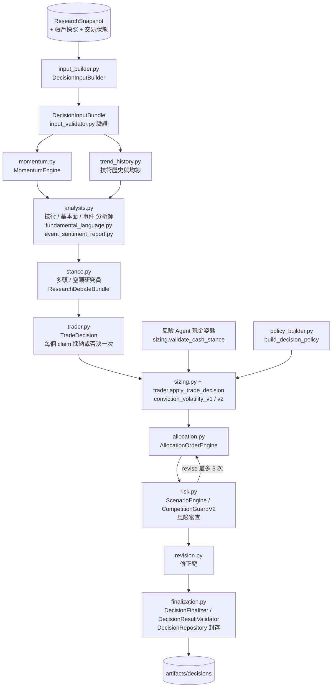

# decision｜分析團隊、多空研究、交易、配置與風控

每日決策鏈的核心契約與確定性程式：建立時間點一致的 `DecisionInputBundle`、動能與技術歷史、三位分析師的報告契約與 Validator、多頭／空頭研究（`StancePacket`、`ResearchDebateBundle`）、交易 Agent 的 `TradeDecision`、conviction 加現金姿態的權重計算、配置與下單、情境與 CompetitionGuard、風險審查與修正鏈、最終決策重建驗證與不可變封存。原則是「確定性歸程式，不確定性歸 LLM」：子 Agent 只輸出解讀、論點、意圖與信心等級、現金姿態；指標、權重、股數、費稅、現金與競賽限制全由本套件的 Python 程式計算並重建驗證。流程編排在 `automation/daily_pipeline.py`。

## 決策流程

## 檔案清單

| 檔案 | 職責 | 主要公開項目 |
| --- | --- | --- |
| `__init__.py` | 匯出公開介面 | 見下方「對外介面」 |
| `contracts.py` | 相容轉出層，維持 `etf_agent.decision.contracts` 既有匯入路徑 | 轉出下列三檔的全部公開名稱 |
| `fields.py` | 時間點一致的共用基礎：列舉、錯誤型別、欄位解析、雜湊、禁用欄位與未知欄位檢查 | `DecisionToolError`、`decision_bundle_sha256`、`decision_rules_sha256`、`artifact_content_sha256`、`validate_forbidden_keys`、`reject_unknown_fields`、`snapshot_execution_price`、`intent_artifact_id` |
| `input_validator.py` | DecisionInputBundle 重建驗證 | `DecisionInputValidator` |
| `input_context.py` | 已驗證的 bundle 查詢視圖與證據對應（含 `company_news_input` 的 `news:finmind:` 證據）；`evidence_policy: typed_evidence_v1` 下另判定證據種類（price／financial／profile／revenue／material_event／news／market／account／status）、註冊市場層級證據（全市場情緒、恐懼貪婪、隔夜、`market-regime:pool-breadth`），並要求個股 claim／finding 的 `claim_kind`／`finding_kind` 與證據種類對映、至少一個證據屬於該股票 | `DecisionContext`、`evidence_policy`、`CLAIM_KINDS`、`MARKET_REGIME_EVIDENCE_ID` |
| `input_builder.py` | 由 `ResearchSnapshot` 組裝時間點一致的 `DecisionInputBundle`；有傳入時附上選配的 `company_news_input` | `DecisionInputBuilder` |
| `active_share.py` | 競賽 Active Share：讀取並驗證主動型 ETF 前 15 大持股（來源核准、可得時間、排名、權重），選取前 15 大並以占淨值權重計算 | `load_active_etf_benchmarks`、`top_weights`、`active_share`、`ACTIVE_SHARE_TOP_N` |
| `momentum.py` | 確定性動能與市場狀態計算與驗證 | `MomentumEngine`、`MomentumResultValidator` |
| `trend_history.py` | 技術分析用整段歷史價格與逐日均線；不產生趨勢標籤 | `TechnicalTrendHistoryTools`、`TechnicalTrendHistoryValidator` |
| `analysts.py` | 分析團隊：確定性輸入摘要、`AnalystReport` 契約與 Validator、技術 gate、基本面指標、事件 high 重大性挑出；資料包含 `company_news_input` 時事件 brief 逐檔帶 `news`（只有標題），事件報告為 `EVENT_NEWS_VERSION`（2.3），否則 2.2 | `company_news`、`event_market_version`、`build_analyst_brief`、`seal_report`、`AnalystReportValidator`、`technical_trend_gate`、`compute_fundamental_metrics`、`growth_signal_quality`、`high_materiality_events`、`sentiment_unavailable_report`、`sentiment_report`、`seal_event_sentiment_report`、`seal_event_market_report`、`compact_event_batch`、`analyst_report_names`、`report_envelope` |
| `event_financial_context.py` | 將同一快照財報接到事件解讀，保留原值、單位、期間與引用 | `event_financial_context` |
| `cash_flow_context.py` | 從已核對的現金流文件計算營業現金流、自由現金流與對稅前淨利比率，給基本面分析師 | `cash_flow_context` |
| `drawdown.py` | 從帳本 NAV 歷史計算峰值回撤，綁進 Policy 的 `drawdown_control`，強制現金姿態下限；歷史列有 `run_id` 時另存 `history_ref`（head_run_id、length、sha256），驗證時可由帳本重算峰值；有解除門檻時沿歷史重放狀態機 | `bind_drawdown`、`measure_drawdown`、`stance_floor`、`stance_floor_path`、`stance_meets_floor`、`history_reference`、`verify_history_reference`、`validate_drawdown_control` |
| `reentry_cooldown.py` | 出場後 N 日不再買進的冷卻名單：從決策庫確定性取得最近出場的股票並綁進 Policy 的 `position_sizing.reentry_cooldown` | `recent_exit_symbols`、`bind_reentry_cooldown` |
| `market_scope.py` | 全市場情緒通道狀態：新聞優先，否則用恐懼貪婪指標；個股情緒與交易行情不能代替。另有隔夜市場背景通道（美股指數、台股代理，1.1 另含日韓、VIX、夜盤與 `agreement`，與 `market_sentiment` 分開，只給風險 Agent 現金姿態與報告） | `market_sentiment_channel`、`overnight_market_channel` |
| `fundamental_language.py` | 把指標缺口轉為有期間、報表與欄位的中文說明；不改寫數值或分類 | `explain_metric_gap`、`chinese_gap_explanations`、`period_label`、`render_fundamental_report` |
| `event_sentiment_report.py` | 將已驗證的合併分析報告呈現為繁體中文，不新增結論 | `render_event_sentiment_report` |
| `stance.py` | 研究團隊：多頭／空頭研究員的隔離輸入、`StancePacket`、`ResearchDebateBundle` | `shared_input_sha256`、`stance_role_input_sha256`、`build_stance_brief`、`seal_stance_packet`、`StancePacketValidator`、`build_research_debate`、`ResearchDebateBundleValidator`、`stance_envelope` |
| `trader.py` | 交易 Agent：權衡多空論點的 `TradeDecision` 與確定性配置轉接 | `TradeDecisionValidator`、`seal_trade_decision`、`trade_decision_envelope`、`apply_trade_decision`、`claims_by_symbol`、`support_by_symbol` |
| `prior_decision.py` | 前次決策背景：從決策庫找同帳戶、目標交易時段更早、approved／no_trade 的封存 run（同時段多個時優先帳本結算記錄），整理持股的前次意圖與重估條件為不可引用的 `PriorDecisionContext`，並重建驗證 | `find_prior_decision_run`、`read_decision_run`、`build_prior_decision_context`、`prior_decision_brief`、`prior_reference_tokens`、`PriorDecisionContextValidator` |
| `cash_ratio.py` | 姿態內現金子等級（`cash_ratio_range`）的前次現金比例 anchor：與前次決策背景同一個 run 的最終 `effective_policy.cash_buffer_rate`，沒有前次 run 時為本次起始現金比例；綁進 Policy 並由 Finalizer 以決策庫重算比對 | `bind_cash_ratio_anchor`、`cash_ratio_anchor`、`validate_cash_ratio_anchor`、`account_cash_ratio` |
| `trader_report.py` | 以已驗證 `TradeDecision` 呈現交易整合結果，不重貼多空全文 | `render_trader_report` |
| `sizing.py` | conviction 等級、現金姿態、持股廣度（`positions_by_breadth` 對應檔數）、換股名額（`rotation`）、入選順序（`selection_tiebreak`）與低波動偏好強度（v2 的 `volatility_exponent`），及其到權重的確定性轉換；2026-11-03 的執行面版本閘門常數與驗證（`cash_fit_order`／`cash_fit_min_fill_ratio`、`cash_ceiling_fix`、`stock_limit_headroom`＋`LIMIT_HEADROOM_BUY`、`buy_gap_reserve`／`buy_gap_reserve_rate`、`insufficient_funds_policy`）；2026-11-05 的 `high_conviction_cash_floor`（`floor_ratio`）與 `limit_scaled_conviction`（`alpha`，α 方案份額下限） | `validate_cash_stance`、`validate_position_sizing`、`breadth_target`、`conviction_weights`、`alpha_floor_weights`、`cash_fit_min_fill_ratio`、`buy_gap_reserve_rate`、`high_conviction_floor_ratio`、`limit_scaled_alpha` |
| `position_review.py` | 持股檢視（停損／停利警示）：程式算帳面報酬與近 20 日高點回落（policy `context: "v1"` 時另附相對交易池的 5／20 日報酬與基本面資料可得時間）、依 `position_review` 門檻標警示，交易 Agent 須處理，Finalizer 重算比對（team_inputs 2.4） | `build_position_review`、`validate_position_review`、`position_review_brief`、`POSITION_REVIEW_VERSION` |
| `selection_ranking.py` | 入選排序：交易 Agent 第二輪在同信心等級內排先後；封存、驗證涵蓋範圍、轉成 `rank_by_symbol` 綁進 policy（team_inputs 2.5） | `SelectionRankingValidator`、`apply_selection_ranking`、`program_ranking`、`selection_ranking_brief` |
| `swap_nomination.py` | 換股提名（5c，閘門 `position_sizing.agent_swap`：v1 影子只封存、v2 正式由 `allocation.py` 的 `_agent_swap` 依提名換股；v2 的有序配對由 `apply_swap_nomination` 綁進 Policy，Finalizer 以 team_inputs 的提名重算比對）：信封與封存（`completed`／`not_needed`／`exhausted`／`unavailable`）、`nomination_facts` 與 `needs_nomination`、簡報、2.6 A 段靜態檢查、論點提示綁定；設計見 [agent_nominated_rotation_plan.md](../../../docs/agent_nominated_rotation_plan.md) | `SwapNominationValidator`、`nomination_facts`、`swap_nomination_brief`、`program_nomination`、`bind_thesis_hints`、`apply_swap_nomination` |
| `release_order.py` | 回撤減碼的釋出順序（5d，閘門 `position_sizing.drawdown_derisk` v5，尚未開啟）：交易 Agent 對可減碼持股給「先放掉誰」的順序與依據、只有代號與文字；`release_facts`、`ReleaseOrderValidator`、信封與封存（`completed`／`not_needed`／`exhausted`／`unavailable`）、`apply_release_order` 綁進 `drawdown_derisk.release_symbols`／`release_ref`；`team_inputs.release_order`（選配鍵、不升版本）由 Finalizer 整份重建並比對 Policy；順序失敗時 `allocation.py` 退回 v4 的 ATR 順序並留 `DERISK_ORDER_SKIPPED:*`；設計見 [agent_autonomy_plan.md](../../../docs/agent_autonomy_plan.md) 階段 2 | `ReleaseOrderValidator`、`release_facts`、`release_order_brief`、`program_release_order`、`apply_release_order` |
| `held_weight_facts.py` | 階段 4（`position_sizing.held_weight_budget` v2，尚未開啟）：交易 Agent 簡報的持股權重事實（現有權重、單股上限、`limit_scaled_conviction` 啟用時 high 份額下限，背景、不可引用），`team_inputs.held_weight_facts`（選配鍵、不升版本）由 Finalizer 整份重算；預算算法不變。同階段另有 `cash_fit_order` v2（不取消零頭）、`high_conviction_cash_priority` v2（移除封鎖）、`reentry_cooldown` v3（名單改成交易 Agent 的提示，買回須回應），見 [agent_autonomy_plan.md](../../../docs/agent_autonomy_plan.md) 階段 4。 | `build_held_weight_facts`、`validate_held_weight_facts`、`held_weight_brief` |
| `rotation.py` | 滿檔換股的名額脈絡：程式算好的持股檔數、硬上限、空名額與全池多空強度統計，交給交易 Agent 當背景並由 Finalizer 重算比對 | `build_portfolio_slots`、`validate_portfolio_slots`、`PORTFOLIO_SLOTS_VERSION` |
| `dip_facts.py` | 優質股第二階段閘門（`quality_dip_assessment`、`event_direction`，已實作、尚未開啟）的列舉與驗證（`validate_dip_assessment`、`validate_event_directions`）也在此檔；優質股被大盤拖累的第一階段事實（`position_sizing.quality_dip_facts` v1，已實作、尚未開啟）：全交易池的視窗前 60 日 beta 殘差與名次、價格位置、財報三個清單、`price_pattern` 與 `candidate`；分析師階段的事實（不含事件一項與候選標示）、交易 Agent 的 `dip_background`（不可引用）、`team_inputs.dip_facts` 由 Finalizer 整份重算；不影響配置 | `build_dip_facts`、`analyst_dip_view`、`validate_dip_facts`、`dip_background_brief`、`dip_reference_tokens`、`quality_dip_facts_gate`、`validate_quality_dip_facts_gate` |
| `exposure_facts.py` | Agent 主導曝險階段 1（`position_sizing.exposure_view` v1，2026-11-10 已開啟）：組合曝險（重用 `build_exposure_review`）、持股產業權重、最近一個交易池上漲日報酬與持股當日貢獻、非持股 beta；風險 Agent 與換股提名的背景簡報、`exposure_view` 列舉驗證與 `team_inputs.exposure_facts` 整份重算。純紀錄，不影響配置。 |
| `exposure_swap.py` | Agent 主導曝險階段 2、3 的子閘門 `agent_swap.exposure`（已實作、尚未開啟）：Policy 驗證、`purpose`、曝險事實編號 `review:<代號>:exposure`、`lower_conviction_review` 順序驗證、`exposure_view` 綁定。 |
| `quality_dip_swap.py` | 優質股第三階段的子閘門 `agent_swap.quality_dip`（已實作、尚未開啟）：換股提名 `purpose` 多 `quality_dip`（前提 `agent_swap.exposure`）；5c 結構條件（候選標示與 `dip_assessment` 相符、無新壞事、非 `price` 多頭 claim、換出者 hold／low）、v2 配置綁定（`turn_assessment`、對數、買進權重與買進不超過賣款由 `allocation.py` 執行）；設計見 [quality_dip_plan.md](../../../docs/quality_dip_plan.md) 第 10.4 節 | `validate_quality_dip_swap_gate`、`quality_dip_swap_binding`、`bind_quality_dip_turn`、`buy_reasons`、`sell_reasons`、`validate_quality_dip_pair` |
| `valuation_facts.py` | 估值 V2（`position_sizing.valuation_facts` v1，已實作、尚未開啟）：讀估值 V1 已保存且早於 cutoff 的 run，算 PER／PBR 在自身歷史的位置（三個視窗並列），以 `citable=false` 背景給基本面分析師與交易 Agent，`team_inputs.valuation_facts` 由 Finalizer 以同一個估值資料夾整份重算；授權範圍不允許時全部不可用；設計見第 10.5 節 | `build_valuation_facts`、`validate_valuation_facts`、`valuation_background_brief`、`valuation_reference_tokens`、`valuation_root_for` |
| `policy_builder.py` | 由策略樣板、bundle 規則與產業資料組成 `DecisionPolicy` | `build_decision_policy` |
| `allocation.py` | 確定性配置、下單、費稅與現金；Policy 與 Proposal 驗證。`_fit_cash` 依閘門決定買單取得現金的順序、塵埃取消與跳空預留；`_run_min_positions` 同時處理最低檔數與現金上限補救；`_fit_stock_weights` 依是否有買單決定封頂係數。`effective_policy` 只在 policy 有閘門欄位時才多出對應鍵 | `AllocationOrderEngine`、`DecisionPolicyValidator`、`ProposalValidator`、`decision_policy_sha256` |
| `risk.py` | 確定性情境、競賽檢查（Guard，Active Share 以前 15 大比前 15 大）與風險審查契約 | `ScenarioEngine`、`ScenarioValidator`、`CompetitionGuardV2`、`GuardValidator`、`RiskReviewValidator`、`sector_exposure`、`liquidity_exposure`、`revision_effects` |
| `revision.py` | 提案／審查修正鏈的確定性建立與重播 | `RevisionHistoryBuilder`、`RevisionHistoryValidator` |
| `finalization.py` | 最終決策重建與不可變封存（`DecisionRepository` 繼承 `ImmutableRunStore`） | `DecisionFinalizer`、`DecisionResultValidator`、`DecisionRepository`、`build_team_inputs` |
| `service.py` | 對外應用服務，供 `portfolio_decision` CLI 使用：建立輸入、動能、配置、風控、封存；`build_input_file(company_news=True)` 只在 FinMind 個股新聞截止時已核准才加入 `company_news_input` | `PortfolioDecisionApplicationService` |

## 對外介面

`__init__.py` 匯出（節錄）：契約（`DecisionInputValidator`、`DecisionContext`、`DecisionToolError`、`DECISION_SCHEMA_VERSION`、各種 `*_sha256`）、`DecisionInputBuilder`、`MomentumEngine`／`MomentumResultValidator`、`TechnicalTrendHistoryTools`／`Validator`、分析師（`build_analyst_brief`、`AnalystReportValidator`、`seal_report`、`seal_event_market_report`、`sentiment_report`、`ANALYSTS` 等）、研究（`build_research_debate`、`build_stance_brief`、`seal_stance_packet`、`StancePacketValidator`、`ResearchDebateBundleValidator`、`STANCE_ROLES`）、交易（`TradeDecisionValidator`、`seal_trade_decision`、`apply_trade_decision`、`trade_decision_envelope`、`TRADE_INTENTS`、`render_trader_report`、`SIZING_METHOD`）、`build_decision_policy`、`AllocationOrderEngine`、`DecisionPolicyValidator`、`ProposalValidator`、`ScenarioEngine`／`Validator`、`CompetitionGuardV2`／`GuardValidator`、`RiskReviewValidator`、`RevisionHistoryBuilder`／`Validator`、`DecisionFinalizer`、`DecisionResultValidator`、`DecisionRepository`、`build_team_inputs`、`PortfolioDecisionApplicationService`。完整清單見 `decision/__init__.py`。

## 上下游

- 上游（依 import）：`core`、`data`（`input_validator.py`、`service.py`）、`perception`（`analysts.py`、`input_validator.py`、`market_scope.py`、`service.py`）、`fundamentals`（`analysts.py`、`event_financial_context.py`）、`research`（`input_validator.py`、`finalization.py`，用來驗證舊的 `ResearchResult`）。
- 下游：`automation.daily_pipeline`（編排整條鏈）、`virtual_account`（`DecisionInputValidator`、`DecisionRepository`、`DecisionResultValidator`）、`competition`、`decision_delivery`、`dashboard`、`perception.market_news.service`（用 `decision_bundle_sha256`）、`cli/portfolio_decision.py`、`cli/virtual_account.py`、`cli/market_news.py`、`scripts/evaluate_*_brief.py`。
- 循環依賴：`decision` 與 `perception` 互相 import，改動時需檢查循環 import。
- 讀：`ResearchSnapshot`、帳戶快照、交易狀態、`config/decision_rules.json`、`config/decision_policy.json`、產業分類、資料庫。寫：決策封存 `artifacts/decisions/<日期>/<run_id>/`（含 `team_inputs`、`policy`、`proposal`、`scenario`、`guard`、`risk_review`、`revision_history`、`decision`）。

## 對應的 CLI／scripts／測試

- CLI：`cli/portfolio_decision.py`；scripts：`scripts/evaluate_event_brief.py`、`scripts/evaluate_technical_brief.py`。
- 測試：`tests/decision/`（`test_portfolio_decision_agent.py`、`test_portfolio_risk_decision.py`、`test_decision_input_builder.py`、`test_active_share.py`、`test_stance.py`、`test_trader.py`、`test_team_chain.py`、`test_position_sizing.py`、`test_cash_fit_and_limits.py`、`test_risk_limit_gates.py`、`test_trader_report.py`、`test_batching.py`、`test_decision_delivery.py`、`test_drawdown.py`）；`tests/research/test_analysts.py`、`test_fundamental_language.py`、`test_technical_trend_history.py`。
- 帳本歷史驗證：policy 的 `drawdown_control` 含 `history_ref` 時，`DecisionFinalizer`／`DecisionResultValidator` 需要選用參數 `nav_history_provider`（型別 `NavHistoryProvider`，以 `history_ref.head_run_id` 讀回 NAV 歷史；`ledger_nav_history_provider(ledger_root, bundle)` 為依帳戶開帳本的實作）。沒有提供、帳本讀不到或歷史不符一律拒絕；沒有 `history_ref` 的舊 policy 不讀帳本。
- 架構文件：[docs/architecture.md](../../../docs/architecture.md)、[docs/technical_trend_history.md](../../../docs/technical_trend_history.md)。

## 規則與邊界

- 多頭／空頭研究員讀同一份共同輸入（`shared_input_sha256`），互相隔離（`peer_packet_ids` 為空）。
- 兩方都對全部交易池逐檔給 `strength` 與有證據的 claims；`none` 時不得有 claims。
- 交易 Agent 把多空每個 claim 剛好採納或否決一次，不新增事實或 claim。
- buy／add 給 `high`／`medium`／`low`；權重由 `conviction_volatility_v1`（固定 1／ATR14）或 `conviction_volatility_v2`（依 `volatility_exponent` 0～1 調整低波動偏好，0 為不看波動度）依 Policy 乘數計算，Agent 不輸出數字。`limit_scaled_conviction`（版本閘門，目前正式設定已開啟，alpha 0.6）讓 high 的份額至少為 max(原式, `alpha` × 單股上限)（必要份額總和超過預算時依入選名次填到用完；`volatility_exponent` 為 0 時中／低信心不高於上一等級，分不完留作現金；`sizing.alpha_floor_weights`）。
- 滿檔時新股只能用出場釋出的名額（`rotation` 的 `max_swaps_per_run`、`min_new_conviction`；不足標 `MAX_POSITIONS`，信心不足標 `ROTATION_CONVICTION`）；交易 Agent 只收到 `portfolio_slots` 當背景，配對由程式決定。
- 風險 Agent 給 `aggressive`／`neutral`／`defensive` 現金姿態與 `concentrated`／`balanced`／`diversified` 持股廣度並附證據（檔數由 Policy 對應，Agent 不輸出數字；`cash_ratio_range` 啟用時另給列舉子等級 `cash_grade`）；不手寫權重、不覆寫 CompetitionGuard。
- 現金比例由 Policy 依姿態對應（`cash_ratio_range` 啟用時依姿態加子等級對應 `grid`），競賽現金上限由 Guard 強制。
- 修正循環最多三次；硬性規則失敗一律拒絕。
- 單股硬性權重上限的減碼一律由程式執行。
- 減碼賣單意圖由程式標為 `trim` 或 `exit`，並留下 `RISK_STOCK_WEIGHT` 旗標。
- 非可交易標的不建立買賣單（`RISK_NOT_TRADABLE`）；持股將低於 `min_positions` 時依 ATR14 由低到高留住 `exit` 持股（`RISK_MIN_POSITIONS`，`forced_exit` 不留）。
- 配置後投資組合前 15 大與任一必備主動型 ETF 前 15 大的 Active Share 低於 `minimum_active_share`（15%）時，程式取消與最低那檔 ETF 重疊最多的 buy／add 候選後重新配置，最多 3 次（`RISK_ACTIVE_SHARE`，不賣既有持股）；仍不通過由 Guard 拒絕。
- 強制換股（`position_sizing.rotation.forced_swap`，版本閘門）：持股滿檔又沒人出場時，信心達門檻的未持有買進候選由程式換掉交易 Agent 標 hold、且每週論點檢視判定 broken（名單綁在 Policy）的持股，賣單意圖標 `exit`、旗標 `RISK_FORCED_SWAP`；省略此欄位的舊 Policy 維持原行為。
- 產業權重在任一情境超過 `max_sector_weight`（目前 0.6）時，`_fit_sector_weights` 同樣在 Guard 前按整張減碼（舊路徑先減買單、再賣持股；`sector_fit: "v1"` 啟用時只減買單增量、不賣持股，Guard 容忍「既有已超限且本次沒有買進」的產業並記 `carried`），留下 `RISK_SECTOR_WEIGHT` 旗標；上限為 1 時不動作。
- 2026-11-03 晚間的風控閘門（`position_sizing`，只由人設定、策略反思禁區，省略即舊行為）：`turnover_fit`（換手超過 `max_turnover_rate`（目前 0.3）時依信心低→高、ATR 高→低縮減買單，`TURNOVER_LIMIT`；賣單本身超過時留住 exit，`RISK_TURNOVER`）、`reentry_cooldown`（`days` 3：決策庫最近出場的股票未持有時不再買，`RISK_REENTRY_COOLDOWN`；名單由 `reentry_cooldown.py::bind_reentry_cooldown` 綁進 Policy；`version` v2 只計交易 Agent 自己的 exit／forced_exit 意圖、程式賣出不計，Finalizer 以決策庫整份重算名單，v1 不變）、`drawdown_derisk`（與 `drawdown_control.release_neutral_below`／`release_defensive_below` 成對：姿態下限沿帳本歷史重放 `stance_floor_path`；defensive 時依 ATR 高→低減碼到姿態緩衝，一次最多 NAV × `max_derisk_fraction`，`RISK_DRAWDOWN`；預算 ≤ 0 的旗標改為 `CASH_BUFFER`；`version` v1 整張進位可超過上限且同檔 add 會加回原持股、v2 進位不得超過上限、v3 另把被減碼的持股排除在本次加碼候選外，減碼後股數為上限、不建買單，舊版本逐位元維持）、`rotation.forced_swap.confirmation`（被換出者須有本次採納的空頭 claim，否則 `RISK_FORCED_SWAP_UNCONFIRMED`；換出數受 `min_positions` 與現金限制，可被留住）。
- 交割以淨額計：rules 的 `reuse_sell_proceeds` 自 `decision-rules-2026-11-03` 起為 `true`，同日賣出收入可買替補；rules 封進 bundle，舊 run 以封存值重建。
- 2026-11-03 執行面版本閘門（`position_sizing`，只由人設定、策略反思禁區，省略即舊行為）：`cash_fit_order`（買單依信心、名次、代號取得現金；新股殘量低於 `cash_fit_min_fill_ratio`（預設 0.5）整筆取消，`RISK_CASH_FIT`；持有的 add 只減量）、`cash_ceiling_fix`（現金比例達上限時依 ATR14 留住 `exit` 持股，`RISK_CASH_CEILING`，與 `RISK_MIN_POSITIONS` 同迴圈）、`stock_limit_headroom`（有 buy／add 的股票封頂 ×0.97，只續抱 ×0.995）、`buy_gap_reserve`（買單累計總額 × `buy_gap_reserve_rate`（預設 0.03）計入現金需求）、`insufficient_funds_policy: "void_batch"`（只給虛擬帳本結算：現金不足整批作廢）。2026-11-06 新增 `high_conviction_cash_priority: "v1"`（須 `cash_fit_order`；可動用現金先全部給高信心：high 新股不做塵埃取消、買得到幾張買幾張，high（含已持有的 add）被現金縮減且至少買到一張後，後面未持有的中、低信心新股降為 0 並留 `CASH_BUFFER` 旗標（持股加碼不受影響；high 連一張都買不起而整筆取消時不擋後面買單）；省略即舊行為，策略反思禁區）。
- 2026-11-05 版本閘門（`position_sizing`，只由人設定、策略反思禁區，省略即舊行為；正式設定：`limit_scaled_conviction`、`cash_ratio_range` 已開啟，`high_conviction_cash_floor` 與 `cash_ratio_range` 互斥而未開啟）：`high_conviction_cash_floor`（`{version: v1, floor_ratio}`，須 `cash_buffer_floor`、`cash_fit_order`，有 `drawdown_derisk` 時須 v3；high 買單下限改為 min(NAV × 緩衝 × floor_ratio, 起始現金)，動用到一般下限以下時記 `RISK_CASH_SOFT_FLOOR`；`drawdown_derisk` 觸發與目標同改為這條線；當日減碼時不套用；`_cash_floor` 為 `_fit_cash` 與 `_forced_swap_victims` 共用；effective 另含 `high_conviction_cash_floor`、`high_conviction_floor_ratio`；風險 Agent 簡報附 `high_conviction_cash_floor_by_stance`）、`limit_scaled_conviction`（`{version: v1, alpha}`，須 `conviction_volatility_v2` 與 `selection_ranking`；proposal 的 `position_sizing` 區塊記錄 alpha）。`cash_ratio_range`（`{version: v1, grid, max_daily_raise}`，pipeline 另綁 `anchor`；與 `high_conviction_cash_floor` 互斥，有 `drawdown_derisk` 時須 v3）：`cash_buffer_rate` = `grid[cash_stance][cash_grade]`，今日可選格點 ≤ max(該姿態 lower, anchor + max_daily_raise)，往下不限；格點兩位小數、姿態內嚴格遞增且相鄰差距 ≤ max_daily_raise、姿態間不重疊、每點 ≤ 0.22；`increase_cash_buffer` 不得高於今日可選最高格點；Finalizer 以決策庫重讀前次 run 重算 anchor（`sizing.allowed_cash_grades`、`cash_ratio.py`；CLI finalize／validate-decision 在閘門開啟時預設讀 `artifacts/decisions`，或以 `--decision-repository` 指定，沒有閘門的舊 run 不讀）。不論有無閘門，`RiskReviewValidator` 都要求 `increase_cash_buffer` 的值低於 `cash_weight_ceiling`。
- 2026-11-08 版本閘門（審查 D-1／D-2；`position_sizing`，只由人設定、策略反思禁區，省略即舊行為；正式設定**已開啟**（`held_weight_budget` v1、`drawdown_derisk` v4））：`held_weight_budget: "v1"`（已持有的加碼候選現有權重高於等級份額時，依現有權重計入配置預算、目標權重即現有權重、不建買單，`RISK_HELD_WEIGHT`；其他候選不再按高估的預算超配後再被 `CASH_BUFFER`／`RISK_CASH_FIT` 砍回）、`drawdown_derisk.version: "v4"`（v3 再加單次減碼預算取 min(NAV × `max_derisk_fraction`, NAV × `max_turnover_rate` − 交易 Agent 賣單 gross)，減碼不再把賣單總額推過換手上限而觸發 `RISK_TURNOVER` 留住交易 Agent 的 exit、改賣別檔；餘額不足一張就不減碼；`cash_ratio_range`／`high_conviction_cash_floor` 的「須 v3」改為接受 v3／v4）。
- Decision run 另存 `team_inputs`；Finalizer 與下游重建驗證都要傳入，缺少即拒絕。2.2 另含 `prior_decision_context`，交易 Agent 的文字欄位引用它即拒絕。2.6（bundle 有 `fundamental_period_policy` 時必為 2.6）另含程式計算的 `fundamental_metrics`，Finalizer 以 `validate_fundamental_metrics` 整份重算比對，改寫或降版即拒絕；舊 bundle／舊 run 不重算。
- `typed_evidence_v1`（bundle 的 `evidence_policy`，新 bundle 預設）：個股 claim／finding 宣告種類並至少引用一個屬於該股票且對映的證據，市場層級與帳戶證據只能作補充；現金姿態至少引用一個市場層級證據、全市場情緒負面時不得 aggressive。舊 bundle 維持原驗證。
- 舊版 1.0 debate 已移除，Finalizer 與 Validator 遇到一律拒絕。
- Decision artifacts 使用嚴格欄位白名單與可重算內容雜湊。
- Snapshot、研究結果與決策的 `snapshot_id`、cutoff 與資料版本必須一致。
- 事件分析師標為 high 的事件，由程式提供同 Snapshot 的事實與脈絡，並保留重大性、發現與證據。
- 事件報告 2.3：每則核准個股新聞須在 `events` 剛好分類一次；沒有重大訊息也沒有新聞的股票由程式輸出 `unknown`；批次權重為事件數＋新聞數。需要 2.2 或 2.3 由資料包有無 `company_news_input` 綁定，`DecisionInputValidator` 以 `perception.company_news.validate_pack` 重驗新聞輸入。
- 情緒無核准來源時確定性 `unavailable`。
- 價格口徑：決策與帳本用同日官方原價，研究指標用調整價。
