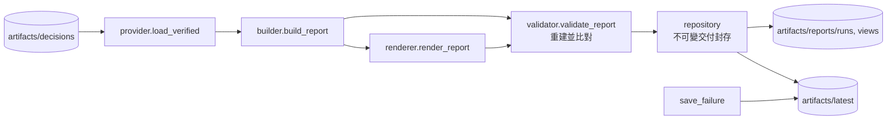

# decision_delivery｜風控後最終交付

從已封存、通過完整重建驗證的 Decision run 建立同源的中文 JSON 與 Markdown 閱讀版，並維護不可變交付封存與有序、原子的 `latest` 索引。可獨立重跑，不呼叫 Agent，不產生新的投資判斷，也不產生 D-Plan。

## 檔案清單

| 檔案 | 職責 | 主要公開項目 |
| --- | --- | --- |
| `__init__.py` | 匯出公開介面 | `DeliveryError`、`build_delivery`、`save_failure`、`validate_delivery` |
| `contracts.py` | 交付契約的錯誤型別 | `DeliveryError` |
| `provider.py` | 只載入經 manifest 及完整決策鏈驗證的封存 | `verify_inputs`、`load_verified` |
| `builder.py` | 由決策封存建立同源閱讀資料 | `build_report` |
| `renderer.py` | 現行固定模板（第 3 版：金額單位顯示 TWD、估值時間轉台北時間顯示，封存值不改）的中文 Markdown，判斷皆引用原文；另保留第 2 版只驗證舊交付 | `render_report`、`render_report_v2`、`renderer_for`、`cell` |
| `renderer_v1.py` | 第 1 版樣板，只用來驗證舊交付 | `render_report_v1` |
| `tools.py` | 確定性格式與交易時鐘工具 | `trade_date`、`cell`、`percent` |
| `validator.py` | 以原始封存重建 JSON 與 Markdown 並比對 | `validate_report` |
| `repository.py` | 不可變交付封存（繼承 `ImmutableRunStore`）、發布鎖、原子 latest 索引 | `DeliveryRepository`、`atomic_text`、`publication_lock` |
| `service.py` | 對外服務：建立、驗證、保存交付與失敗診斷 | `build_delivery`、`save_delivery`、`save_failure`、`validate_delivery`、`report_status`、`diagnostic_markdown`、`status_footer` |

## 對外介面

`DeliveryError`、`build_delivery`、`save_failure`、`validate_delivery`。

## 上下游

- 上游（依 import）：`core`、`decision`（4 個檔案引用）、`competition`（`provider.py` 用 `load_decision_run` 載入決策封存）。
- 下游：`cli/decision_delivery.py`、`scripts/run_daily_pipeline.py`（成功時 `build_delivery`，失敗時 `save_failure`；`--delivery-only` 重建既有 run 的交付）。
- 讀：決策封存。寫：`artifacts/reports/`（`runs`、`views`、依日期的副本）與 `artifacts/latest/`（`latest.md`／`latest.json` 或失敗診斷）。

## 對應的 CLI／scripts／測試

- CLI：`cli/decision_delivery.py`（`build`、`validate`）；scripts：`scripts/run_daily_pipeline.py`。
- 測試：`tests/decision/test_decision_delivery.py`。

## 規則與邊界

- 交付 ID 由輸入內容雜湊決定（`delivery-` + canonical sha256 前 32 碼）；發布 `latest` 必須提供本次執行 `started_at`，否則 `DeliveryError`。
- 決策被風控拒絕時，狀態標為 `DECISION_REJECTED`，不產生 D-Plan 候選。
- 報告不代表主辦方平台已驗證（`organizer_validation: not_run`）；D-Plan 結果以每日流程的 `pipeline.json` 為準。
- 不修改研究結論、不放寬風控。
