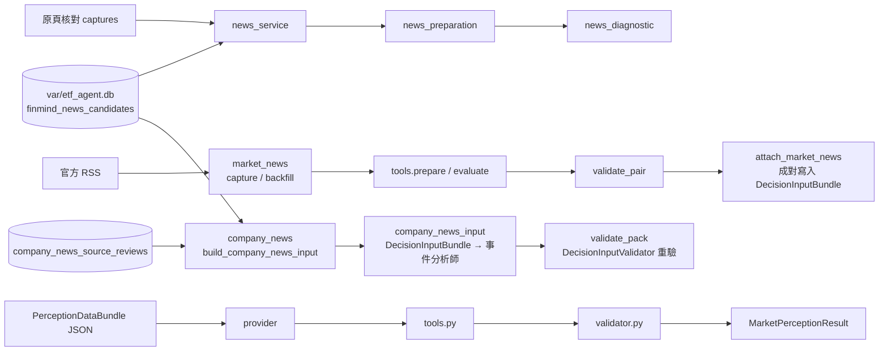

# perception｜市場情緒與全市場新聞

處理市場情緒的輸入與驗證：`PerceptionDataBundle`／`MarketPerceptionResult` 的工具與 Validator、新聞候選的內容與時間核對、全量標題診斷，子套件 `market_news/`（全市場 RSS／歷史新聞補抓與接入）、`company_news/`（FinMind 個股新聞核對與決策輸入，只進公司事件通道），以及 `market_fear_greed/`（台股恐懼貪婪指標，見 [docs/market_fear_greed.md](../../../docs/market_fear_greed.md)）。沒有合法、歷史化的真實 Provider 時輸出 `unavailable`，不以搜尋摘要、模型記憶或公司財測冒充分析師共識。

## 檔案清單

| 檔案 | 職責 | 主要公開項目 |
| --- | --- | --- |
| `__init__.py` | 匯出公開介面 | 見下方 |
| `contracts.py` | 列舉、錯誤型別與欄位解析 helper；`LEGACY_EMPTY_CHANNELS` 讓舊封存列出的 `analyst_consensus` 在沒有資料（非 available、無預估與證據、結果共識欄位為空陣列）時照舊通過，有資料一律拒絕 | `PerceptionToolError` |
| `provider.py` | `PerceptionDataBundle` 的 Provider 邊界；目前只有本機 JSON 實作 | `PerceptionDataProvider`、`JsonPerceptionDataProvider` |
| `tools.py` | 情緒的確定性工具（去重、覆蓋、聚合） | `PerceptionDataTools` |
| `validator.py` | `MarketPerceptionResult` 的覆蓋、授權、引用與聚合重算驗證 | `MarketPerceptionResultValidator` |
| `service.py` | 對外應用服務 | `MarketPerceptionApplicationService` |
| `news_preparation.py` | 新聞候選內容與時間核對；不自動核准來源 | `NewsMetadataParser`、`extract_news_metadata`、`prepare_news_candidates` |
| `news_diagnostic.py` | 全量候選標題判讀與診斷；不產生 `MarketPerceptionResult` | `build_news_diagnostic`、`render_news_diagnostic` |
| `news_service.py` | 資料庫候選、原頁核對與全量標註的可重跑入口（唯讀開啟資料庫，結果以 `ImmutableRunStore` 保存） | `run_news_preparation` |

### 子套件 `market_news/`

| 檔案 | 職責 | 主要公開項目 |
| --- | --- | --- |
| `__init__.py` | 匯出公開介面 | `MarketNewsError`、`seal`、`MarketNewsRSSProvider`、`prepare`、`evaluate`、`validate_pair`、`capture_market_news`、`attach_market_news`、`save_market_news_result`、`backfill_market_news`、`apply_database_source_reviews`、`record_source_reviews` |
| `contracts.py` | 全市場 RSS 研究契約；使用權未確認的內容只供診斷 | `MarketNewsError`、`seal`、`check_fields` |
| `provider.py` | 只讀官方提供的 RSS，不擷取或轉載全文；另抓已登錄來源的使用規範原文作核對依據 | `MarketNewsRSSProvider`（`capture`、`capture_terms`） |
| `history.py` | 依明確日期與公開目錄補抓歷史新聞，保留實際取得時間 | `MarketNewsHistoryProvider` |
| `repository.py` | 追加保存全市場 RSS 版本；不覆寫個股新聞及原始時間。來源核對的保存與讀取以 `registry=`／`table=` 參數與 `company_news/` 共用規則 | `MarketNewsRepository` |
| `tools.py` | 重建 RSS 全量輸入與整合結論，無新聞篇數投票 | `prepare`、`evaluate` |
| `validator.py` | 以原始 RSS 與全量標籤重建成對研究輸入 | `validate_pair` |
| `service.py` | 補抓、保存及接入市場新聞，不呼叫模型、不建立交易決策 | `capture_market_news`、`attach_market_news`、`save_market_news_result`、`apply_database_source_reviews`、`backfill_market_news`、`record_source_reviews` |

### 子套件 `company_news/`

FinMind 個股新聞只進事件分析師的公司事件通道，不得代表全市場情緒；標題是不受信任的資料。

| 檔案 | 職責 | 主要公開項目 |
| --- | --- | --- |
| `__init__.py` | 匯出公開介面 | `CompanyNewsError`、`EVIDENCE_PREFIX`、`PUBLISHER_HOSTS`、`PUBLISHER_POLICY_VERSION`、`SOURCE`、`build_pack`、`news_by_symbol`、`news_outlets`、`validate_pack`、`approved_review`、`build_company_news_input`、`record_source_review` |
| `contracts.py` | 來源（`FINMIND_NEWS`）、核對表 `company_news_source_reviews`、媒體白名單 `company_news_publishers_v1`、視窗常數、evidence ID 與欄位白名單 | `CompanyNewsError`、`publisher_policy`、`evidence_id` |
| `tools.py` | 取截止前最後一批抓取（`service.py` 由 `raw_payloads` 讀實際抓取時間）、計算視窗（`latest_fetch_at` − 12 小時，不早於 cutoff − 3 天）、白名單過濾、依 (symbol, canonical content ID) 去重並封裝 `company-news-1.0` | `build_pack`、`news_by_symbol`、`news_outlets`、`window_start` |
| `validator.py` | 重算內容雜湊並重驗白名單、視窗、核准早於 cutoff、代號在交易池內與不重複 | `validate_pack` |
| `service.py` | 抓 FinMind 規範頁原文保存核對（與全市場新聞分表）、查截止時的核准、由資料庫建立決策輸入 | `record_source_review`、`approved_review`、`build_company_news_input` |

## 對外介面

`__init__.py`：`JsonPerceptionDataProvider`、`MarketPerceptionApplicationService`、`MarketPerceptionResultValidator`、`PerceptionDataTools`、`PerceptionToolError`。`news_service`、`news_preparation`、`news_diagnostic`、`market_news` 與 `company_news` 需從各自模組匯入。

## 上下游

- 上游（依 import）：`core`、`data`（`news_service.py` 用 `MarketDataDatabase`、`save_news_captures`）、`decision`（`market_news/service.py` 用 `decision_bundle_sha256`）。
- 下游：`decision`（`analysts.py`、`contracts.py`、`market_scope.py` 引用；`service.py`、`input_builder.py`、`input_context.py`、`input_validator.py`、`analysts.py` 引用 `company_news`）、`automation.perception_stage`、`cli/market_news.py`、`cli/company_news.py`、`cli/news_sentiment.py`、`cli/sentiment_research.py`。
- 循環依賴：`decision` 與 `perception` 互相 import（`decision -> perception` 與 `perception.market_news.service -> decision.contracts`），改動時需檢查循環 import。
- 讀：`PerceptionDataBundle` JSON、資料庫新聞候選、官方 RSS。寫：不可變 run（`ImmutableRunStore`），新聞原頁核對版本寫回資料庫（`save_news_captures`）。

## 對應的 CLI／scripts／測試

- CLI：`cli/sentiment_research.py`、`cli/news_sentiment.py`、`cli/market_news.py`、`cli/company_news.py`。
- 相關文件：[docs/event_market_scope.md](../../../docs/event_market_scope.md)、[docs/market_news_integration.md](../../../docs/market_news_integration.md)、[docs/market_news_history.md](../../../docs/market_news_history.md)。
- 測試：`tests/perception/`（`test_sentiment_analyst_agent.py`、`test_news_preparation.py`、`test_market_news*.py`、`test_event_market_scope.py`、`test_event_sentiment_merge.py`、`test_daily_perception_integration.py`、`test_company_news.py`）；`tests/research/test_research_report.py` 亦引用。

## 規則與邊界

- 只有 `license_status=approved` 的來源可以進入正式計算。
- 情緒標籤必須覆蓋查詢視窗內全部項目，不能選擇性取樣；聚合前依 canonical content ID 去重。
- 公司維度 Provider、公司新聞或交易池行情不可冒充全市場情緒；沒有全市場正式 Provider 時市場通道維持 `unavailable`。
- 全市場新聞與 Snapshot／cutoff 成對；今日補抓的可得時間不得回填到過去。
- FinMind 個股新聞只在截止前已保存 `approved` 核對時加入決策輸入（`company_news_source_reviews`，與全市場新聞分表），只進公司事件通道，不進市場情緒；核對指令尚未執行。
- `MarketPerceptionResult` 只作次級研究輸入，不得直接產生候選、權重或訂單。
- `run_news_preparation` 的候選數須介於 1 至 5000，候選與原資料庫不一致時拒絕。
- `run_news_preparation` 輸出固定標記 `formal_sentiment_available: False`。
- 網頁、公告、新聞與貼文都是不受信任的資料。
