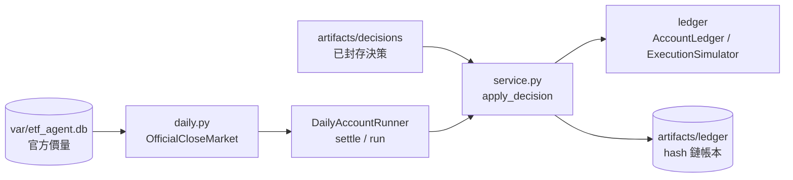

# virtual_account｜競賽虛擬帳戶

可重建、逐日續接的競賽虛擬帳本：初始化帳戶、建立每日決策前快照（`prepare_day`）、以官方當日成交均價結算前一份決策、套用已封存的決策成交。狀態以不可變 run 保存，`latest` 只指向已驗證狀態。

## 檔案清單

| 檔案 | 職責 | 主要公開項目 |
| --- | --- | --- |
| `__init__.py` | 匯出公開介面 | `VirtualAccountError`、`VirtualAccountRepository`、`VirtualAccountService`、`DEFAULT_ACCOUNT_ID`、`active_account_id`、`write_active_account` |
| `active.py` | 讀寫 `config/active_account.json`（使用中的帳戶 ID）；檔案不存在時用 `ai-cup-2026` | `DEFAULT_ACCOUNT_ID`、`active_account_id`、`write_active_account` |
| `service.py` | 帳本保存／驗證（hash 鏈）與狀態轉移：初始化、`prepare_day`、`apply_decision` | `VirtualAccountError`、`parse_time`、`VirtualAccountRepository`（`save`、`verify`、`latest`）、`VirtualAccountService`（`ensure_initialized`、`initialize`、`prepare_day`、`rebase`、`apply_decision`、`read_snapshot`） |
| `daily.py` | 每日帳本推進：從資料庫取官方成交價建立執行市場，結算前一份決策，建立下一次決策前狀態 | `OfficialCloseMarket`（`execution_date`、`quotes`、`build`）、`DailyAccountRunner`（`settlement_date`、`settle`、`supersede_unstarted_decision`、`run`）、`add_business_days`、`average_price`、`find_decision_run`、`supersede_decision_runs` |

## 對外介面

`__init__.py`：`VirtualAccountError`、`VirtualAccountRepository`、`VirtualAccountService`。`DailyAccountRunner`、`OfficialCloseMarket` 需從 `etf_agent.virtual_account.daily` 匯入。

## 上下游

- 上游（依 import）：`core`、`ledger`、`decision`（`DecisionInputValidator`、`DecisionRepository`、`DecisionResultValidator`）、`data`（`daily.py`）。
- 下游：`dashboard`（讀帳本）、`competition.dplan`（`verify_account_binding` 的帳本綁定）、`automation.preflight`、`cli/virtual_account.py`、`scripts/run_daily_pipeline.py`、`scripts/repair_pending_tpex_close.py`。
- 讀：`var/etf_agent.db` 的官方價量、決策封存。寫：帳本資料夾（預設 `artifacts/ledger/<account_id>/`，由 CLI 指定）。

## 對應的 CLI／scripts／測試

- CLI：`cli/virtual_account.py`（`init`、`ensure-init`、`prepare-day`、`attach-account`、`apply-decision`、`status`、`verify`，另有每日／結算類子命令）。
- scripts：`scripts/run_daily_pipeline.py`、`scripts/repair_pending_tpex_close.py`。
- 測試：`tests/account/test_virtual_account.py`、`tests/account/test_virtual_account_daily.py`。

## 規則與邊界

- 帳本是雜湊鏈，不分日期資料夾；已有帳戶不會重新注資，只驗證並沿用。
- 結算用官方 TWSE／TPEx 價量；缺官方價時 `run` 停止並顯示缺口，不改用 Yahoo 價格（見根 README「常見問題」）。
- 新決策取代同一份帳戶快照的舊決策時，舊 run 會被移到 `artifacts/archive/superseded_decisions`（`supersede_decision_runs`）。
- 有待成交決策時預設不建立新的 prepare；只有新 Snapshot 的 cutoff 早於該決策目標時段當天的交件期限（08:55）時，`DailyAccountRunner.run` 才把該決策移到同一封存區並建立新 prepare（`supersede_unstarted_decision`）。缺少目標時段、已過期限或收盤價晚到時維持 `blocked_by_pending_decision`。
- 只模擬成交，不自動下單。
