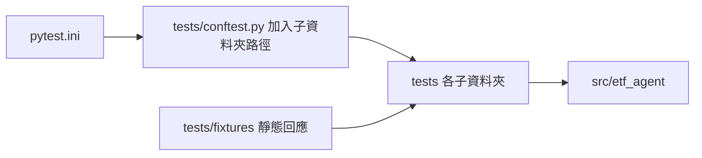

# tests/：自動化測試

依被測領域分資料夾的自動化測試，與 `src/etf_agent/` 子套件大致對應，由 pytest 收集執行。

- 風格：`unittest.TestCase`（`setUp` 準備物件，`self.assertEqual`／`assertRaises` 等斷言）。
- 新測試同樣風格，涵蓋正常流程與 fail-closed 分支。
- fail-closed 例：cutoff 後資料、缺時區、引用不存在、版本不一致、結果遭竄改、無授權來源。

## 如何執行

設定見 `pytest.ini`（`testpaths = tests`、`pythonpath = src`）。在專案根目錄：

```bash
PYTHONPYCACHEPREFIX=/tmp/etf-agent-pycache .venv/bin/python -m pytest
# 只跑單一資料夾或檔案
PYTHONPYCACHEPREFIX=/tmp/etf-agent-pycache .venv/bin/python -m pytest tests/decision
PYTHONPYCACHEPREFIX=/tmp/etf-agent-pycache .venv/bin/python -m pytest tests/data/test_trading_calendar.py
# Docker 內
./start.sh check
```

`tests/conftest.py` 把 `tests/` 下除 `fixtures` 以外的子資料夾加入 `sys.path`，測試檔可共用輔助模組（例如 `from test_daily_pipeline import FakeRunner`）。

GitHub Actions（`.github/workflows/ci.yml`）在每次 push 與 pull request 時，於 ubuntu-latest／Python 3.12 安裝 `requirements.txt`，依序執行 `python -m pytest`、`python -m compileall -q src tradeagent tests` 與 `git diff --check`（PR 比對 base 分支，push 比對上一個 commit）；Skill 的 `quick_validate.py` 依賴本機 `~/.codex`，不在 CI 執行。測試不得依賴本機未追蹤檔案、`.env`、網路或 Asia/Taipei 本機時區（CI 為 UTC）。



## 子資料夾

| 資料夾 | 測什麼 | 檔案 |
| --- | --- | --- |
| `core/` | 共用基礎：canonical JSON／雜湊、含時區時間、Decimal、不可變 run 保存 | `test_core.py` |
| `data/` | Data Agent：行情與公司事件收集、歷史回補、財報與基本面補抓、FinMind 排程、價格新鮮度、產業分類、交易狀態與開休市日曆、來源稽核／封存／健康度、Snapshot | `test_data_agent`、`test_data_collection`、`test_financial_statements`、`test_finmind_schedule`、`test_fundamental_repair`、`test_historical`、`test_ogd_candidate_facts`、`test_ogd_trading_status`、`test_price_freshness`、`test_sector_classification`、`test_source_audit`、`test_source_capture`、`test_source_health`、`test_supplemental_sources`、`test_tpex_history`、`test_trading_calendar`、`test_trading_status`（省略 `.py`） |
| `perception/` | 市場情緒、全市場新聞（含歷史原頁與來源核對）、FinMind 個股新聞（核准、白名單、視窗與重驗）、事件與情緒合併、每日鏈整合與拒絕路徑 | `test_company_news`、`test_daily_perception_integration`、`test_event_data_availability`、`test_event_market_scope`、`test_event_sentiment_merge`、`test_market_news`、`test_market_news_history`、`test_market_news_source_reviews`、`test_news_preparation`、`test_sentiment_analyst_agent` |
| `research/` | 分析師（技術／基本面／事件）契約與驗證、基本面研究、技術趨勢歷史、事件研究與 Research Report | `test_analysts`、`test_event_research_agent`、`test_fundamental_language`、`test_fundamental_research_agent`、`test_research_report`、`test_technical_trend_history` |
| `decision/` | 決策鏈：輸入包、分批、多空與交易 Agent 契約、現金姿態與持股廣度、部位計算、風控與 Guard、交付報告、個股新聞走完全鏈 | `test_batching`、`test_company_news_chain`、`test_decision_delivery`、`test_decision_input_builder`、`test_portfolio_decision_agent`、`test_portfolio_risk_decision`、`test_position_breadth`、`test_position_sizing`、`test_prior_decision`、`test_stance`、`test_team_chain`、`test_trader`、`test_trader_report` |
| `account/` | 虛擬帳戶開帳、結算與每日推進；D-Plan 候選的匯出與檢查 | `test_virtual_account`、`test_virtual_account_daily`、`test_competition_dplan` |
| `benchmark/` | 基準比較：買入持有與費稅、as-of 版本（前視拒絕）、缺價／無成交／未核准 unavailable、基準收集不污染交易池、儀表板端點與 CLI | `test_benchmark_comparison`、`test_benchmark_collection` |
| `automation/` | 每日流程編排、子 Agent 執行器、預檢、run 目錄配置、儀表板、`start.sh` 各入口與資料模式 | `test_agent_runner`、`test_daily_log`、`test_daily_pipeline`、`test_daily_script`、`test_dashboard`、`test_policy_replay`（多日 Policy 回放）、`test_preflight`、`test_run_layout`、`test_start_data_modes`、`test_start_entrypoints` |
| `fixtures/` | 測試用的靜態官方回應 | 見下 |

## fixtures/

| 檔案 | 內容 | 使用者 |
| --- | --- | --- |
| `twse_stock_day_all.json` | TWSE 全市場日行情回應樣本 | `data/test_data_collection.py`、`data/test_source_health.py` |
| `universe_validation_twse.json` | 交易池驗證用的 TWSE 回應樣本 | 同上 |
| `universe_validation_tpex.json` | 交易池驗證用的 TPEx 回應樣本 | 同上 |

fixtures 是測試輸入，不是真實資料來源，不作為正式行情或公司事件。
